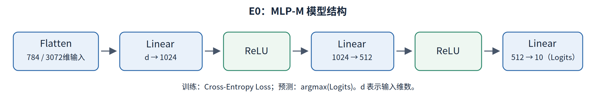
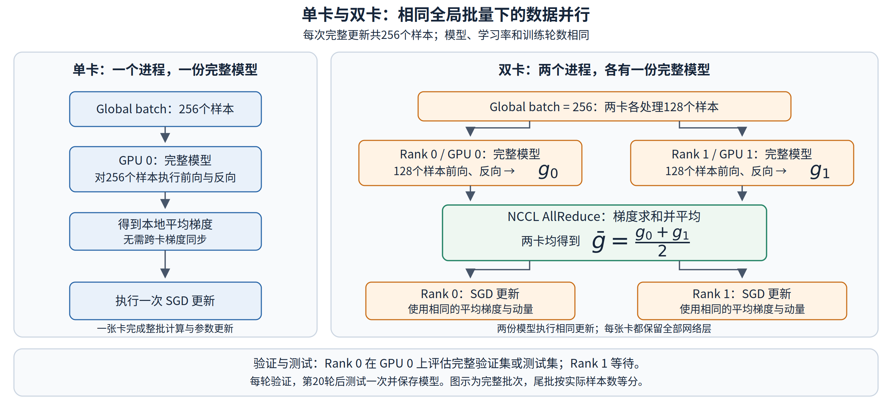
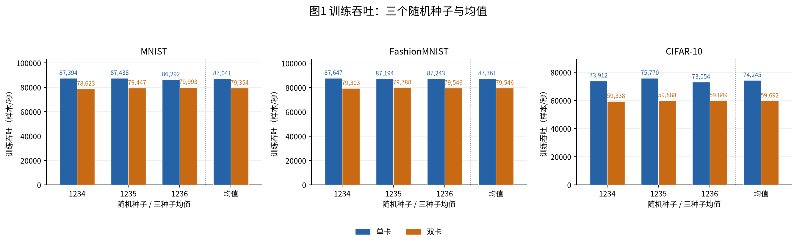
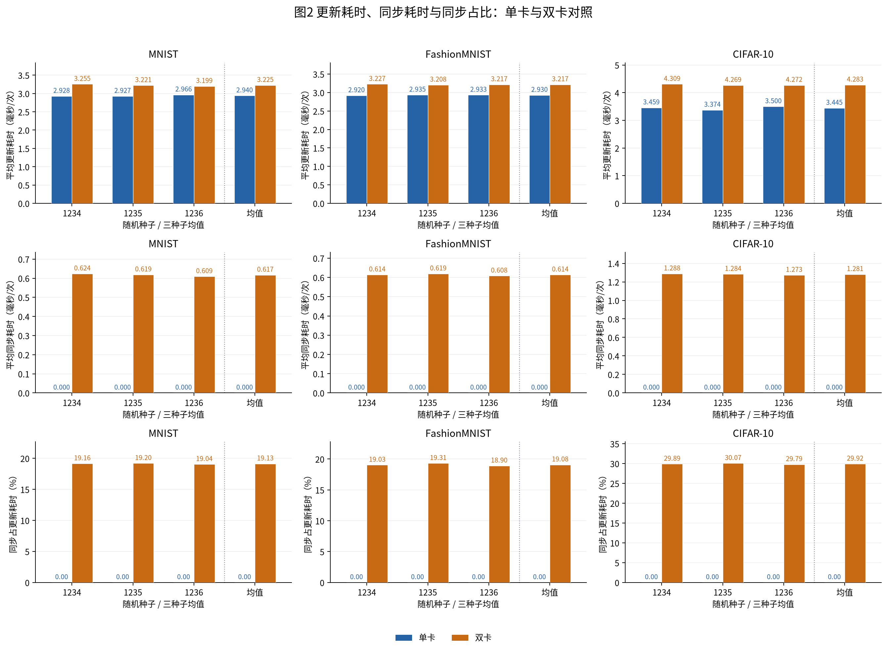
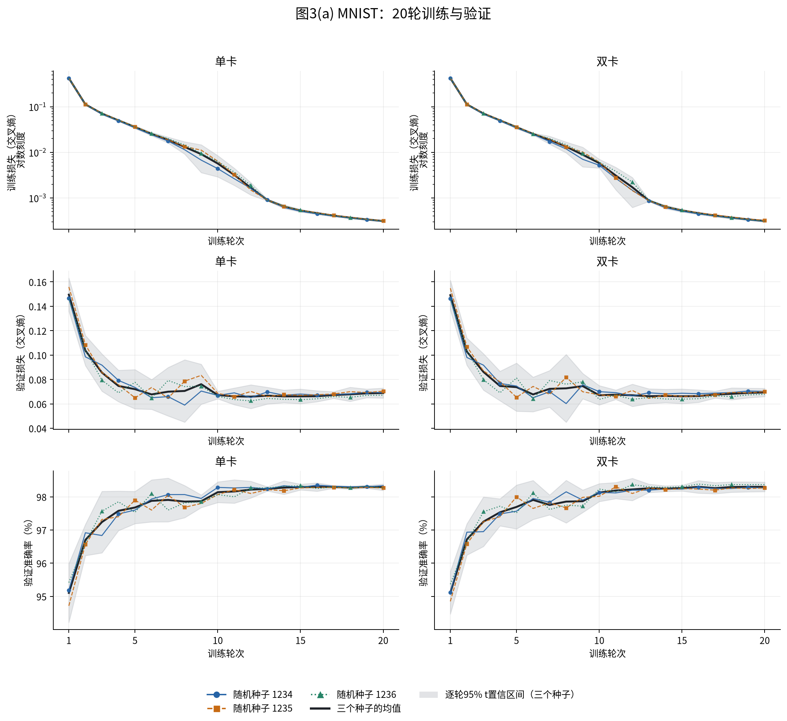
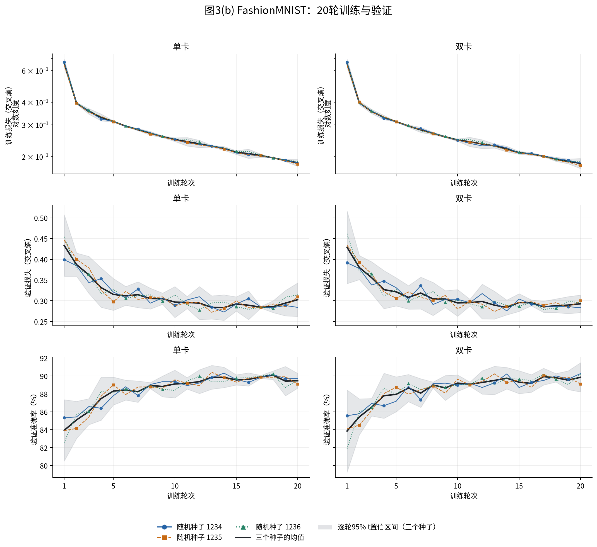
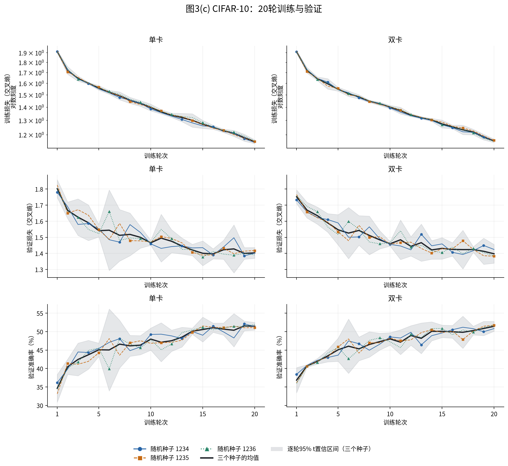
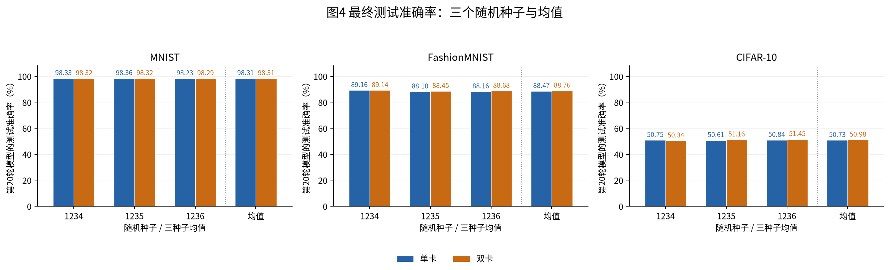

# E0：三随机种子的单 GPU 与双 GPU 对照

## 1. 实验设置

E0 比较相同全局 batch 下，单 GPU 和双 GPU 的训练速度、同步成本与分类结果。MNIST、FashionMNIST、CIFAR-10 分别运行单卡和双卡，每种配置使用1234、1235、1236三个训练种子，共18次正式运行，每次固定训练20轮。

本报告的图表使用这18次运行的完整记录。每次运行都在第20轮后评估官方测试集并保存模型。正确性检查与正式训练分别记录，性能统计按三个训练种子汇总。

### 数据划分

官方训练集按类别分层留出10%作为验证集，划分种子固定为1234；训练种子只影响模型初始化和每轮样本顺序。三个训练种子使用相同的训练、验证划分，官方测试集保持完整。

| 数据集 | 训练样本 | 验证样本 | 测试样本 | 输入维数 |
|---|---:|---:|---:|---:|
| MNIST | 54,000 | 6,000 | 10,000 | 784 |
| FashionMNIST | 54,000 | 6,000 | 10,000 | 784 |
| CIFAR-10 | 45,000 | 5,000 | 10,000 | 3,072 |

图像转换为 float32，像素除以255后展平；CIFAR-10 按 HWC 顺序展平。训练不使用图像增强。原始数据缓存和读取接口独立放在项目顶层的 [Data](../../Data/README.md)。

### 模型



模型结构图使用常见算子名称：Flatten 表示数据预处理中的图像展平，Linear 表示全连接层，ReLU 表示激活函数，Logits 表示输出的10个类别原始得分。图中 `d` 是输入维数，MNIST、FashionMNIST 为784，CIFAR-10 为3072；箭头表示数据流向。两个隐藏层的维数分别为1024、512，最后一个 Linear 层输出10类 Logits。训练使用 Cross-Entropy Loss（交叉熵损失），预测用 argmax 选择得分最高的类别。单卡和双卡使用相同的 MLP-M 网络结构。

| 数据集 | 网络结构 | 参数量 | 每次同步的 FP32 梯度载荷 |
|---|---|---:|---:|
| MNIST、FashionMNIST | 784 → 1024 → 512 → 10 | 1,333,770 | 约5.34 MB |
| CIFAR-10 | 3072 → 1024 → 512 → 10 | 3,676,682 | 约14.71 MB |

优化器是 SGD，momentum=0.9。MNIST、FashionMNIST 的固定学习率为0.1，CIFAR-10 为0.05。模型和梯度使用 FP32。

### GPU、通信与训练协议

正式测量使用同一台 Linux 主机上的两张 RTX 4090，软件为 Python 3.12.14、PyTorch 2.15.0+cu132、torchvision 0.29.2+cu132、CUDA 13.2、NCCL 2.30.7，驱动595.91.07。GPU 拓扑为 PHB，GPU 0 到 GPU 1 的 P2P 访问不可用，详细记录见 [environment.json](environment.json)。

#### 单卡与双卡具体有什么区别

E0 的双卡训练采用分布式数据并行。每张卡都有一份完整模型，两个进程分担同一次更新中的样本计算，再汇总梯度。下面将“一个进程一次处理的样本数”称为局部批量，将“一次参数更新合计使用的样本数”称为全局批量。

| 对照项 | 单卡运行 | 双卡运行 |
|---|---|---|
| 训练进程与设备 | 一个进程，使用第0张卡（`cuda:0`） | 两个进程，进程0、1分别使用第0、1张卡 |
| 模型副本 | 一份完整模型 | 每张卡各一份完整模型，初始参数一致 |
| 完整批次的局部批量 | 256个样本 | 每张卡128个样本 |
| 完整批次的全局批量 | 256个样本 | `128 + 128 = 256`个样本 |
| 样本分配 | 当前全局批次全部交给一张卡 | 同一全局批次按进程分成不重叠的两份，每张卡处理其中一份 |
| 前向与反向 | 对256个样本计算本地平均梯度 | 两张卡并行计算各自128个样本的平均梯度 |
| 梯度同步 | 无跨卡梯度同步 | 通过 NCCL 全归约（AllReduce）对梯度求和后除以2；同步完成后才更新参数 |
| 参数更新 | 使用本地梯度执行一次 SGD 更新 | 两个进程使用相同的平均梯度，各自执行一次 SGD 更新，保持模型副本一致 |
| 每轮与总更新数 | 由训练样本数和全局批量决定 | 与单卡相同；双卡没有增加更新次数 |
| 学习率与训练轮数 | 数据集对应的固定学习率，20轮 | 与单卡相同，不随卡数扩大学习率 |
| 验证、测试与模型保存 | 第0张卡评估完整验证集或测试集，并保存末轮模型 | 由进程0在第0张卡上完成同样的评估和保存，另一个进程等待 |
| 主机计算线程预算 | 一个进程32线程 | 每个进程16线程，共32线程 |



流程图左侧是一张卡完成整批前向、反向和 SGD 更新的过程；右侧是两张卡先分担计算，再通过绿色的 NCCL AllReduce 同步框汇总梯度的过程。Global batch 是一次更新的全局样本数，Rank 是训练进程编号；双卡的 Rank 0、Rank 1 分别使用 GPU 0、GPU 1。两份模型都保留全部网络层，均使用平均梯度更新。图下方说明两种配置的验证和测试执行方式。

以完整批次为例，记两张卡的局部平均梯度为 `g0`、`g1`，同步后两张卡均使用 `g_avg = (g0 + g1) / 2`。图中梯度的下标0、1对应两个 Rank，带横线的梯度符号表示平均梯度。由于两份局部批量相同，这在数学上对应256个样本的平均梯度。相同种子的两组使用相同的模型初始化种子和全局采样顺序；双卡将顺序按进程分片。浮点求和顺序会随计算与归约方式改变，因此参数和最终准确率不要求逐位一致。

这个对照固定模型、数据划分、训练种子、全局批量、学习率和训练轮数，观察增加一张卡后的性能与结果变化。两卡分担计算的同时，也增加了跨卡同步和进程协调成本，局部批量还从256变为128，因此双卡能否加速需要由实测吞吐和更新耗时判断。

三种子的配对顺序为1234：单→双，1235：双→单，1236：单→双。所有运行串行执行。每轮使用全部训练子集，保留不完整尾批；双卡的两份尾批大小相同。

| 数据集 | 每轮更新数 | 末次全局样本数 | 20轮总更新数 | 20轮总训练样本数 |
|---|---:|---:|---:|---:|
| MNIST、FashionMNIST | 211 | 240 | 4,220 | 1,080,000 |
| CIFAR-10 | 176 | 200 | 3,520 | 900,000 |

每轮训练后只评估验证集，不早停、不恢复验证最优模型。完成第20轮后才对官方测试集评估一次，并保存当前模型。双卡下，验证和最终测试均在进程0的单张 GPU 上执行；验证后两个进程通过屏障等待，再一起进入下一轮。验证最优轮只作诊断记录。

## 2. 如何运行

下面所有命令都在项目根目录 `d1-gradient-sync/` 执行。完整实验需要两张可见 CUDA GPU，以及支持 NCCL 的 PyTorch。

### 准备环境与数据

```bash
uv sync --locked
nvidia-smi

# 数据已缓存时只读取；首次缺少数据时增加 --download
uv run python -m Data.datasets

# 只列出18次计划，不启动训练或改写结果
uv run python -m E0.run --list
```

三份配置位于 `E0/configs/mnist.yaml`、`fashionmnist.yaml`、`cifar10.yaml`。默认不传 `--seed`，就会完整运行三个种子。

### 训练三个数据集、三个种子

当前目录已保存正式结果。复跑使用新的输出目录，以免与已有记录混合：

```bash
CUDA_VISIBLE_DEVICES=0,1 NCCL_DEBUG=INFO uv run python -m E0.run --dataset all --output-dir E0/results/new_run
```

这条命令共运行18次，每次20轮，并包含每轮验证和末轮测试。只运行某个数据集时，仍默认完成三个种子的单、双卡对照：

```bash
uv run python -m E0.run --dataset mnist --output-dir E0/results/mnist_new_run
```

`--seed 1234` 只用于选择单个种子的调试运行；完整三种子报告应使用默认计划。`--world-size 1` 或 `2` 可选择单卡或双卡。已有同名运行时，入口会拒绝追加，需先归档或更换输出目录。

### 独立验证与模型测试

训练中的验证已自动执行。下面可以独立加载已有模型，在 GPU 上重新评估：

```bash
# 种子1234、单卡训练模型：评估原验证子集
uv run python -m E0.evaluate --checkpoint E0/results/mnist/checkpoints/e0_baseline_k1_ws1_mM_b256_r0_epoch20.pt --split validation --device cuda:0

# 种子1236、双卡训练模型：评估完整官方测试集
uv run python -m E0.evaluate --checkpoint E0/results/mnist/checkpoints/e0_baseline_k1_ws2_mM_b128_r2_epoch20.pt --split test --device cuda:1

# 检查18次正式记录，并在 GPU 上独立复测18个模型
uv run python -m E0.check_results

# 检查新输出目录中的完整18次运行
uv run python -m E0.check_results --results-dir E0/results/new_run
```

文件名的 `r0/r1/r2` 分别对应种子1234/1235/1236；`ws1/ws2` 表示单卡/双卡。实际模型路径以每个数据集的 `final.csv.checkpoint_path` 为准。独立评估输出样本数、损失、准确率、实际设备和模型轮数，不进行训练。

### 代码测试与重新绘图

```bash
# E0 回归测试；涉及模型计算的检查使用 GPU
uv run pytest E0/tests -q

# 从正式18次记录生成三种子图和统计 CSV
uv run python -m E0.plot_results

# 为新输出目录生成相同图表
uv run python -m E0.plot_results --results-dir E0/results/new_run
```

图表与数值表均从三个种子的完整训练记录计算。

## 3. 指标是什么意思

一次“更新”指一个全局 batch 完成前向、反向、必要的梯度同步和一次优化器更新。E0 没有梯度累积，因此每个训练批次对应一次更新。

记某个种子的一次完整运行为：总训练样本数 `N`，总更新数 `U`，所有更新分段时间之和 `T` 秒，所有梯度同步段之和 `S` 秒。

| 指标 | 含义与计算方式 | 单位 | 如何解读 |
|---|---|---|---|
| 训练吞吐 `train_throughput` | 全局处理样本数 / 分段训练时间，即 `N / T` | 样本/秒 | 越高表示单位时间处理的样本越多。双卡的样本数包含两个进程的工作量 |
| 更新耗时 `avg_update_ms` | 一次优化器更新平均花费的分段时间，即 `1000 × T / U` | ms/更新 | 越低表示完成一次全局更新越快，包含取批、计算、同步和优化器操作 |
| 同步耗时 `avg_sync_ms` | 每次更新中，梯度同步路径的平均时间，即 `1000 × S / U` | ms/更新 | 包含等待其他进程、NCCL AllReduce、梯度平均和设备完成等待 |
| 同步占比 `sync_share` | 同步时间占更新分段时间的比例，即 `S / T × 100%` | % | 表示同步路径占用了多少训练更新时间，不是 GPU 利用率或网络带宽利用率 |
| 测试准确率 `test_acc` | 第20轮模型在完整官方测试集上预测正确的样本数 / 测试样本数 | % | 越高表示该次运行的分类结果越好 |

逐轮图另外展示以下三个指标。损失均按实际样本数加权，交叉熵没有物理单位。

| 指标 | 含义 | 如何解读 |
|---|---|---|
| 训练损失 `train_loss` | 当轮训练过程中，各批次前向计算的交叉熵按样本数加权平均；双卡汇总两个进程的损失与样本数 | 越低表示对当轮训练样本的拟合误差越小。各批次计算时参数正在更新，因此它是训练过程中的平均损失 |
| 验证损失 `val_loss` | 每轮结束后，使用该轮模型在完整验证子集上计算的平均交叉熵 | 越低越好；可与训练损失的走势一起观察泛化差距 |
| 验证准确率 `val_acc` | 每轮结束后，完整验证子集上的正确预测数 / 验证样本数，图中乘100显示为百分数 | 越高越好；用于观察随训练轮次变化的验证表现 |

例如 MNIST、种子1234的双卡运行，20轮处理1,080,000个训练样本，更新4,220次，分段训练时间约13.736471秒。因此吞吐约78,622.8样本/秒，平均更新约3.255ms；同步约0.624ms/更新，占比约19.16%。

单卡没有梯度 AllReduce，同步耗时和占比均为0。对应曲线的三个种子会在0处重合。

### 分段时间的边界

逐步记录满足 `t_step = t_data + t_fwd_bwd + t_sync + t_opt`：

- `t_data`：从内存数据中取出本批数据，并送入对应 GPU 的时间。
- `t_fwd_bwd`：前向和反向的时间，已扣除 hook 中单独统计的同步段。
- `t_sync`：阻塞式梯度同步 hook 的时间。
- `t_opt`：优化器更新参数、清空梯度的时间。

CUDA 分段边界显式等待设备完成。吞吐和上述耗时包含所有训练更新、预热标记步和尾批，排除数据集初始加载、进程启动、验证、最终测试、模型保存、日志写入和每轮损失汇总。因此它们描述分段训练性能，与程序从启动到退出的总墙钟时间不同。尾批按实际样本数计入，不能一律用256代替每次更新的样本数。

## 4. 三个种子的统计和图例

先分别计算每个种子的完整运行指标，再对1234、1235、1236三个值等权取算术均值。下表中的 `均值 ± 标准差` 使用样本标准差，即分母为 `n−1=2`；不使用中位数。

图1、图2、图4使用并列柱状图：每组左侧蓝柱表示单卡，右侧橙柱表示双卡。前三组横坐标1234、1235、1236是三次原始观测，第四组“均值”是对应配置三个种子的算术均值；竖虚线分开逐种子结果与均值。三张图均不绘制置信区间和误差条。所有柱状图的纵轴从0开始，柱顶标注实际数值。

20轮曲线中，三种颜色和点形分别对应三个种子，黑色粗线是每轮的三种子算术均值，灰色阴影是用该轮三个结果单独计算的95% Student-t均值置信区间。每一轮的区间都重新计算，不将全程最小—最大值铺成水平阴影。

图3采用的双侧区间为 `均值 ± t(0.975, 2) × 样本标准差 / √3`，其中 `t(0.975, 2) ≈ 4.303`。公式见 [NIST 均值置信区间](https://www.itl.nist.gov/div898/handbook/eda/section3/eda352.htm)，临界值见 [NIST t分布表](https://www.itl.nist.gov/div898/handbook/eda/section3/eda3672.htm)。这里的样本量是三个独立训练种子，不是20个epoch，也不是10,000个测试样本。

例如 MNIST 单卡吞吐的三种子均值为87,041.2，样本标准差为649.5样本/秒，三次原始观测范围为86,291.7–87,438.3。图1用三组柱保留原始观测，第四组柱展示均值，标准差与观测范围在表格中保留。机器统计表还保留置信限字段，图1、图2、图4不使用这些字段绘图。

图3的区间以跨种子重复近似独立、指标分布近似正态为前提。只有三个种子，不能验证分布假设，区间仅作探索性的不确定性展示。逐轮区间是逐点区间，不保证整条20轮曲线同时具有95%覆盖率。若某些轮次的三个值相同，区间可以收缩到零。

### 图表与指标对应关系

图内解释性文字以中文为主，模型算子和技术名称采用 Flatten、Linear、ReLU、Logits、SGD、NCCL AllReduce 等通用写法；数据集统一保留 MNIST、FashionMNIST、CIFAR-10 原名。图1、图2、图4用蓝色和橙色的并列柱区分单卡与双卡，图3用左右列区分卡数、用颜色和点形区分训练种子，子图编号为 (a)、(b)、(c)。

| 图号 | 展示内容 | 横轴 | 纵轴与单位 |
|---|---|---|---|
| 图1 | 三个数据集的训练吞吐 | 三个随机种子及其均值 | 训练吞吐，样本/秒 |
| 图2 | 三个数据集的更新时间与同步成本 | 三个随机种子及其均值 | 从上到下为更新耗时（毫秒/次）、同步耗时（毫秒/次）、同步占比（%） |
| 图3(a) | MNIST 的训练与验证过程 | 训练轮次1—20 | 从上到下为训练交叉熵、验证交叉熵、验证准确率（%） |
| 图3(b) | FashionMNIST 的训练与验证过程 | 训练轮次1—20 | 同图3(a) |
| 图3(c) | CIFAR-10 的训练与验证过程 | 训练轮次1—20 | 同图3(a) |
| 图4 | 第20轮模型的最终测试准确率 | 三个随机种子及其均值 | 测试准确率，% |

## 5. 每个种子的正式结果

### MNIST

| 种子 | GPU数 | 吞吐（样本/s） | 更新（ms） | 同步（ms） | 同步占比 | 测试准确率 |
|---|---:|---:|---:|---:|---:|---:|
| 1234 | 1 | 87,393.7 | 2.928 | 0.000 | 0.00% | 98.33% |
| 1234 | 2 | 78,622.8 | 3.255 | 0.624 | 19.16% | 98.32% |
| 1235 | 1 | 87,438.3 | 2.927 | 0.000 | 0.00% | 98.36% |
| 1235 | 2 | 79,447.0 | 3.221 | 0.619 | 19.20% | 98.32% |
| 1236 | 1 | 86,291.7 | 2.966 | 0.000 | 0.00% | 98.23% |
| 1236 | 2 | 79,992.6 | 3.199 | 0.609 | 19.04% | 98.29% |

### FashionMNIST

| 种子 | GPU数 | 吞吐（样本/s） | 更新（ms） | 同步（ms） | 同步占比 | 测试准确率 |
|---|---:|---:|---:|---:|---:|---:|
| 1234 | 1 | 87,646.7 | 2.920 | 0.000 | 0.00% | 89.16% |
| 1234 | 2 | 79,303.1 | 3.227 | 0.614 | 19.03% | 89.14% |
| 1235 | 1 | 87,193.9 | 2.935 | 0.000 | 0.00% | 88.10% |
| 1235 | 2 | 79,787.6 | 3.208 | 0.619 | 19.31% | 88.45% |
| 1236 | 1 | 87,242.9 | 2.933 | 0.000 | 0.00% | 88.16% |
| 1236 | 2 | 79,546.5 | 3.217 | 0.608 | 18.90% | 88.68% |

### CIFAR-10

| 种子 | GPU数 | 吞吐（样本/s） | 更新（ms） | 同步（ms） | 同步占比 | 测试准确率 |
|---|---:|---:|---:|---:|---:|---:|
| 1234 | 1 | 73,911.9 | 3.459 | 0.000 | 0.00% | 50.75% |
| 1234 | 2 | 59,338.3 | 4.309 | 1.288 | 29.89% | 50.34% |
| 1235 | 1 | 75,770.4 | 3.374 | 0.000 | 0.00% | 50.61% |
| 1235 | 2 | 59,887.9 | 4.269 | 1.284 | 30.07% | 51.16% |
| 1236 | 1 | 73,054.0 | 3.500 | 0.000 | 0.00% | 50.84% |
| 1236 | 2 | 59,849.1 | 4.272 | 1.273 | 29.79% | 51.45% |

## 6. 平均性能与上下分布

以下为三种子的均值±样本标准差。同步占比一列中，±后面的数值以百分点计。

| 数据集 | GPU数 | 吞吐（样本/s） | 更新（ms） | 同步（ms） | 同步占比（%） |
|---|---:|---:|---:|---:|---:|
| MNIST | 1 | 87,041.2 ± 649.5 | 2.940 ± 0.022 | 0.000 ± 0.000 | 0.000 ± 0.000 |
| MNIST | 2 | 79,354.1 ± 689.6 | 3.225 ± 0.028 | 0.617 ± 0.007 | 19.133 ± 0.083 |
| FashionMNIST | 1 | 87,361.2 ± 248.5 | 2.930 ± 0.008 | 0.000 ± 0.000 | 0.000 ± 0.000 |
| FashionMNIST | 2 | 79,545.7 ± 242.2 | 3.217 ± 0.010 | 0.614 ± 0.006 | 19.079 ± 0.208 |
| CIFAR-10 | 1 | 74,245.5 ± 1,388.6 | 3.445 ± 0.064 | 0.000 ± 0.000 | 0.000 ± 0.000 |
| CIFAR-10 | 2 | 59,691.8 ± 306.7 | 4.283 ± 0.022 | 1.281 ± 0.008 | 29.917 ± 0.138 |

### 图1：训练吞吐，比较单位时间完成多少训练工作



图1从左到右分别是 MNIST、FashionMNIST、CIFAR-10。横轴前三组是三个训练种子，最后一组是三次运行的均值，每组各有单卡和双卡两根柱。纵轴为全程训练吞吐 `train_throughput`，单位为样本/秒，数值越高表示处理相同训练工作量越快。双卡吞吐统计两张卡合计处理的样本数。图中的数值是完整20轮训练分段的统计，不是某一轮或某一瞬间的峰值。

蓝柱表示单卡，橙柱表示双卡。三个数据集的双卡柱都低于配对的单卡柱，表明本次实现与硬件条件下，双卡没有获得吞吐提升。柱顶给出对应数值，图中不绘制置信区间或误差条。各子图纵轴均从0开始，上限随数据范围确定，跨数据集比较应读取刻度和标注数值。

### 图2：更新时间与同步成本，查看一次更新的时间花在哪里



图2是三行三列的并列柱状对照图。三列从左到右对应 MNIST、FashionMNIST、CIFAR-10，每个子图的横轴与图1相同，前三组是三个种子，最后一组是均值；每组蓝柱表示单卡，橙柱表示双卡。柱顶标注数值，不绘制置信区间或误差条。

- 第一行是平均更新耗时 `avg_update_ms`，单位为毫秒/次更新，越低越快。一次更新包含取批、前向反向、梯度同步和优化器操作；双卡的一次更新是两张卡合计处理一个全局批次。
- 第二行是平均同步耗时 `avg_sync_ms`，单位为毫秒/次更新，显示每次更新用于梯度同步路径的时间。单卡无需跨卡同步，蓝柱高度为0，柱顶标注0；双卡的橙柱显示对应同步成本。
- 第三行是同步占比 `sync_share`，单位为百分数，表示同步耗时占更新耗时的比例。MNIST、FashionMNIST 的双卡均值约为19%，CIFAR-10 约为30%。该指标描述同步成本，不能用作 GPU 利用率。

将三行合看，可以观察到双卡增加了同步路径，同时其平均更新耗时也高于单卡。同步段还包含等待和梯度平均操作，图2不能单独用来推算纯网络传输带宽。图1和图2的前三组柱来自上节列出的18次正式运行，第四组柱分别对对应配置的三个种子取均值。

## 7. 20轮训练、验证与末轮测试

图3的三张图分别展示三个数据集的学习过程。每张图的左列为单卡、右列为双卡，横轴均为训练轮次1—20。上排是训练交叉熵，中排是验证交叉熵，均为损失、越低越好；下排是验证准确率，单位为百分数、越高越好。上排训练损失使用对数纵轴，均值和置信限是在原始损失尺度上计算后再绘制的。

三条彩线依次表示种子1234、1235、1236，颜色、线型和点形一一对应；黑色粗线表示该轮的三种子均值，灰色阴影表示该轮均值的95% t置信区间。对比左右两列可以看卡数的影响，观察同一子图的三条彩线与阴影宽度可以看种子差异。验证指标来自固定验证子集。

### 图3(a)：MNIST 的训练损失、验证损失和验证准确率



这张图用于观察 MNIST 的拟合和验证过程。上排训练损失持续下降，到第20轮两组均值都约为0.00031；下排验证准确率在第20轮分别为单卡98.289%、双卡98.300%。中排验证损失在训练后期仍有波动，训练损失继续下降并不意味着验证损失会同比下降。左右列曲线整体接近，说明两组在该任务上的学习过程相近。

### 图3(b)：FashionMNIST 的训练损失、验证损失和验证准确率



这张图对应 FashionMNIST，三个子指标和排列方式与图3(a)相同。第20轮，单卡、双卡的平均训练损失约为0.1847、0.1835，验证损失约为0.3027、0.2929，验证准确率约为89.472%、89.856%。可以用中下两排观察不同种子下验证表现的波动，再结合上排查看训练拟合程度；这些百分数属于验证集，最终测试结果见图4。

### 图3(c)：CIFAR-10 的训练损失、验证损失和验证准确率



这张图对应 CIFAR-10。上排训练损失在20轮内从约1.91降至单卡1.1543、双卡1.1601；中排验证损失的末轮均值约为1.4029、1.3975；下排末轮验证准确率约为51.460%、51.440%。验证曲线在不同轮次和种子间有明显波动，灰色区间也随当轮差异变化。它展示的是当前展平图像多层感知机的学习效果。

### 图4：第20轮模型的最终测试准确率

每次运行只有第20轮的一次最终测试，因此测试结果按种子展示，不绘制逐轮测试曲线。下面的表同时列出测试准确率和测试交叉熵；图4仅绘制测试准确率。

| 数据集 | GPU数 | 测试准确率均值（%） | 样本标准差（百分点） | 三种子最小—最大（%） | 测试损失均值±样本标准差 |
|---|---:|---:|---:|---:|---:|
| MNIST | 1 | 98.307 | 0.068 | 98.23–98.36 | 0.06827 ± 0.00064 |
| MNIST | 2 | 98.310 | 0.017 | 98.29–98.32 | 0.06850 ± 0.00078 |
| FashionMNIST | 1 | 88.473 | 0.595 | 88.10–89.16 | 0.34685 ± 0.01329 |
| FashionMNIST | 2 | 88.757 | 0.351 | 88.45–89.14 | 0.33757 ± 0.00520 |
| CIFAR-10 | 1 | 50.733 | 0.116 | 50.61–50.84 | 1.41507 ± 0.00157 |
| CIFAR-10 | 2 | 50.983 | 0.576 | 50.34–51.45 | 1.40452 ± 0.02419 |



图4从左到右对应 MNIST、FashionMNIST、CIFAR-10，纵轴是完整官方测试集上的正确预测比例，单位为百分数，越高越好。横轴前三组对应三个种子的最终模型，最右侧为三种子均值。每组蓝柱表示单卡，橙柱表示双卡，柱顶标注准确率，不绘制置信区间或误差条。

该图用于比较相同20轮训练预算下的最终分类结果及种子差异。单卡、双卡的平均测试准确率分别为：MNIST 98.307%、98.310%，FashionMNIST 88.473%、88.757%，CIFAR-10 50.733%、50.983%。三个子图使用相同的百分比刻度，纵轴从0开始；较小差异可直接读取柱顶数值。只有三个种子，这些均值差不能单独支持双卡会提高准确率的结论。

## 8. 结果解释

以两组吞吐均值之比计算，MNIST、FashionMNIST、CIFAR-10 的双卡/单卡比例分别为0.912、0.911和0.804。三个种子中，双卡吞吐都低于配对的单卡结果。双卡同步路径平均占更新耗时约19.13%、19.08%和29.92%。

这些结果属于全局 batch 256、阻塞式同步 hook 和显式 CUDA 分段等待的实现。同步段的存在可以从记录直接观察到，但局部 batch 的计算效率、主机侧取批和进程到达时间也会影响耗时，不能把全部性能差异解释为纯传输时间。当前互联条件和计时方式下的结论，也不能直接外推到充分重叠计算通信的 DDP。

三种子的平均测试准确率显示，两组 MNIST 结果接近；FashionMNIST、CIFAR-10 的双卡均值分别高约0.283和0.250个百分点。只有三次独立种子运行，这些均值差尚不足以说明双卡训练会系统性改善准确率。CIFAR-10 的结果还受展平图像的 MLP 模型能力限制。

## 9. 文件与复核

| 文件 | 用途 |
|---|---|
| `mnist/`、`fashionmnist/`、`cifar10/` 的 `final.csv` | 每个数据集六次正式运行的完整最终结果、种子及模型路径 |
| 各数据集的 `runs.csv` | 每次更新的实际样本、四段时间、同步调用和字节数 |
| 各数据集的 `epochs.csv` | 每次运行20轮的训练和验证结果，`test_acc` 留空 |
| [seed_results.csv](seed_results.csv) | 三个数据集合并后的18次逐种子结果 |
| [seed_summary.csv](seed_summary.csv) | 每个指标的均值、样本标准差、原始范围、标准误及95% t置信限，`n=3` |
| [epoch_summary.csv](epoch_summary.csv) | 每轮单独计算的三种子统计和95% t置信限 |
| [validation.json](validation.json) | 18次运行完整性检查与独立 GPU 模型复测 |
| [tests.log](tests.log) | 当前 E0 代码回归检查输出 |

图表读取三个数据集目录中的训练记录。模型训练和评估使用CUDA，主机负责数据读取、预处理、线程调度和文件序列化。

### 每个训练步的耗时、吞吐与同步

18次运行的71,760个参数更新均有原始计时和实际样本数，保存于各数据集的`runs.csv`。[逐步索引](step_metrics/run_index.csv) 与 [导出审计](step_metrics/audit.json) 将它们整理为`step_metrics/rank_steps.csv.gz`和`global_units.csv.gz`，列出每步毫秒、`实际样本数×1000/毫秒`得到的样本/秒、是否跨卡同步、归约次数和逻辑梯度字节。单卡归约为0，双卡按实际记录保留。

E0保存rank0观测，双卡每步全局吞吐按全局实际样本数除以rank0更新耗时计算，统计范围与取较慢rank的口径不同。原CSV毫秒保留3位小数，导出维持其精度。性能汇总包含预热与尾批；跨实验比较时需同时阅读计时范围。
