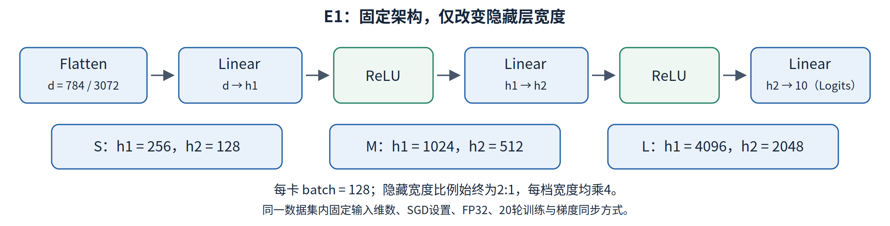
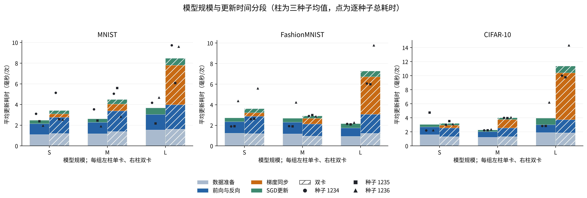
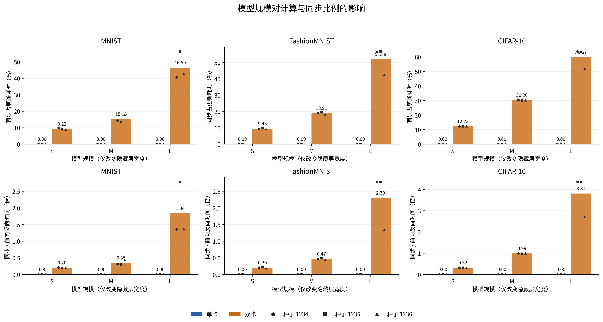
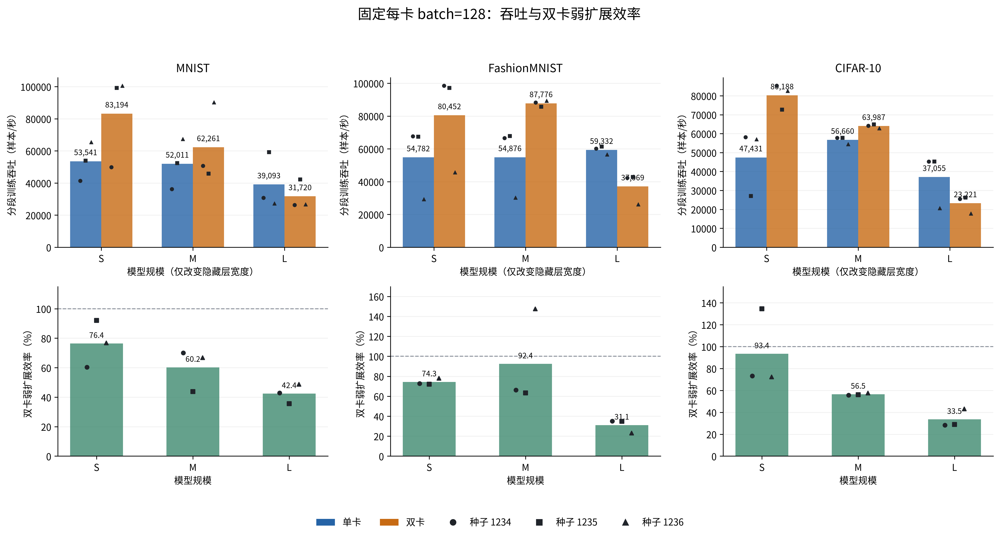
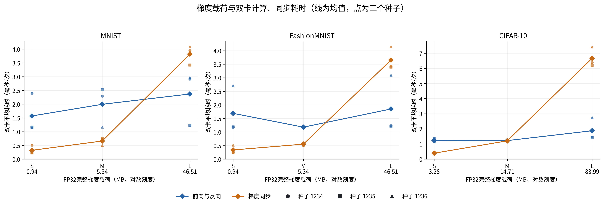

# E1：模型规模对计算与通信开销比例的影响

## 1. 研究问题与对照方式

E1 研究同一类模型在宽度增大时，前向反向计算与梯度同步的耗时各自怎样变化，以及二者的比例如何影响双卡吞吐。每个数据集内固定输入维数、每卡 batch、网络深度、激活函数、优化器、学习率、精度和训练轮数，只改变隐藏层宽度；每档模型均进行单卡和双卡对照。

与 E0 的全局 batch 固定为256不同，E1 的每卡 batch 固定为128：单卡每次更新处理128个样本，双卡每卡处理128个、全局处理256个。双卡每次更新的工作量翻倍，所以性能对照采用吞吐扩展比和弱扩展效率。两组的优化器更新次数不同，最终准确率只用于检查训练表现，不能据此声称双卡优化与单卡等价。

输入是展平图像，MLP 没有序列长度参数。MNIST、FashionMNIST 的输入维数固定为784，CIFAR-10 为3072；三种数据集分开统计，不能把输入维数的变化误当作纯宽度变化。

### 模型规模

S、M、L 均为 `Flatten → Linear → ReLU → Linear → ReLU → Linear`，输出10类 Logits。隐藏层宽度始终保持2:1，每档各放大4倍：S为256→128，M为1024→512，L为4096→2048。M与E0的模型相同。



模型图上方是共同的数据流，`h1`、`h2`表示两个隐藏层宽度，下方三框列出本次唯一改变的模型宽度。Flatten 对应数据准备时的展平，Linear 和 ReLU 的层数与排列不变。

| 数据集 | 模型 | 两个隐藏层宽度 | 参数量 | FP32完整梯度载荷 |
|---|---|---|---:|---:|
| MNIST、FashionMNIST | S | 256→128 | 235,146 | 0.941 MB |
| MNIST、FashionMNIST | M | 1024→512 | 1,333,770 | 5.335 MB |
| MNIST、FashionMNIST | L | 4096→2048 | 11,626,506 | 46.506 MB |
| CIFAR-10 | S | 256→128 | 820,874 | 3.283 MB |
| CIFAR-10 | M | 1024→512 | 3,676,682 | 14.707 MB |
| CIFAR-10 | L | 4096→2048 | 20,998,154 | 83.993 MB |

表中的 MB 按十进制 `10⁶`字节计。设输入维数为 `d`，两个隐藏层为 `h1`、`h2`，则参数量为 `P=(d+1)h1+(h1+1)h2+(h2+1)×10`，每份 FP32 完整梯度的载荷为 `4P`字节。前向矩阵乘的估计运算量为每个样本 `2(dh1+h1h2+10h2)` FLOPs；该估计不包含偏置、激活、反向和优化器操作，不是实测 GPU 算力。

固定每卡批量时，全连接层的计算量和梯度载荷都会随参数量增长，因此不能预设“模型越大，同步占比就一定越低”。本实验观察的是启动开销、计算效率、载荷和同步等待共同作用后的实测变化。

### 固定设置

官方训练集分层留出10%验证，划分种子固定为1234，三个训练种子为1234、1235、1236。MNIST、FashionMNIST 使用54,000个训练候选样本和6,000个验证样本，CIFAR-10 使用45,000和5,000个。官方测试集均为10,000个样本。像素转为 FP32、除以255，不做图像增强；CIFAR-10 仍按 HWC 顺序展平。

SGD momentum=0.9；MNIST、FashionMNIST 的学习率固定为0.1，CIFAR-10 为0.05；卡数和模型规模都不改变学习率。每次训练固定20轮，不早停、不恢复最优验证模型；每轮只验证，完成第20轮后测试并保存末轮模型。

所有训练、验证、测试和模型加载均在 CUDA 上执行，双卡使用 NCCL，一进程一张 GPU。每进程主机计算线程固定为4，数据加载 worker=0，评估 batch=1024。FP32 计算禁用 TF32，不使用 AMP、编译、梯度累积、压缩或延迟同步。DDP 的梯度桶容量固定为128 MiB，大于最大的83.993 MB梯度；每步检查只发生一次完整梯度 AllReduce。

实验环境为单机两张RTX 4090，每张可见显存24,564 MiB、功率上限450 W；软件为Python 3.12.14、PyTorch 2.15.0+cu132、CUDA 13.2、NCCL 2.30.7，驱动595.91.07。两卡拓扑为PHB，GPU 0到1的P2P访问不可用。`lscpu`显示32个逻辑处理器、QEMU Virtual CPU、KVM虚拟化，记录见[host_context.json](host_context.json)。硬件时钟和宿主机调度未受控，主机开销与设备状态波动可能影响计时，三个种子的分布需与均值一起读取。

为严格固定每张卡的训练批量，训练使用 `drop_last=True`；验证与测试保留全部样本。

| 数据集 | 单卡每轮更新 | 双卡每轮更新 | 单卡每轮训练样本 / 丢弃 | 双卡每轮训练样本 / 丢弃 |
|---|---:|---:|---:|---:|
| MNIST、FashionMNIST | 421 | 210 | 53,888 / 112 | 53,760 / 240 |
| CIFAR-10 | 351 | 175 | 44,928 / 72 | 44,800 / 200 |

相同数据集、卡数和种子下，S/M/L 使用相同数据划分、每轮样本顺序和丢尾规则；不同模型的参数形状不同，初始化的具体参数值也不同。每个种子轮换模型执行次序，并交替单、双卡先后，所有正式运行串行执行。

## 2. 计时方式与指标选择

### 为什么保留阻塞式同步

常规 DDP 会在反向过程中按梯度桶发起归约，以重叠计算和通信；此时同步操作的总时长不等于暴露在整步关键路径上的开销。为便于解释比例，E1 沿用 E0 的阻塞式通信 hook：等待梯度就绪，通过 NCCL 求和、除以卡数，再等待设备完成。固定单个完整梯度桶，避免模型规模变化同时改变桶数量。[PyTorch DDP 工作原理](https://docs.pytorch.org/docs/2.15/notes/ddp.html)

每个 rank 逐步记录数据准备、前向反向、同步和优化器四段时间。所有 CUDA 计时边界显式等待设备完成；同步段从进入 AllReduce 前计时，到梯度平均及设备等待结束。前向反向耗时扣除单独记录的同步段。一次完整更新时间满足：

`t_step = t_data + t_compute + t_sync + t_opt`。

每步选取 `t_step` 最大的 rank，使用这个 rank 的整行四段时间作为汇总，保证各段能准确加和。不会把不同 rank 的各段最大值相加。单卡使用唯一的 rank。两个 rank 的原始 CSV 全部保留，均可独立复查。

这是逐步最慢 rank 的分段耗时口径，不是没有插桩时的程序总墙钟吞吐。计时排除数据集初始读取、进程启动、CSV写入、逐轮损失归约、验证、最终测试和模型保存。同步路径包含进程到达时间差，因此不能视为纯链路传输。显式同步会减少计算通信重叠，结果限定于这种阻塞式测量实现。

每次运行的前10次更新参与正常训练，但作为预热排除性能统计。之后的完整训练批次全部参与性能汇总；预热标记不会每轮重新开始。所有20轮的训练和验证曲线仍完整保存。

### 主指标与辅助指标

以下 `T`、`C`、`S` 分别为预热后选定 rank 的整步、计算、同步累计毫秒数，`U` 是计时更新数，`N=U×128×卡数` 是计时全局样本数。

| 指标 | 定义 | 回答的问题 |
|---|---|---|
| 平均前向反向耗时 | `C/U`，ms/更新 | 增大模型宽度后，单卡局部计算增加多少？ |
| 平均同步耗时 | `S/U`，ms/更新 | 归约更大梯度的同步路径成本增加多少？ |
| 同步占比 | `S/T×100%` | 同步占完整更新时间的多大比例？ |
| 同步/计算时间比 | `S/C`，倍 | 同步与前向反向相比有多贵？0.5表示同步是计算的一半，1表示相等 |
| 二者中的同步比例 | `S/(C+S)×100%` | 排除数据准备和优化器后，计算与同步之间如何分配时间？ |
| 平均更新耗时 | `T/U`，ms/更新 | 完成一个全局批次的总分段成本是多少？ |
| P50/P95更新耗时 | 预热后逐步 `t_step` 的50%/95%分位数 | 更新耗时的典型值和长尾波动如何？ |
| 分段训练吞吐 `Q` | `1000N/T`，样本/秒 | 单、双卡合计每秒处理多少训练样本？ |
| 吞吐扩展比 | 同一种子的 `Q双/Q单` | 双卡的总体样本处理速度提高多少？理想值为2 |
| 双卡弱扩展效率 | `(Q双/Q单)/2×100%` | 固定每卡批量的吞吐，达到理想线性扩展的多少？ |
| 参数量与梯度载荷 | `P`个、`4P`字节 | 实测变化对应多少模型参数和梯度数据？ |
| 每卡训练显存峰值 | 训练分段内各卡 `max_memory_allocated` 的最大值，MB | 更大的模型消耗多少框架跟踪的张量显存？ |

其中前向反向耗时、同步耗时、同步占比和同步/计算时间比是主研究指标。更新耗时和吞吐用于检验比例变化是否带来性能收益；参数量、载荷和显存提供规模背景。验证与最终测试损失、准确率用于检查模型正常学习。显存统计不包括 NCCL 或驱动的全部外部分配，不能等同于 `nvidia-smi` 的整卡占用。

固定每卡批量时，`Q双/Q单 = 2 × 平均更新耗时单 / 平均更新耗时双`，因此弱扩展效率也等于两组平均更新时间的反比。它用于描述分段吞吐的扩展，不等于完整20轮训练的墙钟加速，也不等于达到某个准确率的速度。双卡还增加 DDP 处理和进程协调开销，数据准备、优化器耗时也可能变化，因此不能把 `1−同步占比`直接当作扩展效率。

梯度载荷是每个 rank 参与一次归约的逻辑张量大小，既不是各卡字节数之和，也不等于实际链路传输量。NVIDIA 的 NCCL tests 区分 `algbw` 和按集体通信模式修正的 `busbw`；本实验同步时间还含等待和平均操作，因此不将“载荷/同步时间”作为实测总线带宽。[NVIDIA NCCL tests 性能指标](https://github.com/NVIDIA/nccl-tests/blob/master/doc/PERFORMANCE.md)

### 三个种子的统计

每个种子先从原始逐步记录计算完整运行指标，再等权汇总三个种子的算术均值、样本标准差和最小—最大范围。扩展比先按同一种子配对求比值，再取三个比值的均值；不使用“两组均值相除”替代。表内的“均值±标准差”表示三次训练重复的离散程度，P95则描述单次运行内的更新波动，二者不能互相替代。

图中柱或粗线表示三种子均值，圆、方、三角形分别保留三个种子的原值。图表不绘制置信区间，逐步更新数不作为训练重复数。

## 3. 如何运行与复核

在项目根目录完成环境和数据准备后，检查计划和模型规模，再执行单卡、双卡训练。省略筛选参数时共 54 次，每次 20 轮。

```bash
bash "sh/4.1.E1计划与模型检查.sh"
bash "sh/4.2.1.E1单卡训练.sh"
bash "sh/4.2.2.E1双卡训练.sh"
bash "sh/4.3.1.E1单卡测试.sh"
bash "sh/4.3.2.E1双卡测试.sh"

uv run --locked pytest E1/tests -q
bash "sh/4.4.E1结果核验.sh"
bash "sh/4.5.E1绘图.sh"
```

默认输出为 `E1/results/reproduce/`。测试脚本默认加载 MNIST、M 档、种子 1234 所得的对应末轮模型，结果核验和绘图读取完整网格。筛选参数、检查点路径、归档执行顺序与核验方式见 [E1 运行说明](../README.md#运行)。

每个组合保存 `steps_rank0.csv`、双卡的 `steps_rank1.csv`、`epochs.csv`、`final.json`、GPU 元数据和 `checkpoint.pt`。模型位于 `{数据集}/{S或M或L}/ws{卡数}_seed{种子}/`，源码与哈希位于 `provenance/`，环境与拓扑位于 `environment.json`。当前训练入口将逐轮样本吞吐、更新/计算/同步耗时、同步占比和同步/计算耗时比一并输出到终端和 `epochs.csv`。

正式运行前的 CUDA/NCCL 梯度检查、固定局部批量、末轮测试隔离和目录协议检查记录见 [前置检查](preflight.json)。

## 4. 实测结果与图表

54次运行均完成20轮训练，54个末轮模型均已在GPU上独立复测。各档模型的单、双GPU结果分别独立采集，统计使用各自的CUDA训练记录。

### 4.1 前向反向与同步成本

表中均为三个种子的“均值±样本标准差”。耗时单位是毫秒/更新；同步占比以百分数表示，标准差的单位为百分点；同步/计算时间比没有量纲。每个种子的比值先独立计算，再跨种子取均值，因此表中比值不一定等于两列耗时均值相除。

| 数据集 | 模型 | GPU数 | 前向反向耗时（ms） | 同步耗时（ms） | 同步占更新耗时（%） | 同步/计算时间比 |
|---|---|---:|---:|---:|---:|---:|
| MNIST | S | 1 | 1.050±0.282 | 0 | 0 | 0 |
| MNIST | S | 2 | 1.571±0.713 | 0.321±0.160 | 9.223±0.553 | 0.202±0.008 |
| MNIST | M | 1 | 1.094±0.357 | 0 | 0 | 0 |
| MNIST | M | 2 | 1.994±0.729 | 0.659±0.137 | 15.159±2.225 | 0.348±0.072 |
| MNIST | L | 1 | 1.492±0.595 | 0 | 0 | 0 |
| MNIST | L | 2 | 2.369±0.988 | 3.818±0.350 | 46.505±8.564 | 1.840±0.819 |
| FashionMNIST | S | 1 | 1.129±0.625 | 0 | 0 | 0 |
| FashionMNIST | S | 2 | 1.689±0.884 | 0.339±0.155 | 9.433±0.327 | 0.205±0.014 |
| FashionMNIST | M | 1 | 1.126±0.596 | 0 | 0 | 0 |
| FashionMNIST | M | 2 | 1.179±0.010 | 0.552±0.034 | 18.910±0.744 | 0.468±0.025 |
| FashionMNIST | L | 1 | 0.806±0.046 | 0 | 0 | 0 |
| FashionMNIST | L | 2 | 1.849±1.079 | 3.655±0.422 | 51.885±8.225 | 2.301±0.834 |
| CIFAR-10 | S | 1 | 1.105±0.539 | 0 | 0 | 0 |
| CIFAR-10 | S | 2 | 1.234±0.111 | 0.392±0.035 | 12.228±0.115 | 0.318±0.002 |
| CIFAR-10 | M | 1 | 0.813±0.028 | 0 | 0 | 0 |
| CIFAR-10 | M | 2 | 1.225±0.010 | 1.209±0.022 | 30.205±0.156 | 0.987±0.013 |
| CIFAR-10 | L | 1 | 1.111±0.561 | 0 | 0 | 0 |
| CIFAR-10 | L | 2 | 1.876±0.752 | 6.666±0.658 | 59.674±6.800 | 3.809±0.957 |

三个数据集的双卡结果均表现为：S→M→L 时同步耗时和同步占比上升。L 的同步段在三个数据集上都已高于前向反向计算段。MNIST 的 L 同步占比只有约46.5%，但同步/计算时间比达到1.84，是因为整个更新还包含数据准备和 SGD 操作；两种比例回答的问题不同。

前向反向的测量值没有呈现稳定、严格的参数量线性关系。例如 FashionMNIST 的单卡 L 均值低于 S、M，而部分组的跨种子耗时差异较大。计算段包含主机发起操作和等待设备的成本，又处于未锁频的虚拟化环境中，因此不能据此宣称增大模型本身会降低计算量。该现象也说明只看耗时均值或只看一个种子会掩盖波动。

### 图1：模型规模与更新时间的四段分解



图1的三列从左到右分别为 MNIST、FashionMNIST、CIFAR-10。横轴是模型规模 S、M、L，每组左柱是单卡、右侧带斜线柱是双卡；纵轴为平均更新耗时，单位毫秒/次。浅蓝、深蓝、橙、绿依次表示数据准备、前向反向、梯度同步和 SGD 更新。每根堆叠柱是三个种子的分段均值，加和得到平均更新时间。

黑色圆点、方点、三角形分别表示种子1234、1235、1236的总更新时间。点是对应运行的总耗时，不是某个颜色分段的耗时，也不是误差条。该图用于看同步增加后是否成为完整更新的重要组成部分，以及数据准备和优化器成本是否仍然明显。三个数据集的双卡 L 都出现较大的橙色同步段；单卡没有橙色梯度同步段。

### 图2：同步占比与同步/计算时间比



图2是本实验的主要比例图。三列对应三个数据集，横轴均为 S、M、L；每组蓝柱表示单卡、橙柱表示双卡。上排纵轴是同步占更新时间的百分比 `S/T×100%`，下排纵轴是同步/前向反向时间比 `S/C`，单位为倍。柱和数值标注表示三个种子的均值，黑色点形对应三个种子的原值。

下排的数值1表示同步与计算耗时相等。CIFAR-10 的 M 约为0.99，L 约为3.81；MNIST、FashionMNIST 的 L 分别约为1.84、2.30。可以据此判断，在本次阻塞式实现下，L 的同步路径已经比前向反向更昂贵。单卡两行始终为0，作为无跨卡通信的参照。图中没有置信区间，原始点也没有被当作20轮或数千步独立重复。

### 4.2 吞吐与双卡扩展

吞吐单位为样本/秒；扩展比是同一种子的双卡/单卡吞吐之比；弱扩展效率的标准差以百分点表示。所有扩展指标先配对、再汇总。

| 数据集 | 模型 | 单卡吞吐 | 双卡吞吐 | 吞吐扩展比 | 双卡弱扩展效率（%） |
|---|---|---:|---:|---:|---:|
| MNIST | S | 53,541.4±12,063.2 | 83,194.2±28,894.9 | 1.528±0.318 | 76.40±15.89 |
| MNIST | M | 52,011.1±15,631.3 | 62,261.3±24,362.6 | 1.204±0.287 | 60.22±14.35 |
| MNIST | L | 39,093.0±17,460.5 | 31,720.0±9,029.1 | 0.848±0.132 | 42.39±6.58 |
| FashionMNIST | S | 54,781.9±22,093.5 | 80,451.8±30,072.9 | 1.486±0.066 | 74.31±3.31 |
| FashionMNIST | M | 54,875.7±21,318.8 | 87,775.8±1,917.0 | 1.848±0.958 | 92.38±47.89 |
| FashionMNIST | L | 59,332.3±2,480.6 | 37,069.2±9,414.3 | 0.621±0.137 | 31.06±6.84 |
| CIFAR-10 | S | 47,431.2±17,688.1 | 80,187.9±6,611.8 | 1.868±0.713 | 93.39±35.66 |
| CIFAR-10 | M | 56,660.3±1,899.3 | 63,986.8±1,000.6 | 1.130±0.022 | 56.49±1.11 |
| CIFAR-10 | L | 37,055.4±14,201.2 | 23,220.7±4,635.2 | 0.670±0.170 | 33.50±8.48 |

三个数据集的L在各自三个种子上，双卡吞吐均低于单卡，对应扩展效率范围分别为35.62%—48.75%、23.16%—35.14%、28.26%—43.28%。在所测实现与硬件条件下，L的同步成本抵消了增加一张卡带来的吞吐收益。

部分小、中模型的扩展效率出现大幅波动。FashionMNIST 的 M 有一次达到147.65%，CIFAR-10 的 S 有一次达到134.57%，其余同配置种子明显较低。这些值按原始记录保留，不裁剪到100%。由于单卡和双卡分别测量、主机与硬件状态未完全受控，单次比值高于100%不能作为获得稳定超线性扩展的证据。

### 图3：总体吞吐与配对扩展效率



图3上排横轴是 S、M、L，纵轴为分段训练吞吐（样本/秒）；蓝柱、橙柱分别表示单卡、双卡。下排横轴仍为模型规模，纵轴为双卡弱扩展效率（%），绿柱表示三个配对种子的均值，100%虚线表示理想的两倍吞吐。圆、方、三角形仍对应三个种子，超出100%的观测也完整展示。

该图把图2的同步成本与实际处理速度联系起来。三个数据集的 L 均没有获得双卡总体吞吐提升；S、M 的部分组有提升，但改善幅度和重复稳定性不同，尤其不能只凭 FashionMNIST M 的均值判断其接近理想扩展。

### 图4：梯度载荷怎样对应双卡耗时



图4的横轴是每次完整 FP32 梯度载荷，单位 MB，采用对数刻度，刻度同时标出 S/M/L。纵轴为双卡平均耗时，单位毫秒/次。蓝线表示前向反向、橙线表示梯度同步；菱形和连线是三个种子的均值，小圆、方、三角形表示三个种子的实际观测。连线只连接本次测到的三档模型，不是连续载荷的拟合或预测。

MNIST、FashionMNIST 从 S 到 L 的载荷由0.941 MB增至46.506 MB，双卡同步均值分别从0.321、0.339 ms增至3.818、3.655 ms；CIFAR-10 的载荷由3.283 MB增至83.993 MB，同步均值从0.392 ms增至6.666 ms。相比之下，前向反向耗时没有按同样幅度增长。该图支持“这组宽度扫描中，同步成本更快成为主要开销”的观察，但不能单独确定链路带宽、NCCL算法或GPU内核效率。

### 4.3 显存与最终分类结果

测试准确率为三个种子的均值±样本标准差，标准差单位为百分点；显存列为每次运行的各卡训练峰值取最大值后，再跨种子取均值，单位 MB。

| 数据集 | 模型 | 单卡测试准确率（%） | 双卡测试准确率（%） | 单卡每卡峰值显存（MB） | 双卡每卡峰值显存（MB） |
|---|---|---:|---:|---:|---:|
| MNIST | S | 98.253±0.228 | 98.273±0.067 | 11.9 | 12.8 |
| MNIST | M | 98.537±0.074 | 98.307±0.040 | 25.4 | 30.8 |
| MNIST | L | 98.523±0.083 | 98.333±0.023 | 150.5 | 197.0 |
| FashionMNIST | S | 88.103±0.404 | 88.430±0.195 | 11.9 | 12.8 |
| FashionMNIST | M | 88.540±0.392 | 88.810±0.802 | 25.4 | 30.8 |
| FashionMNIST | L | 88.850±0.321 | 89.173±0.355 | 150.5 | 197.0 |
| CIFAR-10 | S | 44.773±1.347 | 49.480±1.209 | 20.1 | 23.4 |
| CIFAR-10 | M | 47.157±0.535 | 51.333±1.609 | 55.3 | 69.9 |
| CIFAR-10 | L | 48.413±0.735 | 52.690±0.475 | 264.2 | 348.6 |

模型规模增加时显存需求上升，双卡每卡还保留 DDP 通信缓冲，不能把两张卡的显存当作模型被切分后的总和。在同一数据集和卡数内部，可以观察宽度变化与分类结果；单、双卡之间全局批量、更新次数均不同，尤其 CIFAR-10 的准确率差异不能直接归因于多了一张 GPU。

平均更新耗时、P50/P95、数据准备、优化器耗时、验证与测试损失等完整指标见 [final.csv](final.csv) 和 [seed_summary.csv](seed_summary.csv)。三个种子的逐次扩展结果见 [paired_scaling.csv](paired_scaling.csv)。逐轮训练、验证曲线记录在各运行的 `epochs.csv` 中，官方测试集只在第20轮后使用一次。

## 5. 结论与适用范围

这次控制每卡批量的 MLP 宽度扫描中，增大模型规模没有自动提高计算相对通信的占比。双卡同步占比在三个数据集上都从 S 的约9%—12%升至 L 的约47%—60%，L 的同步/计算时间比均超过1，对应的双卡吞吐在全部配对种子中都低于单卡。参数量、梯度载荷、两类时间和总体吞吐需要一起看，单独报告同步占比不足以解释全部成本。

跨种子波动限制了吞吐扩展效率精确数值的可推广性。当前采用虚拟化主机、未锁定硬件时钟，且测量包含主机发起操作与等待；未使用 profiler 将这些因素进一步分离。现有结果支持本次阻塞同步条件下的规模趋势，不构成最优 DDP 性能、纯 NCCL 带宽或稳定超线性加速的证明。只有三个训练种子，也不足以对较小的模型性能差别作统计显著性判断。

模型族限定为两层隐藏层 MLP，每卡 batch固定为128；GPU互联、精度和同步方式同样固定。结果不能直接推广到 Transformer 序列长度变化、CNN、混合精度、梯度压缩或充分重叠计算通信的训练方式。后续若研究通信重叠或独立 AllReduce 带宽，应作为新的控制变量和独立实验处理。

## 6. 复核证据与文件

54次正式运行的原始记录、数据划分、GPU运行元数据、单桶梯度载荷及指标重算均已通过核验；54个检查点的官方测试准确率与独立 GPU 复测一致，测试交叉熵在预设浮点容差内一致，见 [validation.json](validation.json) 和 [validation.log](validation.log)。

| 文件 | 内容 |
|---|---|
| [final.csv](final.csv) | 54次独立运行的最终测试、性能与资源指标 |
| [seed_summary.csv](seed_summary.csv) | 18组配置、14项指标的三种子均值、样本标准差、原始范围 |
| [paired_scaling.csv](paired_scaling.csv) | 27个种子配对的吞吐扩展比、弱扩展效率、更新时间比 |
| [model_sizes.csv](model_sizes.csv) | 九种数据集/模型组合的参数量、FP32载荷与前向矩阵运算量 |
| [preflight.json](preflight.json) | 正式运行前10项检查结果，模型计算使用 CUDA/NCCL |
| [environment.json](environment.json)、[host_context.json](host_context.json) | GPU、软件版本、互联拓扑与虚拟化主机信息 |
| [provenance/source_sha256.json](provenance/source_sha256.json) | 运行开始时的源码快照及哈希，训练模块保持一致 |
| [analysis_sources.json](analysis_sources.json) | 绘图与核验使用的分析源码哈希及独立快照；坐标范围覆盖全部种子观测 |
| [figure_validation.json](figure_validation.json) | 四张指标图的全部种子点均落在显示范围内 |
| [original_gpu_files_sha256.json](original_gpu_files_sha256.json) | 567份原始结果、元数据和模型文件的SHA-256，便于后续确认未被改写 |
| [completion.json](completion.json) | 54次运行、54次GPU复测及文档图表核对的完成记录 |
| [training.log](training.log) | 54次正式训练的逐轮输出 |

原始记录、统计表和图表分别保存在各运行目录、结果顶层和`figs/`中。

### 每个训练步的耗时、吞吐与同步

54次运行的原始`steps_rank*.csv`保存每次SGD的实际样本数、分段时间、归约次数和逻辑梯度载荷。显式导出位于`step_metrics/`：`rank_steps.csv.gz`包含428,940条逐rank观测，`global_units.csv.gz`包含321,840次全局参数更新。每行增加按实际样本数和实测毫秒计算的样本/秒，以及同步标记和占比，保留预热、尾批与原始文件位置；单卡不执行跨卡归约。

双卡全局每步选择整步耗时更长的rank，使用同一rank的整行时间分段；不能把两卡样本吞吐直接相加或分别取各分段最大值。汇总按原实验的预热和完整批次规则复算。运行索引与行数见 [逐步审计](step_metrics/audit.json)。
