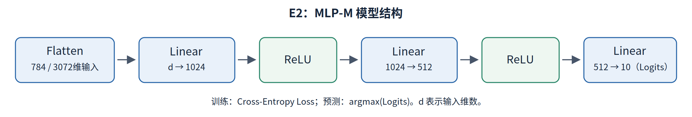
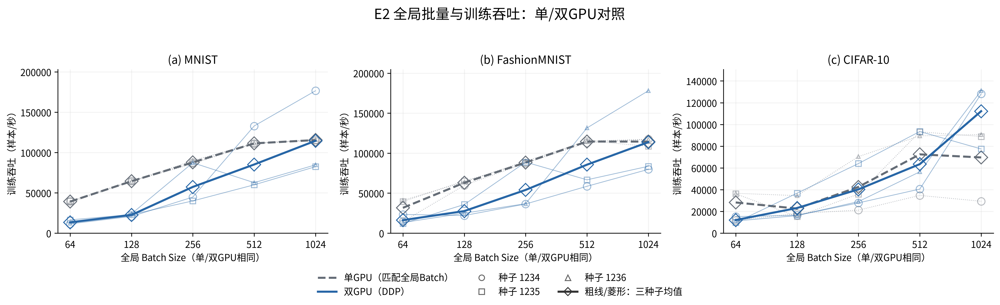
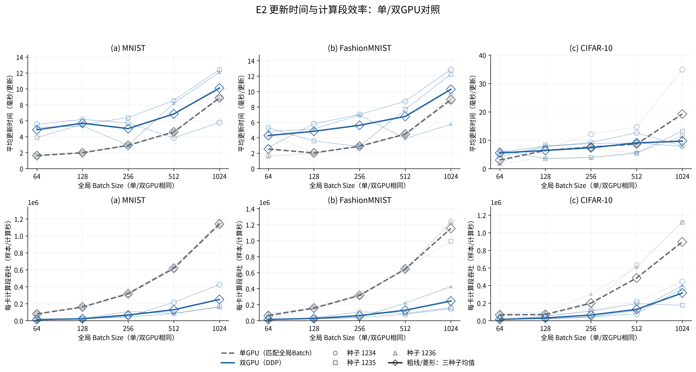
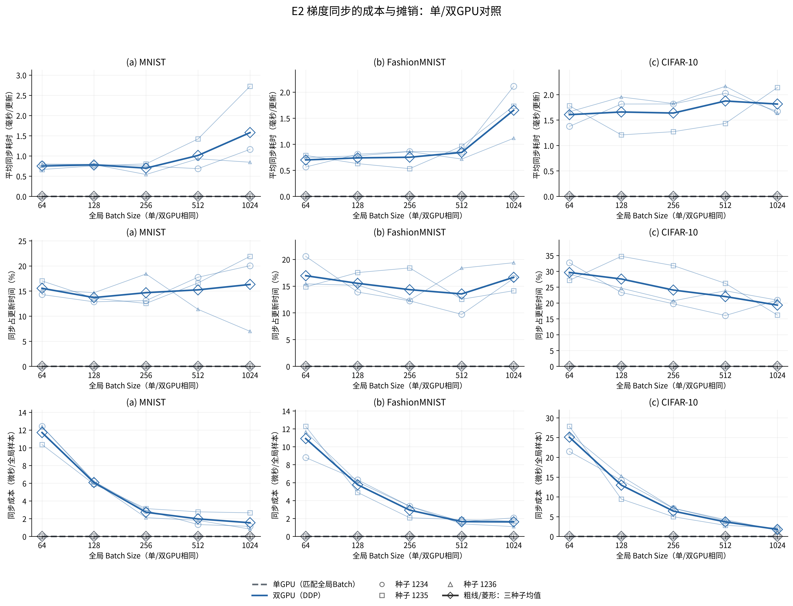
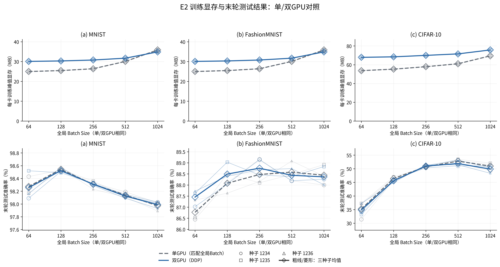
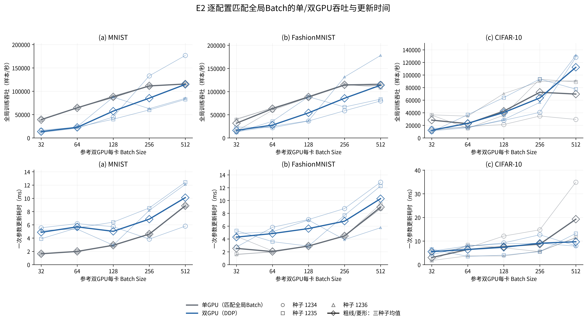
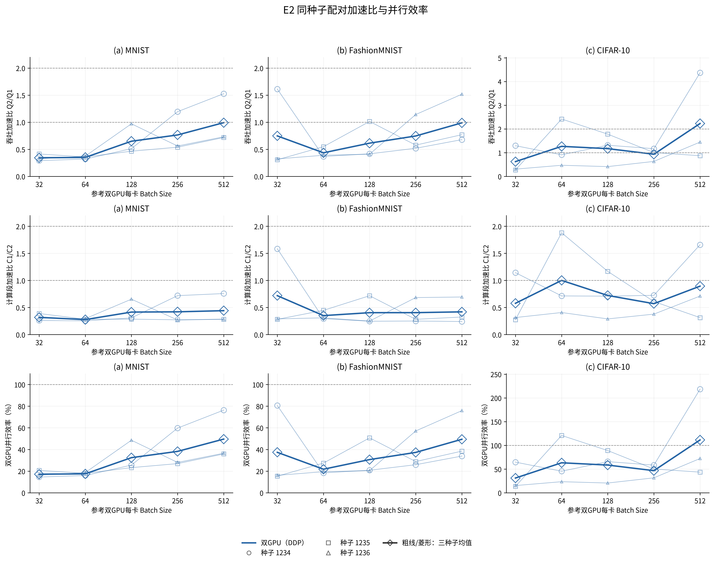
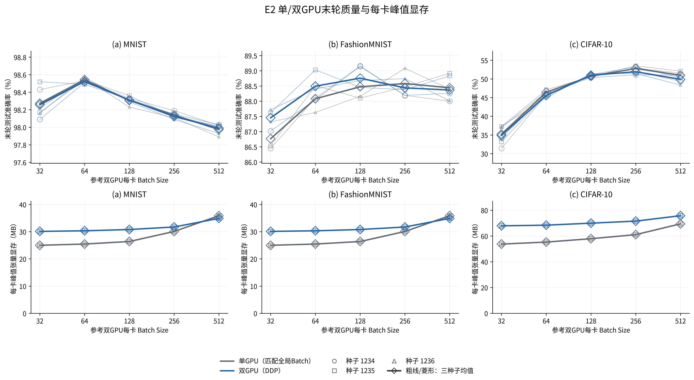

# E2：固定GPU数量，研究全局批大小对训练吞吐的影响

## 1. 实验问题与控制变量

本实验对应实验A：固定两张GPU、梯度累积次数1，改变每张GPU一次处理的样本数。由于全局batch=`GPU数×每卡batch×累积次数`，每卡batch增加会直接增大全局batch。研究重点是批量增大后的训练吞吐、计算段效率、显存和同步摊销。

| GPU数 | 每卡Batch Size | 梯度累积次数 | 全局Batch Size |
|---:|---:|---:|---:|
| 2 | 32 | 1 | 64 |
| 2 | 64 | 1 | 128 |
| 2 | 128 | 1 | 256 |
| 2 | 256 | 1 | 512 |
| 2 | 512 | 1 | 1024 |

MNIST、FashionMNIST、CIFAR-10分别运行五档配置，每档使用1234、1235、1236三个种子，双GPU主实验45次，匹配的单GPU对照45次，每次20轮。主实验固定两张RTX 4090，只改变每卡batch。单GPU对照在每档保持相同全局batch、样本窗口和更新次数，用于判断双卡并行收益。

### 模型、数据与训练



模型与E0一致，两个隐藏层宽度为1024、512，激活函数为ReLU，输出10类Logits。MNIST与FashionMNIST的输入维数为784，参数量1,333,770，FP32梯度载荷5.335 MB；CIFAR-10输入维数3072，参数量3,676,682，梯度载荷14.707 MB。模型及每次更新的梯度载荷在同一数据集内固定。

三个数据集分别分析。沿用E0的训练/验证划分：官方训练集按类别分层留出10%，划分种子固定1234。MNIST、FashionMNIST的训练、验证、测试样本数为54,000、6,000、10,000；CIFAR-10为45,000、5,000、10,000。像素除以255，转为FP32并展平；CIFAR-10按HWC顺序展平，不进行图像增强。数据缓存与原始读取接口位于独立的顶层`Data/`。

固定SGD momentum=0.9，MNIST、FashionMNIST学习率0.1，CIFAR-10为0.05，不按batch缩放学习率。固定FP32、禁用TF32，不使用AMP、梯度压缩或编译。每进程4个主机计算线程，DataLoader worker=0，评估batch=1024。每轮完整训练全部样本，保留尾批；每轮只验证，不早停、不恢复最优验证模型，20轮后才评估一次完整官方测试集并保存末轮模型。

两张GPU各由一个进程驱动，每次参数更新通过NCCL同步一次完整梯度；通信桶容量固定25 MiB，所有配置都为单桶。这里沿用阻塞同步和显式CUDA等待，计算与通信不重叠。每个种子轮换batch执行顺序，正式运行串行进行；主机硬件、软件版本与拓扑记录在`environment.json`。

较大的全局batch会减少每轮参数更新次数：`每轮更新数=ceil(训练样本数/全局batch)`。因此本组固定的是数据遍历轮数与模型配置，优化器更新次数随batch变化。最终准确率用于观察训练行为，不能把其变化全部解释为系统吞吐变化。

| 全局Batch | MNIST/FashionMNIST每轮更新数 | CIFAR-10每轮更新数 |
|---:|---:|---:|
| 64 | 844 | 704 |
| 128 | 422 | 352 |
| 256 | 211 | 176 |
| 512 | 106 | 88 |
| 1024 | 53 | 44 |

完整训练的梯度归约次数为上述更新数乘以20，包含尾批。性能统计另行排除尾批与预热，不改变实际训练预算。

## 2. 计时与指标设计

每次更新从取出该窗口的训练数据开始，到优化器更新及CUDA等待完成为止。分别记录数据准备、前向反向、同步、优化器和其他控制开销：

`T更新 = T数据 + T计算 + T同步 + T优化器 + T其他`。

前向反向时间扣除通信hook单独记录的同步段。“其他”包含窗口调度、分片与上下文等未归入前四段的开销，使完整更新区间能够加和复算。两个rank的原始时间分别保存；每次更新选整体耗时最大的rank，取它的整行分段，不把各rank不同分段的最大值相加。

每次运行的前10次参数更新作为预热，参与训练但排除性能统计；每轮尾批同样训练，但不进入固定batch性能统计。验证、最终测试、模型保存、CSV写入、样本顺序哈希和逐轮损失归约都在性能计时区间外。报告中的吞吐是该插桩更新区间的吞吐，不能代替无插桩程序的总墙钟吞吐。

记预热后的完整更新数为`U`，选定rank的更新、计算、同步累计毫秒数为`T、C、S`，全局样本数为`N`。

| 指标 | 定义与单位 | 用途 |
|---|---|---|
| 训练吞吐 | `1000N/T`，样本/秒 | 主指标，回答增大全局batch是否提高总体处理速度 |
| 平均更新时间 | `T/U`，ms/参数更新 | 观察一次更新变大后的总成本；一次更新的样本数随batch改变 |
| 每卡计算段吞吐 | `1000(N/2)/C`，样本/计算秒 | 用作计算段效率指标，比较批量带来的摊销；不等同于SM利用率或峰值FLOPs利用率 |
| 平均计算耗时 | `C/U`，ms/更新 | 看一次更新的前向反向成本 |
| 平均同步耗时 | `S/U`，ms/更新 | 看每次更新的同步路径成本，包含等待、AllReduce、平均及设备等待 |
| 同步占比 | `S/T×100%` | 同步在完整更新中的暴露比例，限定于本实验阻塞实现 |
| 每样本同步成本 | `1000S/N`，微秒/全局样本 | 判断固定梯度同步成本是否被更大batch摊薄 |
| 每样本逻辑梯度载荷 | `完整梯度字节数/全局batch` | 解释相同一次归约被多少样本分担，不是实际链路传输量 |
| 每卡训练峰值显存 | 各rank的`max_memory_allocated`最大值，MB | 比较batch增加的张量显存需求，排除验证/测试分段，不含全部NCCL与驱动分配 |
| P50/P95更新时间 | 完整更新耗时分位数 | 辅助观察单次运行内部波动，不能当作独立训练重复 |
| 最终损失与准确率 | 第20轮模型的完整官方测试集结果 | 检查训练行为及批量改变后的结果 |

每次参数更新的梯度载荷固定，所以全局batch增大并不直接增大通信张量；它改变的是每轮更新次数，以及每次同步由多少样本分担。同步时间还可能受进程到达时间与主机状态影响，因此不能预设它在所有batch下绝对相同。

先分别计算每个种子的完整运行指标，再对三个种子等权取均值、样本标准差和最小—最大范围。相对每卡128基线的比值也先按同一种子配对计算。图1—4以灰色表示单GPU、蓝色表示双GPU；圆、方、三角对应三个种子，同色粗线与菱形表示均值，单GPU均值用虚线、双GPU用实线，不绘制置信区间。

本机运行于KVM虚拟机，32个虚拟CPU，两卡拓扑为PHB，CUDA报告GPU0到GPU1的P2P访问不可用。实验没有锁定GPU频率或控制宿主机调度；不同运行的耗时可能受主机执行环境影响。三个种子代表三次完整训练重复，其性能离散不能只归因于初始化种子。这里的计算段采用含主机发起与CUDA等待的墙钟计时，不是纯GPU kernel时间。

PyTorch的显存统计区分张量分配与缓存保留，不能将本报告的峰值直接等同于`nvidia-smi`整卡占用。[PyTorch CUDA显存说明](https://docs.pytorch.org/docs/stable/notes/cuda.html)

## 3. 运行、验证与复核

准备好环境与数据后，在项目根目录按顺序运行。两种卡数各 45 次，每次 20 轮。默认结果根目录是 `E2/results/reproduce/`，单卡写入其 `single_gpu/`。两种训练和测试入口、MNIST 代表命令及默认检查点路径见 [复现说明](../README.md#运行入口)。

```bash
bash "sh/5.3.E2双卡训练.sh"
bash "sh/5.1.E2单卡训练.sh"

uv run --locked pytest E2/tests E2/single_gpu/tests -q
bash "sh/5.5.E2结果核验.sh"
bash "sh/5.6.E2配对统计.sh"
bash "sh/5.7.E2绘图.sh"
```

核验复算单双卡记录并在 CUDA 上复测第 20 轮模型。配对按数据集、档位与种子匹配相同工作量，绘图读取配对结果生成 7 张图。另选结果目录时，训练传 `--output-dir`，核验、配对、绘图接收同一个结果根目录作为位置参数。

当前训练入口在终端和 `epochs.csv` 逐轮记录样本吞吐、更新/计算/同步耗时、同步占比和每样本同步耗时。吞吐和计算段加速比及并行效率在同种子结果配对后计算。

正式前置检查涵盖大、小 batch 的完整梯度、尾批、参数更新、末轮测试隔离和指标协议。启动器的端口重试与续跑检查见 [启动器检查](launcher_checks.xml) · [前置检查](preflight.json)。

## 4. 实测结果

45次双GPU训练均完成。下表为三个种子的“均值±样本标准差”，`n=3`；吞吐单位为千样本/秒，比例与准确率的标准差单位为百分点。同一配置的三个显存峰值完全相同，显存列只列均值。

| 数据集 | 全局Batch | 吞吐（千样本/秒） | 更新时间（ms） | 同步占比（%） | 峰值显存（MB） | 测试准确率（%） |
|---|---:|---:|---:|---:|---:|---:|
| MNIST | 64 | 13.45±2.62 | 4.87±0.87 | 15.54±1.37 | 30.09 | 98.26±0.23 |
| MNIST | 128 | 22.57±1.66 | 5.69±0.43 | 13.70±0.91 | 30.32 | 98.52±0.04 |
| MNIST | 256 | 57.34±26.05 | 5.02±1.84 | 14.67±3.23 | 30.79 | 98.31±0.02 |
| MNIST | 512 | 85.16±41.39 | 6.86±2.61 | 15.24±3.41 | 31.71 | 98.12±0.03 |
| MNIST | 1024 | 114.59±53.75 | 10.10±3.73 | 16.31±8.14 | 34.88 | 97.99±0.05 |
| FashionMNIST | 64 | 16.23±6.22 | 4.29±1.36 | 16.94±3.15 | 30.09 | 87.45±0.38 |
| FashionMNIST | 128 | 27.57±7.25 | 4.84±1.15 | 15.51±1.85 | 30.32 | 88.49±0.50 |
| FashionMNIST | 256 | 54.01±30.10 | 5.62±2.37 | 14.33±3.52 | 30.79 | 88.76±0.35 |
| FashionMNIST | 512 | 85.58±39.97 | 6.77±2.55 | 13.53±4.41 | 31.71 | 88.44±0.28 |
| FashionMNIST | 1024 | 113.75±55.66 | 10.28±3.94 | 16.65±2.62 | 34.88 | 88.37±0.42 |
| CIFAR-10 | 64 | 12.05±2.84 | 5.50±1.20 | 29.63±2.83 | 67.87 | 34.88±2.14 |
| CIFAR-10 | 128 | 23.13±11.83 | 6.40±2.53 | 27.56±6.24 | 68.40 | 45.57±0.56 |
| CIFAR-10 | 256 | 40.28±20.56 | 7.34±2.90 | 24.07±6.71 | 69.94 | 50.98±0.58 |
| CIFAR-10 | 512 | 63.48±27.18 | 9.06±3.58 | 22.02±5.31 | 71.54 | 51.92±1.13 |
| CIFAR-10 | 1024 | 112.18±30.12 | 9.68±3.07 | 19.32±2.72 | 75.74 | 49.88±1.37 |

完整逐种子指标见 [final.csv](final.csv)，所有指标的均值、标准差与范围见 [seed_summary.csv](seed_summary.csv)。各指标先逐运行计算再跨种子汇总，所以不能用表中的平均更新时间倒数代替平均吞吐，也不能用平均同步耗时除以平均更新时间代替平均同步占比。

### 图1：全局批大小与训练吞吐



三列(a)、(b)、(c)依次对应MNIST、FashionMNIST、CIFAR-10。横轴为全局Batch Size，单、双GPU相同，按2的幂显示；纵轴为全局训练样本/秒。灰色单GPU每次处理整批，蓝色双GPU每卡处理一半。每种颜色均保留三个种子及其均值。折线连接不同batch配置，不是训练epoch。相同横坐标下比较灰、蓝曲线，才能判断增加一张GPU是否提高吞吐。

双GPU全局batch从64增加到1024时，三数据集的平均吞吐分别由13.45、16.23、12.05千样本/秒增至114.59、113.75、112.18千样本/秒。逐种子计算`Q1024/Q64`后，增益为9.06±5.51、7.92±5.10、9.35±2.05倍，三个种子的端点吞吐均提高。但相邻档位并非每次都提高，例如MNIST种子1236的全局256为87.30千样本/秒，全局1024为84.70千样本/秒。单GPU曲线表明，增大batch本身也能提高吞吐，双卡曲线上升不能直接解释为并行加速；同配置加速比见图6。

### 图2：一次更新成本与计算段效率



三列对应三个数据集，横轴和图例同图1。上排为平均参数更新时间，单位ms/更新，灰、蓝在同一横坐标下处理相同全局样本数。下排为每GPU计算段吞吐：单卡按全局样本数除以计算段耗时，双卡按每卡一半样本数除以所选rank的计算段耗时。两者实际每卡batch不同，该指标反映局部计算效率，整体并行收益仍读图1或配对加速比。

双GPU从全局64到1024，平均更新时间分别由4.87→10.10、4.29→10.28、5.50→9.68 ms，增至原来的约1.8—2.4倍，而每次更新处理的样本数增加16倍。每卡计算段吞吐分别由12.62→250.48、15.32→245.68、14.18→314.62千样本/计算秒；这是本插桩实现中批量计算与主机发起成本被摊薄的结果，不能直接换算成GPU算力利用率。

双GPU数据准备并非可以忽略：全局1024时三个数据集平均数据段为5.40、5.35、5.58 ms，超过各自的平均计算段2.50、2.60、1.87 ms。整体吞吐同时受DataLoader取数、主机切片和同步传输影响，不能只用计算段推断端到端性能。

### 图3：同步耗时、同步占比与每样本摊销



三列为三个数据集，横轴和图例同图1。上排为跨卡同步耗时（ms/更新），中排为其占完整更新时间的百分比，下排为每个全局样本分摊的同步成本（微秒/样本）。单GPU没有跨卡归约，三排灰线均为0，三个种子的标记重合；蓝线是双GPU实测值。零线表示没有该通信操作，不表示单GPU没有计算成本。双卡每次归约载荷不变，也不代表同步时间或占比恒定。

全局64→1024时，MNIST平均同步耗时由0.749增至1.575 ms，但每样本同步成本由11.71降至1.54微秒；FashionMNIST相应为0.698→1.653 ms、10.91→1.61微秒；CIFAR-10为1.606→1.814 ms、25.09→1.77微秒。同步成本被更多样本分担，是比“同步占比下降”更稳定的观察。

同步占比在MNIST为15.54%→16.31%，FashionMNIST为16.94%→16.65%，CIFAR-10为29.63%→19.32%。因此本组数据支持更大batch改善每样本同步摊销，不能概括为所有数据集的同步占比都随batch增大而下降。完整梯度的每样本逻辑载荷则按公式严格降为原来的1/16，与实测时间变化区分开来。

### 图4：训练显存与末轮准确率



三列为三个数据集，横轴和图例同图1。上排为每卡训练峰值张量显存（十进制MB）：单GPU取唯一设备，双GPU取两rank中较大值，不将两卡显存相加。单卡处理整批，双卡各处理一半但增加DDP缓冲，差异按实测读取。下排为第20轮模型完整测试集准确率（%），纵轴按单、双卡全部观测范围显示。重合标记仍分别保留三个种子；逐轮验证另存于各运行的`epochs.csv`。

双GPU全局64→1024时，MNIST/FashionMNIST峰值显存由30.09增至34.88 MB，CIFAR-10由67.87增至75.74 MB。显存增加没有接近16倍，因为模型参数、梯度、动量和DDP缓冲等基础开销仍然存在。

双GPU准确率不随吞吐单调变化：MNIST从98.26%变为97.99%，FashionMNIST从87.45%变为88.37%，CIFAR-10从34.88%变为49.88%，后者在全局512达到51.92%。跨batch比较还包含更新次数与固定学习率的影响；同一全局batch的单、双卡数学预算一致，但FP32运算顺序可以改变训练轨迹。两类差异不能混为同一种优化收益。

### 单、双GPU性能与并行收益

单GPU对照共45次训练，每次20轮，覆盖三个数据集、三个种子与五档全局batch。双GPU每卡batch为32、64、128、256、512时，单GPU实际batch分别为64、128、256、512、1024，累积次数均为1。每一对的全局样本顺序、更新窗口、尾批大小、学习率和优化器更新次数相同。单GPU只有一个模型和一个训练进程，不建立分布式进程组，梯度跨卡归约次数为0。

两种实现数学上计算同一个全局平均梯度，但FP32矩阵运算和求和顺序不同，不能要求20轮后的参数和准确率完全相同。独立GPU检查同时覆盖FP32相对误差和FP64梯度、动量更新参考。45个单卡末轮模型均在CUDA上独立测试，全局顺序哈希能还原双卡的两份分片，见 [单GPU核验](single_gpu/validation.json)。本组最终准确率的双卡减单卡差值，在MNIST为−0.34至0.35个百分点，FashionMNIST为−0.39至1.09个百分点，CIFAR-10为−4.10至2.77个百分点；性能与模型质量一并保留。

#### 配对指标

对每个种子，使用完全相同的预热后完整批次样本数计算以下指标，然后对三个配对结果取均值与样本标准差，不能直接用两个跨种子平均吞吐相除。

| 指标 | 定义 | 读法 |
|---|---|---|
| 吞吐加速比 | `S=Q双卡/Q单卡=T单卡/T双卡` | 大于1表示相同测量工作量用双卡更快 |
| 计算段加速比 | `C单卡/C双卡` | 双卡计算时间取每个更新整体较慢rank的计算段；包含主机发起和CUDA等待，不是FLOPs比值 |
| 双GPU并行效率 | `S/2×100%` | 按两张卡归一化的吞吐收益，不是硬件利用率 |
| 时间节省比例 | `(1−1/S)×100%` | 负数表示双卡耗时增加 |
| GPU分配时间成本比 | `2/S` | 以卡数乘计时区间比较资源成本；不代表实际能耗或费用 |

下表吞吐单位为千样本/秒，其余加速比无量纲。每卡batch列指双GPU参考配置；单GPU实际batch是它的两倍。全部为三种子均值±样本标准差。

| 数据集 | 双卡每卡batch | 单GPU吞吐 | 双GPU吞吐 | 吞吐加速比 | 计算段加速比 | 并行效率（%） |
|---|---:|---:|---:|---:|---:|---:|
| MNIST | 32 | 39.10±0.90 | 13.45±2.62 | 0.343±0.063 | 0.318±0.065 | 17.2±3.1 |
| MNIST | 64 | 64.42±0.39 | 22.57±1.66 | 0.350±0.028 | 0.277±0.021 | 17.5±1.4 |
| MNIST | 128 | 87.78±1.98 | 57.34±26.05 | 0.649±0.280 | 0.416±0.207 | 32.5±14.0 |
| MNIST | 256 | 111.37±0.23 | 85.16±41.39 | 0.765±0.372 | 0.420±0.259 | 38.2±18.6 |
| MNIST | 512 | 115.46±0.55 | 114.59±53.75 | 0.992±0.463 | 0.442±0.274 | 49.6±23.2 |
| FashionMNIST | 32 | 31.64±14.87 | 16.23±6.22 | 0.747±0.749 | 0.719±0.751 | 37.4±37.5 |
| FashionMNIST | 64 | 62.98±2.84 | 27.57±7.25 | 0.436±0.098 | 0.351±0.084 | 21.8±4.9 |
| FashionMNIST | 128 | 88.29±1.40 | 54.01±30.10 | 0.614±0.347 | 0.405±0.271 | 30.7±17.4 |
| FashionMNIST | 256 | 114.52±1.42 | 85.58±39.97 | 0.746±0.344 | 0.405±0.242 | 37.3±17.2 |
| FashionMNIST | 512 | 114.44±5.09 | 113.75±55.66 | 0.989±0.460 | 0.420±0.241 | 49.4±23.0 |
| CIFAR-10 | 32 | 28.22±14.24 | 12.05±2.84 | 0.622±0.581 | 0.578±0.490 | 31.1±29.0 |
| CIFAR-10 | 64 | 22.60±10.42 | 23.13±11.83 | 1.265±1.022 | 1.001±0.777 | 63.3±51.1 |
| CIFAR-10 | 128 | 42.51±25.27 | 40.28±20.56 | 1.169±0.696 | 0.722±0.439 | 58.4±34.8 |
| CIFAR-10 | 256 | 72.47±32.74 | 63.48±27.18 | 0.934±0.275 | 0.571±0.177 | 46.7±13.8 |
| CIFAR-10 | 512 | 69.63±34.91 | 112.18±30.12 | 2.228±1.875 | 0.894±0.691 | 111.4±93.7 |

这些记录没有显示稳定的理想两倍加速。小模型、取数与主机控制成本、阻塞同步均影响结果；单、双GPU分时采集，宿主机调度与频率未受控，跨时段性能差异会干扰加速比。CIFAR-10每卡512的种子1234吞吐比为4.367，显著拉高均值，不能据此认定存在稳定的超线性扩展。并行效率超过100%的观测按公式保留，结合原始种子点解释，不将其截断或当成SM利用率。单GPU使用4个主机线程，双GPU为每进程4个、合计8个，属于随进程数增加的主机资源配置。

### 图5：匹配工作量的吞吐与更新时间



三列依次为MNIST、FashionMNIST、CIFAR-10，横轴为双GPU参考配置的每卡Batch Size。灰色为单GPU，蓝色为双GPU；上排纵轴为全局样本/秒，下排为ms/参数更新。空心圆、方形、三角形分别标识三个种子，粗线与菱形表示各配置三个种子的算术均值，不画置信区间。

### 图6：并行收益与计算段加速比



横轴、三列与种子标记沿用图5。上排为吞吐加速比，中排为计算段加速比，下排为双GPU并行效率百分比；粗线是三个配对比值的均值。加速比1与2的虚线分别表示无收益和理想两倍，效率100%的虚线表示理想线性扩展。全部点保留，包括大于参考线的高波动记录。

### 图7：质量与每卡显存



横轴、颜色、种子标记沿用图5。上排为末轮测试准确率（%），下排为每卡训练峰值张量显存（十进制MB）；双卡取较大rank，单卡取唯一设备。单卡batch较大，但不承担DDP通信缓冲，其显存差异应按实测解释。准确率纵轴按观测范围显示，不能把视觉距离当作百分比提升。

配对明细见 [scaling.csv](scaling.csv)，汇总见 [scaling_summary.csv](scaling_summary.csv)，工作量与公式复算见 [scaling_validation.json](scaling_validation.json)。

## 5. 核验与结论

90次单、双GPU运行均完成原始记录复算与末轮模型CUDA独立复测，测试准确率一致、损失在核验容差内一致。每轮样本数、更新数、尾批、预热标记与分段时间均已核对；双卡每次更新归约一次完整梯度，单卡跨卡归约为0。详见[双卡核验](validation.json)与[单卡核验](single_gpu/validation.json)。

七张统计图保留各组的三个种子和均值。图1—4的数据与配对来源见[main_comparison.csv](main_comparison.csv)、[来源核验](main_comparison_sources.json)，图5—7的配对明细见[scaling.csv](scaling.csv)。曲线值、坐标范围和图片哈希分别记录于[图1—4核验](figure_validation.json)与[图5—7核验](scaling_figure_validation.json)。训练源码保存在`provenance/`。

增大全局batch提高了双GPU平均吞吐、改善每样本同步摊销，但不保证同步绝对成本或占比单调下降。相同全局batch的单、双GPU对照没有显示稳定的理想两倍加速，仍受局部批量、主机成本、阻塞通信和运行波动影响。固定20轮的跨batch准确率还包含更新预算变化，不能将吞吐提高直接视为模型质量收益。

## 6. 逐步记录与复现

E2共90次完整训练，单、双GPU各45次，均保存配置、每步实测、20轮验证、末轮测试与模型。逐步导出包含834,480条rank记录、556,320个全局更新单元。每行保存实际样本数、耗时、吞吐、同步标记、归约次数和载荷，并给出原始文件位置；单卡同步次数为0。预热与尾批在导出中保留，由汇总标志区分。运行索引与复算见 [逐步审计](step_metrics/audit.json)。

单GPU的450个原始文件由[哈希清单](single_gpu/original_gpu_files_sha256.json)保护，双GPU的630个文件由本目录对应清单保护。压缩CSV的公式、同步字段和行数检查见[往返核验](step_metrics/roundtrip_validation.json)。

单双卡复跑与配对流程见 [实验 README](../README.md#运行入口) · [单卡说明](../single_gpu/README.md)。
