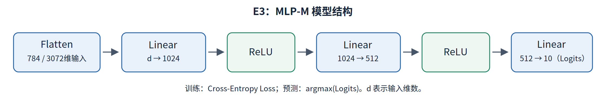
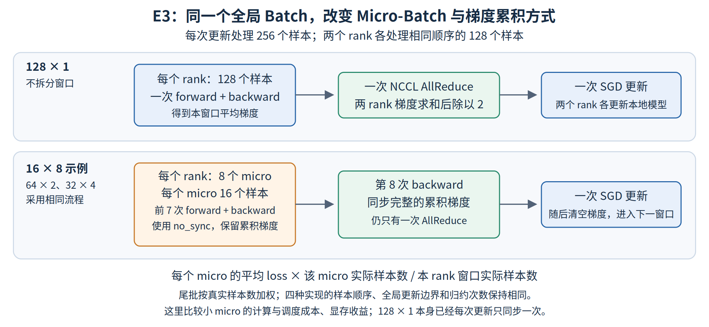
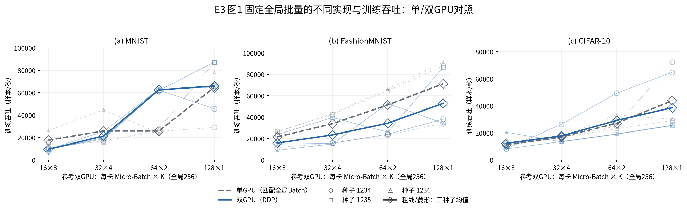
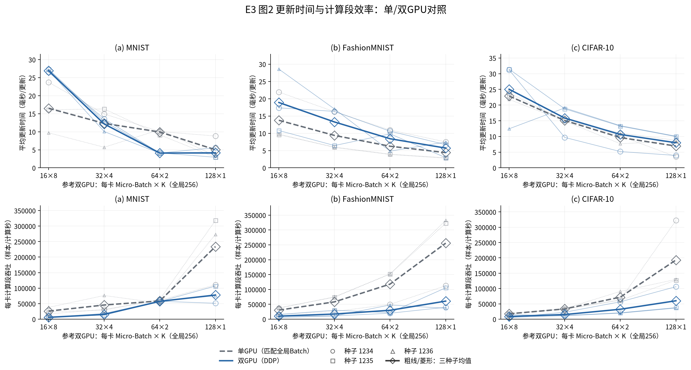
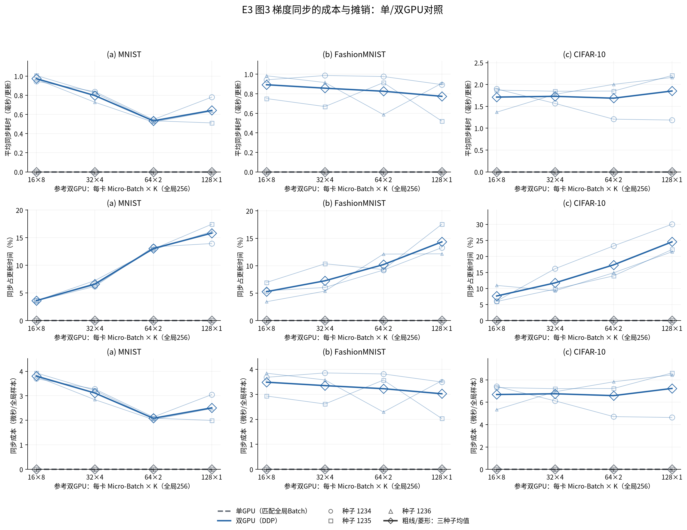
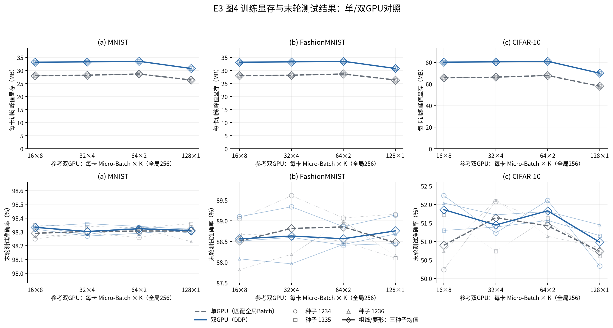
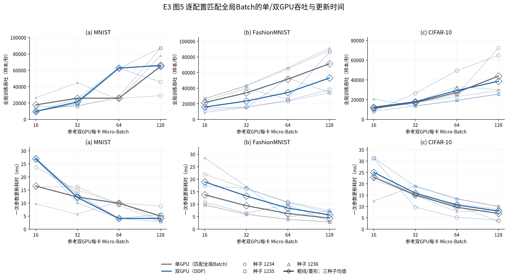
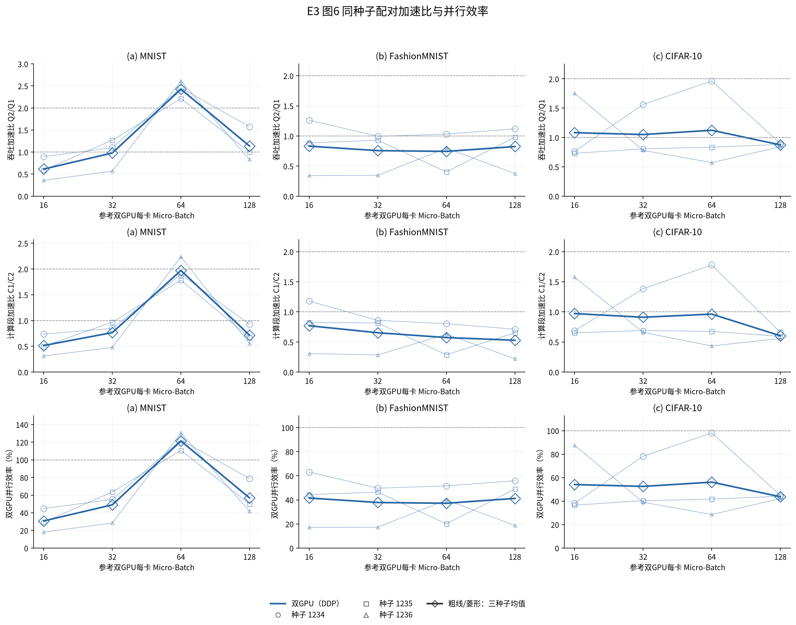
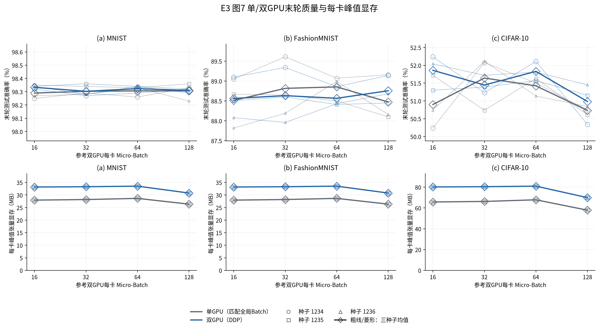

# E3：固定全局批大小，研究Micro-Batch与梯度累积的实现成本

## 1. 实验问题与控制变量

本实验对应实验B。在两张GPU和全局batch=256固定的条件下，只改变每卡micro-batch与对应的累积次数，观察相同一次全局更新的计算效率、吞吐、显存和同步开销。全局batch定义为`GPU数×每卡micro-batch×累积次数`。

| GPU数 | 每卡Micro-Batch | 累积次数K | 每卡每次更新样本 | 全局Batch |
|---:|---:|---:|---:|---:|
| 2 | 128 | 1 | 128 | 256 |
| 2 | 64 | 2 | 128 | 256 |
| 2 | 32 | 4 | 128 | 256 |
| 2 | 16 | 8 | 128 | 256 |

MNIST、FashionMNIST、CIFAR-10分别使用三个种子1234、1235、1236，双GPU与匹配单GPU各36次训练，每次20轮。每个数据集和种子下，四种配置的训练/验证划分、样本顺序、全局更新窗口和参数更新次数相同，学习率不变。模型不包含BatchNorm、Dropout或依赖micro-batch统计、随机掩码的层。

### 模型与训练设置



模型固定为E0的MLP-M：两个Linear隐藏层1024→512、ReLU、10类Logits。MNIST、FashionMNIST输入784维、参数1,333,770个、FP32梯度载荷5.335 MB；CIFAR-10输入3072维、参数3,676,682个、梯度载荷14.707 MB。只改变批量的实现，不改变网络结构或同步张量大小。

数据划分、预处理与E0相同：官方训练集按类别分层留10%验证，划分种子1234，原始图像FP32/255并展平，不使用增强。MNIST、FashionMNIST分别使用54,000训练样本、6,000验证样本，CIFAR-10使用45,000与5,000；三个官方测试集均为10,000个样本。数据读取由独立顶层`Data/`提供。

固定FP32，禁用TF32、AMP、梯度压缩和编译。SGD momentum=0.9，MNIST/FashionMNIST学习率0.1，CIFAR-10为0.05；不按micro-batch或累积次数缩放学习率。双卡各一个进程，主机计算线程每进程4，DataLoader worker=0，评估batch=1024。NCCL阻塞式同步，梯度桶容量25 MiB，每次更新恰好一次完整梯度AllReduce。

四种配置都沿用DDP默认的`gradient_as_bucket_view=False`，窗口间使用`zero_grad(set_to_none=True)`。不为某个累积档位额外启用节省梯度或通信桶显存的选项，以免同时改变实现参数。[PyTorch DDP参数说明](https://docs.pytorch.org/docs/2.15/generated/torch.nn.parallel.DistributedDataParallel.html)

固定20轮、不早停、不恢复验证最优模型，每轮只验证，20轮后才测试并保存末轮模型。训练保留尾批，所以四种实现每轮都使用相同的全部训练样本。MNIST、FashionMNIST每轮211次更新，20轮4,220次；CIFAR-10每轮176次，20轮3,520次。

## 2. 如何保证累积比较公平



每个rank先按相同采样顺序形成最多128个样本的更新窗口，再在主机侧切成micro-batch，逐片传入GPU。这保证128×1、64×2、32×4、16×8处理的是同一全局样本组；各轮每个rank的采样顺序哈希保存在`sampling_rank0/1.json`。

窗口开始只清空一次梯度，前K−1个micro-batch的forward、backward都包在`no_sync()`内，最后一个micro-batch完成反向时才同步累计梯度，随后执行一次SGD更新。每个micro使用平均交叉熵，并乘以`该micro实际样本数/本rank窗口实际样本数`。完整窗口等价于loss除以K；尾批则按实际样本数加权。[PyTorch DDP no_sync说明](https://docs.pytorch.org/docs/2.15/generated/torch.nn.parallel.DistributedDataParallel.html#torch.nn.parallel.DistributedDataParallel.no_sync)

例如CIFAR-10末次全局窗口200个样本，每个rank100个：每卡micro=64时分成64+36，权重分别为0.64、0.36；micro=16时为6个16和最后4个，共7次反向。不能将这些尾批统一除以配置中的K=2或8。两rank样本数相同，NCCL求和后除以2，得到该全局窗口的样本平均梯度。

四种实现每次参数更新均只同步一次，完整训练的归约次数和每次载荷也相同。增加K减少的是“每个micro-batch都同步”的情况；在本实验128×1的大batch参照下，没有额外减少全局更新的通信次数。因此观察到的差别主要来自micro-batch计算、数据传输、调度、显存及进程到达同步点的差异。

理想算术下四种配置的更新梯度等价；FP32的矩阵乘、求和顺序与舍入可能不同，长程训练不要求参数逐位相同。前置测试在CUDA/NCCL下逐次比较梯度与包含momentum的参数更新，并覆盖不等长尾批。末轮参数和测试结果差异另用`compare_implementations.py`记录，不能用末轮差异代替逐步等价性检查。

## 3. 指标与测量方式

一次更新包含整个累积窗口：全部micro-batch的数据准备、前向反向、最后一次梯度同步，以及一次优化器更新。不能用单个micro-batch的耗时冒充一次参数更新时间。

`T更新 = T数据 + T计算 + T同步 + T优化器 + T其他`。

CUDA边界显式等待，通信hook阻塞归约并平均梯度。前向反向时间扣除同步段；“其他”保留窗口控制、切片、上下文切换等未包含在前四段中的成本。两个rank分别记录，每次更新选整体耗时最大的rank的整行分段。计时不包含文件写入、样本顺序哈希、逐轮损失归约、验证、最终测试和模型保存。

前10次更新及所有尾批参与训练，但排除性能统计；四种实现筛选后采用相同完整窗口数。记累计更新、计算、同步毫秒数为`T、C、S`，计时样本数为`N`、更新数为`U`。

| 指标 | 定义 | 研究含义 |
|---|---|---|
| 训练吞吐 | `1000N/T`，样本/秒 | 主指标，比较相同全局工作量的不同实现 |
| 平均参数更新时间 | `T/U`，ms | 一个完整累积窗口加一次SGD的成本 |
| 相对基线吞吐 | 相同种子的`Q配置/Q128×1` | 先配对再取三种子均值，衡量实现开销 |
| 每卡计算段吞吐 | `1000(N/2)/C`，样本/计算秒 | 比较相同样本量拆成小micro后的计算段效率；不是SM利用率 |
| 计算与其他开销 | `C/U`及`T其他/U`，ms | 观察多次前向反向和更多窗口控制成本 |
| 同步耗时与占比 | `S/U`、`S/T×100%` | 查看同步的暴露成本，含进程等待，限定于阻塞同步实现 |
| 每样本同步成本 | `1000S/N`，微秒/全局样本 | 相同全局batch下的同步摊销，归约次数与载荷保持不变 |
| 每卡训练峰值显存 | 各rank训练分段内`max_memory_allocated`的最大值，MB | 检查micro-batch缩小是否降低激活等张量的显存需求 |
| P50/P95更新时间 | 单次运行内逐更新分位数 | 检查更新时间波动，不作为独立训练重复 |
| 末轮参数与测试差异 | 相对128×1的参数最大绝对差、相对L2差、测试损失/准确率差 | 记录实际浮点训练结果差异 |

MLP-M参数、梯度和SGD动量的基础显存不随micro-batch改变，因此显存未必按micro-batch比例下降。这里的峰值是框架跟踪的张量分配，不包含全部驱动、NCCL外部分配，也不等于`nvidia-smi`整卡占用。

三个种子各自计算运行指标，再等权取均值、样本标准差和观测范围；比值先逐种子配对计算。图1—4以灰色表示单GPU、蓝色表示双GPU，圆/方/三角对应三个种子，同色粗线/菱形为均值，单GPU均值为虚线、双GPU为实线，不画置信区间。硬件条件见`environment.json`；未锁频、未控制宿主机调度，波动需结合种子读取。显式同步计时不能外推为充分重叠计算通信时的最优DDP吞吐。

实测环境为32个虚拟CPU的KVM虚拟机、两张RTX 4090，双卡PHB拓扑，GPU0到GPU1的P2P访问不可用。计算段记录包含主机发起与CUDA等待的墙钟时间，不是纯kernel执行时间；性能离散也不能只解释为训练种子差异。

## 4. 如何运行与复核

所有命令在项目根目录执行：

```bash
uv sync --locked
uv run python -m E3.run --list
CUDA_VISIBLE_DEVICES=0,1 NCCL_DEBUG=WARN uv run python -m E3.run
uv run python -m E3.run --resume

# 重跑另选目录
uv run python -m E3.run --output-dir E3/results/new_run

uv run python -m E3.evaluate --checkpoint E3/results/mnist/b16_k8/seed1234/checkpoint.pt --split validation --device cuda:0
uv run python -m E3.evaluate --checkpoint E3/results/mnist/b16_k8/seed1234/checkpoint.pt --split test --device cuda:1

uv run pytest E3/tests -q
uv run python -m E3.check_results
uv run python -m E3.compare_implementations
uv run python -m E3.plot_results
```

`--dataset`、`--batch`和`--seed`可筛选调试组合；核验、参数比较与绘图支持`--results-dir`。已有同名运行时拒绝覆盖。每个运行位于`{数据集}/b{micro}_k{累积}/seed{种子}/`，单独保存配置、数据划分、逐rank采样与计时、每轮训练验证、显存、最终测试和检查点。所有模型计算使用CUDA，多卡通信使用NCCL，缺少GPU时报错，不回退CPU。

联合前置检查14项通过，其中E3为8项，包括四种累积方式的完整梯度、尾批加权、momentum参数更新及末轮测试隔离，见 [preflight.json](preflight.json)。

## 5. 实测结果

36次双GPU训练均完成。下表为三个种子的“均值±样本标准差”，`n=3`；吞吐单位为千样本/秒，比例与准确率的标准差单位为百分点。同一配置的显存峰值在三个种子间完全相同，显存列只列均值。

| 数据集 | Micro-Batch×K | 吞吐（千样本/秒） | 更新时间（ms） | 同步占比（%） | 峰值显存（MB） | 测试准确率（%） |
|---|---:|---:|---:|---:|---:|---:|
| MNIST | 128×1 | 65.96±20.78 | 4.16±1.35 | 15.82±1.76 | 30.79 | 98.31±0.02 |
| MNIST | 64×2 | 62.54±0.59 | 4.09±0.04 | 13.04±0.26 | 33.54 | 98.32±0.03 |
| MNIST | 32×4 | 21.42±3.54 | 12.15±1.86 | 6.62±0.55 | 33.31 | 98.30±0.05 |
| MNIST | 16×8 | 9.50±0.16 | 26.94±0.45 | 3.62±0.06 | 33.20 | 98.33±0.01 |
| FashionMNIST | 128×1 | 52.97±29.07 | 5.71±2.41 | 14.35±2.84 | 30.79 | 88.76±0.35 |
| FashionMNIST | 64×2 | 34.36±16.07 | 8.42±3.13 | 10.21±1.66 | 33.54 | 88.57±0.25 |
| FashionMNIST | 32×4 | 23.45±14.03 | 13.27±5.91 | 7.26±2.71 | 33.31 | 88.63±0.69 |
| FashionMNIST | 16×8 | 15.81±7.43 | 18.90±8.98 | 5.28±1.76 | 33.20 | 88.56±0.51 |
| CIFAR-10 | 128×1 | 38.63±22.65 | 8.00±3.50 | 24.54±4.77 | 69.94 | 50.98±0.58 |
| CIFAR-10 | 64×2 | 29.23±17.44 | 10.64±4.72 | 17.37±5.14 | 80.98 | 51.83±0.27 |
| CIFAR-10 | 32×4 | 17.81±7.45 | 15.86±5.34 | 11.76±3.83 | 80.46 | 51.45±0.25 |
| CIFAR-10 | 16×8 | 12.30±7.16 | 25.04±10.91 | 7.67±2.87 | 80.20 | 51.86±0.50 |

逐种子记录见 [final.csv](final.csv)，所有指标的均值、标准差与范围见 [seed_summary.csv](seed_summary.csv)。吞吐和同步占比先逐运行计算，再跨种子汇总；均值的倒数、两个均值的比值通常不等于这些指标的跨种子均值。

以下相对吞吐先在同一种子内除以128×1，再求三种子均值和样本标准差，基线恒为1。它与“两个平均吞吐相除”是不同统计量，详见 [paired_relative.csv](paired_relative.csv)。

| 数据集 | 64×2相对吞吐 | 32×4相对吞吐 | 16×8相对吞吐 |
|---|---:|---:|---:|
| MNIST | 1.016±0.329 | 0.345±0.101 | 0.155±0.053 |
| FashionMNIST | 0.825±0.641 | 0.436±0.024 | 0.307±0.069 |
| CIFAR-10 | 0.754±0.007 | 0.489±0.070 | 0.418±0.353 |

### 图1：相同全局Batch的训练吞吐



三列(a)、(b)、(c)依次为MNIST、FashionMNIST、CIFAR-10。横轴标注双GPU参考的“每卡micro×K”，从16×8到128×1；对应单GPU实际配置为32×8、64×4、128×2、256×1。灰、蓝两组均固定全局batch256、相同K和更新窗口，纵轴为全局训练样本/秒。每组保留三个种子与均值；横轴改变实现方式，不改变每次更新的样本数。

双GPU三个数据集的最高平均吞吐均出现在128×1，但不能据此断言每次运行都如此。64×2在MNIST的配对均值接近1，FashionMNIST离散较大，CIFAR-10三个种子均约为双卡128×1基线的75%。32×4和16×8在全部九个配对中都慢于双卡128×1。灰线用于区分单卡实现成本，卡数带来的收益在同一横坐标下比较，并按图6的配对比值读取。

### 图2：完整累积窗口的更新时间与计算效率



三列对应三个数据集，横轴与图例同图1。上排为完整参数更新的平均耗时（ms），包含K次前向反向及一次SGD；同一横坐标的灰、蓝两组处理相同256样本。下排为每GPU计算段吞吐（样本/计算秒），单卡每窗口按256样本、双卡按每卡128样本计算。它反映各自批形状的局部效率，不能直接当作全局吞吐加速比。

双GPU的128×1→16×8时，MNIST、FashionMNIST、CIFAR-10平均计算段耗时分别由1.80→21.48、2.63→14.70、2.71→17.92 ms；每卡计算段吞吐分别由77.85→5.96、60.77→10.29、60.03→8.70千样本/计算秒。每次全局更新样本数未变，更多小矩阵运算与forward/backward调用增加了计算段墙钟时间。

双GPU窗口控制与数据传输也有额外成本：128×1→16×8时，平均“其他”段由0.043→0.290、0.064→0.192、0.079→0.246 ms，数据段由1.28→3.43、1.64→2.59、2.67→4.45 ms，均计入完整更新时间。双卡各rank先取128样本窗口、单卡取256样本窗口，再按各自micro切片传入GPU；这里的成本不能直接套用于其他DataLoader组织方式。

### 图3：归约次数相同时的同步成本



三列对应三个数据集，横轴与图例同图1。上排为跨卡同步耗时（ms/更新），中排为其占更新时间的百分比，下排为每个全局样本的同步微秒。单GPU三项均为0，三个种子与均值重合。双GPU四档每次归约载荷和全局样本数相同，下排严格等于上排乘以1000/256，不是独立通信测量。双卡同步占比下降也可能只是分母计算时间增加，需结合图2解释。

128×1→16×8时，同步占比分别由15.82%→3.62%、14.35%→5.28%、24.54%→7.67%；平均同步耗时却分别为0.642→0.974、0.774→0.892、1.851→1.712 ms，并未随K增加按比例减少。因此这里较低的同步占比主要伴随更长的完整更新时间，不能作为通信优化成功的证据。

完整训练中，MNIST/FashionMNIST每次运行均为4,220次梯度归约，CIFAR-10均为3,520次；各配置载荷固定。每个全局样本的逻辑梯度载荷也固定，前两数据集为20.84 kB、CIFAR-10为57.45 kB（十进制），并不随K改变；这仍不是实际链路字节数。

### 图4：显存收益与最终训练结果



三列对应三个数据集，横轴与图例同图1。上排为每卡训练峰值张量显存（MB），单卡取唯一设备，双卡取两rank较大值；下排为第20轮模型测试准确率（%），按单、双卡全部观测范围显示。单卡micro是双卡每卡值的两倍，双卡还包含DDP缓冲，显存必须按实测MB比较。准确率记录有限精度下的轨迹差异，不能替代逐步梯度等价性检查。

双GPU的MNIST三个种子峰值显存一致：128×1为30.79 MB，64×2、32×4、16×8分别为33.54、33.31、33.20 MB。由64减到16时累积实现内部的峰值略降，但双卡四档中总峰值最低的是128×1。本模型不能用“micro越小就越省总显存”概括。

双GPU的FashionMNIST与MNIST显存数值相同；CIFAR-10四档依次为69.94、80.98、80.46、80.20 MB，也呈现相同关系。全部配置峰值均远低于显存容量上限，不能从本实验推断大模型显存不足时应采用的micro-batch。

从实现机制看，累积期间已有的`.grad`会保留，新反向梯度再加到其中；DDP同时使用通信桶，且本实验没有启用梯度桶视图。小micro减少激活，不会删除这些梯度和缓冲。安装版本的[梯度累积实现](provenance/reference/accumulate_grad.h)保存在源码参考中。这是总峰值未必下降的机制解释，本实验没有进行逐分配显存追踪，不能据此把全部差额精确归因到某一种张量。结果也不能外推到激活显存远大于本MLP的模型。

### 末轮参数与测试差异

下表比较每种累积实现与同一种子的128×1。每个数据集合并三种累积方式和三个种子，共9对；前两列取最大值，后两列为最小—最大范围，均不是跨种子均值。相对L2差定义为`||参数配置−参数基线||₂ / ||参数基线||₂`，绝对差为所有参数元素差值绝对值的最大值。

| 数据集 | 最大参数绝对差 | 最大相对L2差 | 准确率差范围（百分点） | 测试损失差范围 |
|---|---:|---:|---:|---:|
| MNIST | 0.100992 | 0.155343 | -0.05～+0.05 | -0.000896～+0.001847 |
| FashionMNIST | 0.799906 | 0.549407 | -0.72～+0.20 | -0.014106～+0.019858 |
| CIFAR-10 | 1.040169 | 0.874425 | +0.14～+1.90 | -0.052339～+0.017331 |

完整逐实现、逐种子记录见 [implementation_differences.csv](implementation_differences.csv)，比较操作在GPU上执行。参数差异并非接近零，不能将20轮后的模型描述为逐位一致或参数近似相同；即使测试准确率接近，参数也可能已经明显偏离。不同micro-batch形状改变矩阵运算和求和的有限精度路径，微小差异可能沿ReLU与SGD训练轨迹放大；这不等于对所有末轮差异做了精确因果归因。

本次CIFAR-10的累积实现测试准确率差均为正，MNIST和FashionMNIST则有正有负。这里记录实际训练结果，不据三个种子将其解释成梯度累积带来的稳定泛化收益。单步梯度是否正确，应在完全相同的参数与动量状态下另行核验，而不是要求两条已分叉的训练轨迹每一步都相同。

### 真实窗口的单步数值诊断

正式训练结束后，另外在双GPU/NCCL上检查三个数据集、四种实现的首个完整窗口与真实尾批，种子固定1234。两个rank合计48条记录，这些是诊断窗口，不计入36次正式训练，也不用于性能统计。先处理首个完整窗口，再直接处理采样顺序末尾的窗口；每次比较前都将参考模型的参数和momentum与被检模型完全对齐。

FP32路径直接调用正式训练的`backward_window`，参考模型在相应GPU上一次处理同一全局窗口。另用GPU FP64重复“按实际样本数加权累积、跨rank平均”与完整全局批的梯度比较，要求`rtol=1e-9、atol=1e-11`。FP64检查48条全部通过。

| 数据集 | FP32最大梯度绝对差 | FP32最大梯度相对L2差 | FP32单步最大参数绝对差 | FP64最大梯度相对L2差 |
|---|---:|---:|---:|---:|
| MNIST | 7.451e-9 | 2.076e-7 | 3.725e-9 | 4.303e-16 |
| FashionMNIST | 7.063e-5 | 1.306e-3 | 7.063e-6 | 4.239e-16 |
| CIFAR-10 | 5.704e-9 | 4.052e-7 | 3.725e-9 | 8.288e-16 |

表中每列都取该数据集16条诊断记录的最大值。完整结果见 [numerical_equivalence.csv](numerical_equivalence.csv)。FP32逐元素检查采用`rtol=5e-4、atol=3e-6`，46条满足，2条未满足；后者是FashionMNIST的128×1首个完整窗口，在两个rank上各记一条，不能写成FP32所有元素均满足阈值。

进一步的GPU诊断定位到该窗口第46号样本、第一隐藏层第953号单元：按128样本计算的激活前值为`+2.980e-8`，按256样本计算为`-7.451e-9`，FP64为`-1.727e-8`。两种FP32批形状使同一参数和样本落在不同ReLU分支，见 [ReLU诊断](relu_numerical_diagnostic.json)。这一实例解释了该窗口的逐元素差异；FP64梯度结果则支持所检窗口的累积归一化正确。它不等于对全部20轮参数差异做了逐运算追踪。

运行诊断：`uv run python -m E3.verify_numerics`。诊断会额外使用FP64作数值参考，正式训练仍全部为FP32。复现代码保留在`provenance/analysis_source/`，完整检查日志见 [numerical_equivalence.log](numerical_equivalence.log)，不混入正式性能统计。

### 单、双GPU性能与并行收益

单GPU分别采用micro256×累积1、128×2、64×4、32×8，与双GPU对应的每卡128×1、64×2、32×4、16×8逐项匹配。全部全局batch为256，保持同种子、同全局样本顺序、同更新窗口及尾批，沿用20轮与原优化器设置，共36次独立单卡训练。每个micro按实际样本数加权loss，窗口末只进行一次SGD；单卡没有跨卡归约。

这里同时固定全局batch与累积次数，仅按GPU数改变实际单卡micro大小。因此比较的是每种实现对应的单、双GPU执行成本，不能用一份256×1的单卡耗时替代其余三种累积配置。更小micro的额外forward/backward调用在单、双卡中均保留。

同一种子先计算吞吐加速比`S=Q双卡/Q单卡=T单卡/T双卡`、计算段加速比`C单卡/C双卡`和并行效率`S/2`，再跨三个种子取均值及样本标准差。C是前向反向墙钟，双卡取整体更新较慢rank的计算段，包含主机发起与CUDA等待；不是纯kernel加速比。`1−1/S`为时间节省比例，`2/S`为两卡相对单卡的GPU分配时间成本比，完整值保存于`scaling.csv`。

单卡每进程4个主机线程，双卡为两个进程各4个；卡数变化同时增加主机线程总预算。单、双GPU分时采集，宿主调度和频率未锁定，跨时段波动限制了精确加速比的解释。FP32批形状与求和顺序仍可能改变最终训练轨迹；单步数学正确性与20轮后参数差异分别检查。性能采集与GPU复测、压缩导出、绘图分别执行。

36次单GPU训练及36个末轮模型的CUDA独立复测均完成，采样哈希、20轮样本数、每次更新的样本窗口、尾批、测量标记和零次跨卡归约均核验通过，见[单GPU核验](single_gpu/validation.json)。单卡数值检查采用FP32相对L2误差，并结合GPU FP64独立梯度与动量更新参考。正式训练保持FP32；逐元素阈值和ReLU分支差异的限制见本节“真实窗口的单步数值诊断”，检查日志保存在`single_gpu/`。

下表为三个种子的均值±样本标准差，吞吐单位为千样本/秒。配置列指双卡的每卡micro×累积K，单卡micro是它的两倍。每行的加速比先同种子配对计算。

| 数据集 | 配置 | 单GPU吞吐 | 双GPU吞吐 | 吞吐加速比 | 计算段加速比 | 并行效率（%） |
|---|---|---:|---:|---:|---:|---:|
| MNIST | 128×1 | 64.67±31.22 | 65.96±20.78 | 1.137±0.389 | 0.717±0.191 | 56.8±19.4 |
| MNIST | 64×2 | 25.88±1.94 | 62.54±0.59 | 2.427±0.199 | 1.972±0.235 | 121.3±10.0 |
| MNIST | 32×4 | 25.88±16.42 | 21.42±3.54 | 0.980±0.367 | 0.766±0.255 | 49.0±18.3 |
| MNIST | 16×8 | 17.69±7.94 | 9.50±0.16 | 0.615±0.269 | 0.516±0.213 | 30.7±13.5 |
| FashionMNIST | 128×1 | 71.23±32.20 | 52.97±29.07 | 0.825±0.395 | 0.529±0.268 | 41.2±19.7 |
| FashionMNIST | 64×2 | 51.49±24.33 | 34.36±16.07 | 0.744±0.318 | 0.574±0.262 | 37.2±15.9 |
| FashionMNIST | 32×4 | 33.94±15.74 | 23.45±14.03 | 0.757±0.357 | 0.654±0.320 | 37.8±17.8 |
| FashionMNIST | 16×8 | 21.54±8.54 | 15.81±7.43 | 0.831±0.463 | 0.770±0.438 | 41.5±23.2 |
| CIFAR-10 | 128×1 | 43.84±24.64 | 38.63±22.65 | 0.874±0.027 | 0.604±0.050 | 43.7±1.4 |
| CIFAR-10 | 64×2 | 27.18±5.40 | 29.23±17.44 | 1.123±0.739 | 0.964±0.717 | 56.2±37.0 |
| CIFAR-10 | 32×4 | 16.98±0.18 | 17.81±7.45 | 1.051±0.445 | 0.911±0.410 | 52.5±22.2 |
| CIFAR-10 | 16×8 | 11.20±0.51 | 12.30±7.16 | 1.082±0.580 | 0.972±0.525 | 54.1±29.0 |

本组没有统一的两倍吞吐收益。MNIST的64×2观察到2.427倍的平均吞吐比及121.3%的并行效率，但单卡与双卡主机线程预算不同且分时采集，不能将其解释为纯GPU算力的稳定超线性扩展。MNIST的16×8平均吞吐比为0.615，FashionMNIST四档均值均小于1。CIFAR-10的后三档比值均值接近1，但种子波动较大；不能据小幅均值差排列确定的最优实现。

最终测试准确率的双卡减单卡差值范围为：MNIST −0.04至0.07个百分点，FashionMNIST −0.56至0.52个百分点，CIFAR-10 −0.85至2.00个百分点。相同数学更新预算并不保证FP32长期轨迹或最终模型完全一致，质量结果与性能一起保存。

### 图5：单、双GPU吞吐与更新时间



三列为MNIST、FashionMNIST、CIFAR-10。横轴是双GPU参考的每卡micro，16、32、64、128分别对应K=8、4、2、1，全部全局batch256；单卡实际micro为横轴的两倍。上排为全局样本/秒，下排为ms/完整SGD更新，包含K次forward/backward及一次SGD。灰色表示单GPU，蓝色表示双GPU；圆、方、三角为三个种子，粗线/菱形为各配置三次运行的均值，无置信区间。

### 图6：吞吐与计算段加速比、并行效率



横轴、数据集和种子标记沿用图5。上排为双卡/单卡吞吐比，中排为单卡/双卡计算段耗时比，下排为两卡归一化效率（%）。粗线是三个同种子比值的均值；虚线1、2表示无收益和理想两倍，效率100%为理想线性参照。超过参考线的观测完整保留，不能读作SM利用率。

### 图7：末轮质量与每卡显存



横轴、颜色和种子标记同图5。上排为20轮末模型完整测试集准确率（%），下排为每卡训练峰值张量显存（十进制MB），双卡取两rank较大值。小micro的激活、累积梯度和DDP缓冲共同决定总峰值，不能只按micro大小推断图中显存；准确率纵轴按实测范围显示。

36对明细、汇总和工作量复算分别见 [scaling.csv](scaling.csv)、[scaling_summary.csv](scaling_summary.csv)、[scaling_validation.json](scaling_validation.json)。三个种子与均值的源CSV及坐标范围见 [对照图核验](scaling_figure_validation.json)。

## 6. 核验与结论

72次单、双GPU运行均通过原始记录复算和末轮模型CUDA独立复测，测试准确率一致、损失在核验容差内一致。各配置完整训练20轮、保留全部训练样本，并保持相同全局更新窗口；双卡每次更新归约一次，单卡无跨卡归约。见[双卡核验](validation.json)与[单卡核验](single_gpu/validation.json)。

双GPU的128×1与E2相同配置独立运行，九对末轮参数在GPU上逐位一致，验证与测试指标也相同，见[基线核对](baseline_agreement.json)。性能分别使用各实验自己的实测记录。

七张统计图保留单、双GPU各组的三个种子与均值，图1—4的数据和配对来源见[main_comparison.csv](main_comparison.csv)、[来源核验](main_comparison_sources.json)，图5—7见[scaling.csv](scaling.csv)。曲线与图片校验分别保存在[图1—4核验](figure_validation.json)、[图5—7核验](scaling_figure_validation.json)。

本MLP与阻塞同步实现中，将双GPU固定全局256拆为32×4或16×8会降低吞吐；较低同步占比主要伴随更长的更新时间，没有减少归约次数。相同实现的单、双卡对照也未显示统一的两倍收益。性能波动、FP32批形状及主机资源预算限制了精确排序，结果不能直接外推到激活显存更大或计算通信充分重叠的模型。

## 7. 逐步记录与复现

单、双GPU共72次完整训练，逐步导出保存430,560条rank观测及287,040次全局更新。每行显式给出实测毫秒、实际样本数、样本/秒、同步类型、次数与逻辑载荷，并能追溯原CSV；单卡跨卡归约为0。预热与尾批保留，计时汇总标记另列。详见 [逐步审计](step_metrics/audit.json)。

E3单卡256×1与E2独立训练的相同单卡配置共9对末轮模型在CUDA上逐位一致，见[控制比较](gpu_control_comparisons.json)。单卡360个原始文件的[哈希清单](single_gpu/original_gpu_files_sha256.json)与[压缩CSV往返核验](step_metrics/roundtrip_validation.json)分别保护模型记录和逐步导出；双卡504个原始文件由本目录对应清单保护。

在项目根目录执行；单卡结果独立保存于`E3/results/single_gpu/`，重跑使用新的`--output-dir`。

```bash
CUDA_VISIBLE_DEVICES=0 OMP_NUM_THREADS=4 MKL_NUM_THREADS=4 uv run python -m E3.single_gpu.run --list
CUDA_VISIBLE_DEVICES=0 OMP_NUM_THREADS=4 MKL_NUM_THREADS=4 uv run python -m E3.single_gpu.run --resume
uv run pytest E3/single_gpu/tests -q
uv run python -m E3.single_gpu.check_results
uv run python -m E3.single_gpu.compare
uv run python -m E3.single_gpu.plot_results
uv run python -m E3.evaluate --checkpoint E3/results/single_gpu/mnist/ref64/seed1234/checkpoint.pt --split validation --device cuda:0
uv run python -m E3.evaluate --checkpoint E3/results/single_gpu/mnist/ref64/seed1234/checkpoint.pt --split test --device cuda:0
```
