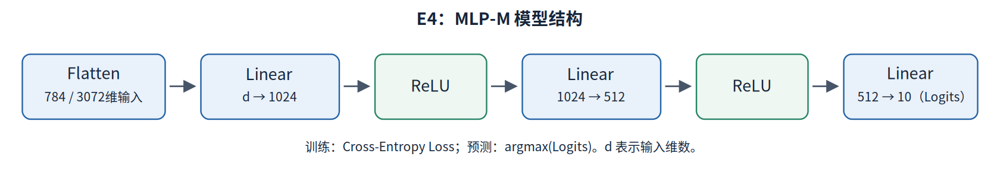
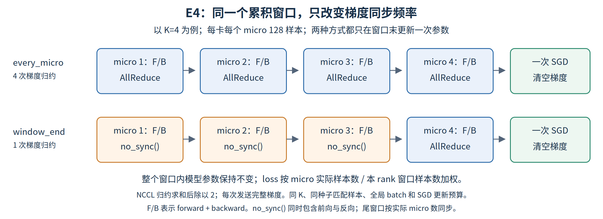
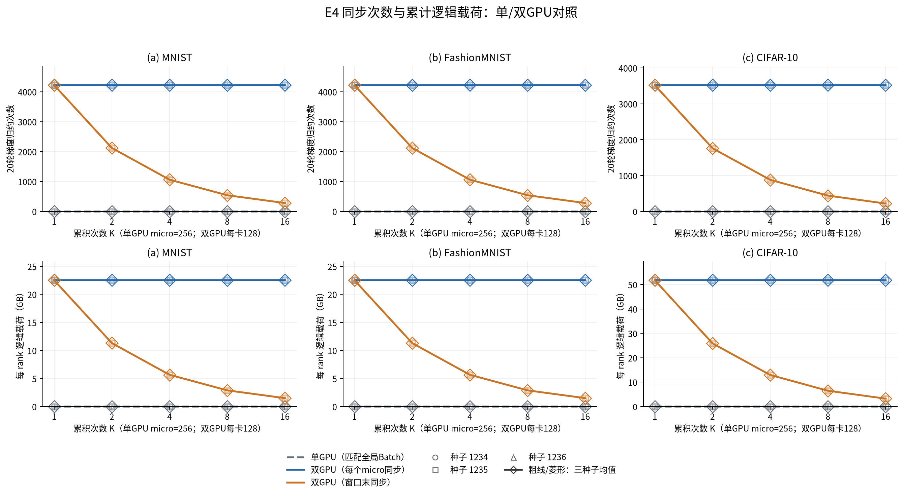
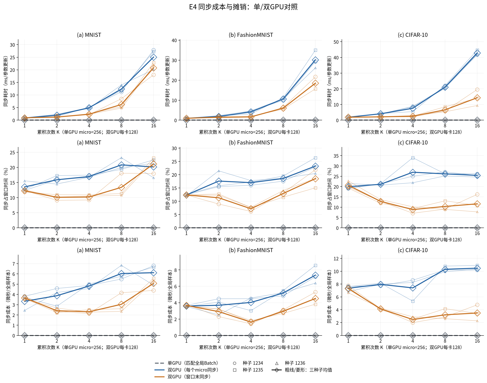
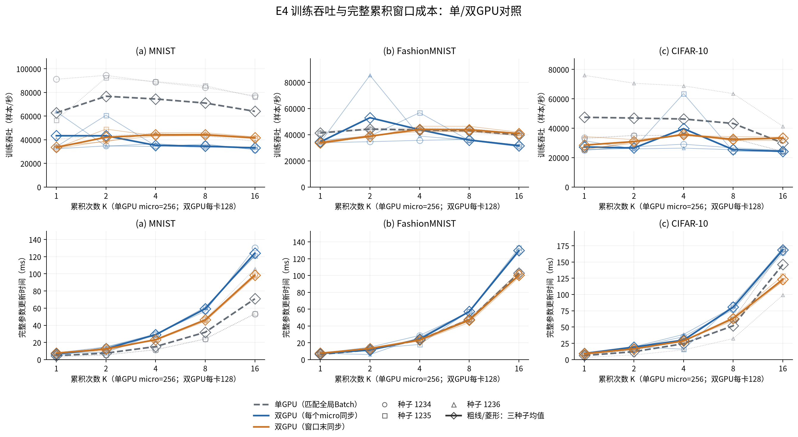
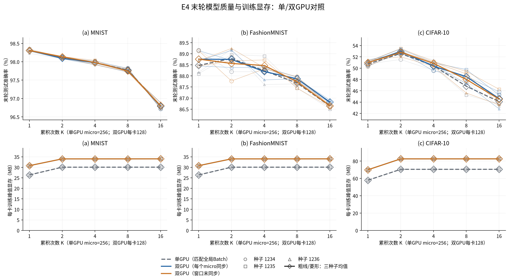
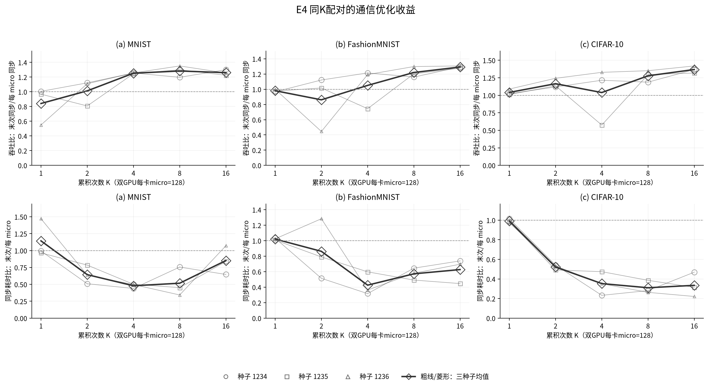
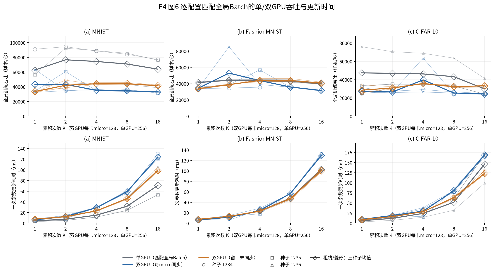
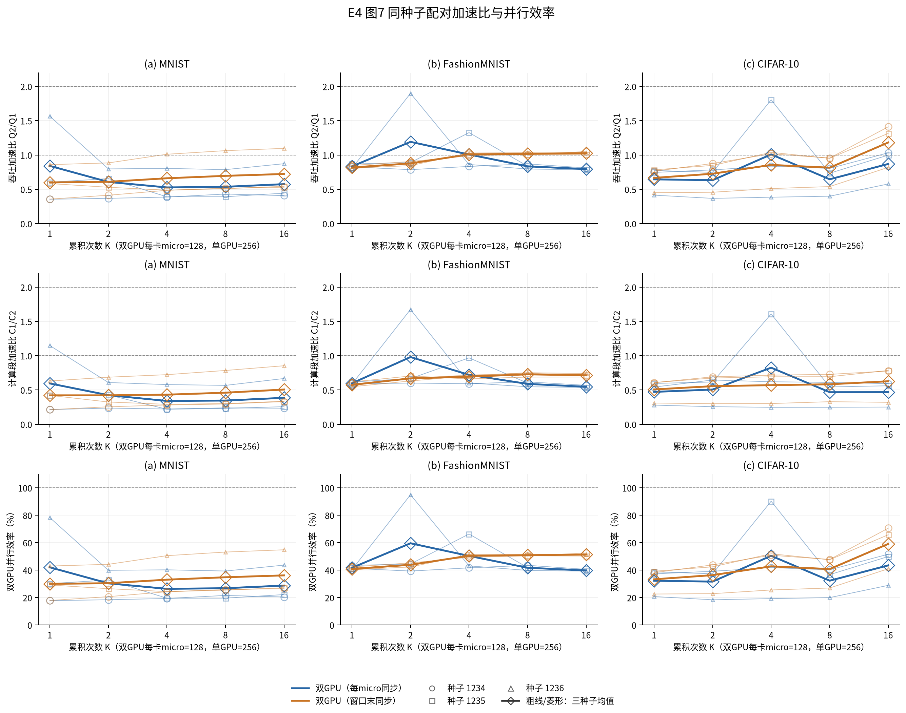
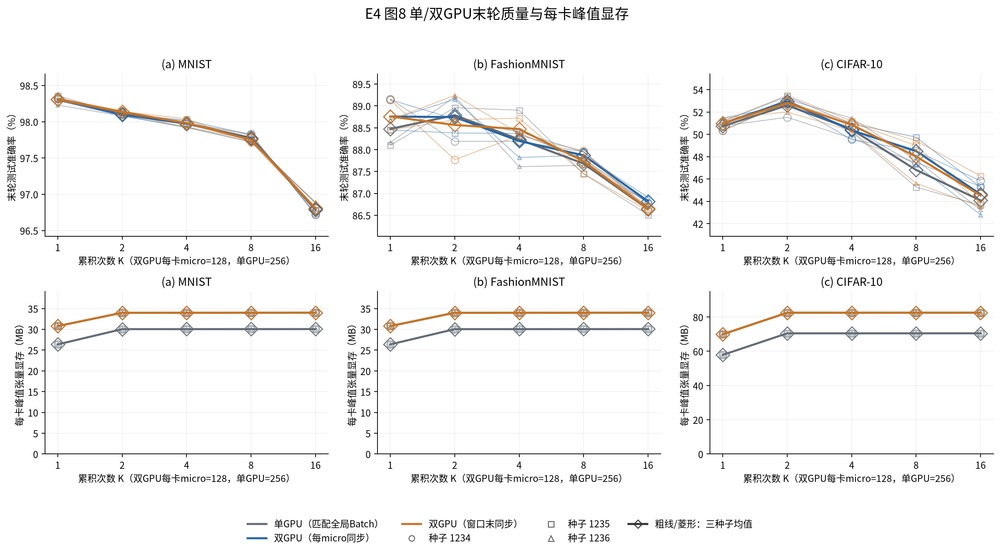

# E4：验证梯度累积中的通信优化

## 1. 研究问题

本实验检验`no_sync()`是否减少梯度累积的通信成本。在相同累积次数K下，配对两种实现：

| 实现 | 梯度同步 | 参数更新 |
|---|---|---|
| every_micro | 每个Micro-Batch反向均进行NCCL AllReduce | 整个累积窗口结束后更新一次 |
| window_end | 前几个micro使用`no_sync()`，实际最后一个micro才同步累计梯度 | 整个累积窗口结束后更新一次 |

两种实现处理相同样本窗口、采用相同loss权重、学习率和SGD更新次数，只改变同步方式。每个micro平均交叉熵乘以“该micro实际样本数/本rank窗口实际样本数”，尾批也按真实大小加权。`no_sync()`同时包住forward和backward，符合[PyTorch DDP说明](https://docs.pytorch.org/docs/2.15/generated/torch.nn.parallel.DistributedDataParallel.html#torch.nn.parallel.DistributedDataParallel.no_sync)。

这与E3的比较不同：E3四种实现本来都每次参数更新只同步一次；本实验增加“每micro均同步、但不提前更新参数”的匹配参照，才能在同K下隔离同步频率的影响。





## 2. 控制变量与训练协议

固定本机两张RTX 4090，CUDA模型计算、NCCL多进程通信。使用E0的MLP-M：Flatten→Linear(d,1024)→ReLU→Linear(1024,512)→ReLU→Linear(512,10)，输出Logits。MNIST/FashionMNIST输入784维、参数1,333,770个、FP32梯度5.335 MB；CIFAR-10输入3072维、参数3,676,682个、梯度14.707 MB。通信桶25 MiB，同一数据集所有配置均为一个完整梯度桶。

双GPU每卡Micro-Batch固定128，扫描K=1、2、4、8、16；单GPU使用micro256、相同K，保持同一全局Batch和更新窗口。三个数据集、三个种子，两种双卡同步方式共90次训练，匹配单卡45次，共135次，每次20轮。同K两种双卡方式共用一份单卡基线。各种子轮换K顺序并交替同步方式的先后，计时任务串行执行。

| K | 每卡Micro-Batch | 全局Batch=2×128×K | MNIST/FashionMNIST每轮参数更新数 | CIFAR-10每轮参数更新数 |
|---:|---:|---:|---:|---:|
| 1 | 128 | 256 | 211 | 176 |
| 2 | 128 | 512 | 106 | 88 |
| 4 | 128 | 1024 | 53 | 44 |
| 8 | 128 | 2048 | 27 | 22 |
| 16 | 128 | 4096 | 14 | 11 |

MNIST/FashionMNIST每轮54000训练、6000验证，CIFAR-10为45000/5000；官方测试集均10000。官方训练集按类别分层留出10%验证、划分种子1234。顶层Data负责原始读取，FP32像素除以255并展平，CIFAR-10采用HWC顺序，不增强。

固定FP32、禁用TF32/AMP和编译。SGD momentum=0.9，MNIST/FashionMNIST学习率0.1，CIFAR-10为0.05，不随K缩放。每进程4个主机计算线程、DataLoader worker=0，评估batch1024。每轮完整训练包括尾批；每轮仅验证、不早停或恢复最优模型，20轮后用末轮模型测试一次并保存。

同K的两种方式具有相同全局batch及优化预算；跨K时全局batch和参数更新次数都变了，因此准确率的跨K变化不能只归因于通信优化。模型无BatchNorm/Dropout，仍可能因FP32求和顺序出现训练轨迹差异。

## 3. 同步次数、逻辑载荷与计时

完整累积窗口包含K个micro。每micro同步方式进行K次梯度归约，窗口末同步方式只进行一次；数学上的归约次数比例为1/K。尾批按实际micro数量统计，完整训练的比例未必恰好为1/K。

例如MNIST/FashionMNIST的K=16末尾每卡仅376个样本，拆成128+128+120，实际只有3个micro。因此每轮every_micro共211次归约，window_end为14次，20轮分别4220次与280次。CIFAR-10相应为176次与11次，20轮3520次与220次。以上都保留尾批，不靠丢弃数据减少通信。

记录的累计逻辑载荷是“实际归约buffer字节数×训练梯度归约次数”，按每rank统计，包含预热和尾批。它反映通信需求，未测量PCIe链路或网络接口硬件字节数，不能写成实际网络流量。初始化广播、每轮损失小张量归约和验证屏障不计入梯度归约次数；它们也不在逐窗口性能计时内。

每个窗口从取出数据开始，到一次SGD及CUDA等待完成结束。使用阻塞NCCL与显式CUDA等待，计算通信不重叠：

`T窗口 = T数据 + T计算 + T同步 + T优化器 + T其他`。

计算段是前向反向墙钟扣除单独记录的同步hook时间；同步段包含NCCL调用、梯度平均、等待其他rank及设备完成的成本，不是纯链路传输。两个rank各自记录，选整个窗口更慢的rank及其整行分段；不拼接不同rank的分段最大值。

最初16个micro作为预热，参与训练但不计性能。只对预热后的完整窗口统计；不完整窗口仍训练，只排除其固定batch性能。验证、测试、保存、日志写入、样本哈希在计时外。这里的吞吐对应插桩窗口，不是完整程序的总墙钟吞吐。

该筛选随K改变计时覆盖率。MNIST/FashionMNIST的K=1与K=16分别覆盖全部训练样本的99.18%与98.23%，CIFAR-10为99.10%与90.57%。后者K=16的尾窗口接近完整窗口大小，但仍未达到4096个全局样本，故整窗排除。完整训练与模型质量使用100%训练样本；同K的两种同步方式计时样本集合相同。

记测量窗口数U、累计全局样本N、累计更新/计算/同步毫秒T/C/S：

| 指标 | 定义与单位 | 含义 |
|---|---|---|
| 训练吞吐 | 1000N/T，样本/秒 | 整体处理效率 |
| 平均参数更新时间 | T/U，ms/窗口 | 包含全部micro及一次SGD；跨K窗口样本数不同 |
| 平均同步耗时 | S/U，ms/窗口 | 一次更新窗口内所有梯度归约的累计暴露成本 |
| 同步占比 | S/T×100% | 同步占完整窗口时间的比例 |
| 每样本同步成本 | 1000S/N，微秒/全局样本 | 通信摊销 |
| 每卡计算段吞吐 | 1000(N/2)/C，样本/计算秒 | 计算段效率代理，不是SM利用率 |
| 归约次数与逻辑载荷 | 完整20轮实际计数、每rank字节数 | 验证减少了多少梯度通信操作和需求 |
| 同K配对吞吐比 | Q末次同步/Q每micro同步 | 先按相同种子配对，再汇总，主通信优化指标 |
| 同K同步耗时比 | S每窗口末次/S每窗口每micro | 衡量同步路径成本实际降低多少 |
| 显存与模型质量 | 训练峰值张量MB、末轮测试损失和准确率 | 检查资源代价与训练行为 |

每个种子先计算整次指标，跨三个种子等权取均值、样本标准差和范围。图1—4的灰色为匹配单GPU，蓝色为双GPU每micro同步，橙色为双GPU窗口末同步；圆/方/三角为三个种子，同色粗线/菱形为均值，单卡均值用虚线，不画置信区间。同K两种双卡方式共用一条单卡基线。环境见environment.json；未锁频或控制宿主机调度，配对结果需结合波动读取。

## 4. 运行与核验

在项目根目录执行：

```bash
uv run python -m E4.run --list
CUDA_VISIBLE_DEVICES=0,1 NCCL_DEBUG=WARN uv run python -m E4.run
uv run python -m E4.run --resume
uv run python -m E4.run --output-dir E4/results/new_run
uv run python -m E4.evaluate --checkpoint E4/results/mnist/k4_window_end/seed1234/checkpoint.pt --split validation --device cuda:0
uv run python -m E4.evaluate --checkpoint E4/results/mnist/k4_window_end/seed1234/checkpoint.pt --split test --device cuda:1
uv run pytest E4/tests -q
uv run python -m E4.check_results
uv run python -m E4.plot_results
```

完整前置检查22项通过，其中E4为13项，覆盖五档K、两种方式的加权梯度、窗口一次SGD、真实micro数小于K的尾批、20轮验证/末轮测试隔离，见[preflight.json](preflight.json)。配置位于E4/configs，结果按`{数据集}/k{K}_{方式}/seed{种子}/`保存。已有同名运行拒绝覆盖，未完成目录先归档；结果核验默认GPU独立复测全部末轮模型。

## 5. 实测结果

90次正式运行均完成20轮。下表每格为三个种子的均值±样本标准差；吞吐单位为千样本/秒，同步耗时单位为ms/参数更新窗口。“配对吞吐比”先对同K、同种子求比再平均，不等于前两列均值相除。每次运行的完整数值见[final.csv](final.csv)，分组统计见[seed_summary.csv](seed_summary.csv)，逐种子收益见[paired_comparison.csv](paired_comparison.csv)。

| 数据集 | K | 每micro同步吞吐 | 窗口末同步吞吐 | 配对吞吐比 | 每micro同步耗时 | 窗口末同步耗时 |
|---|---:|---:|---:|---:|---:|---:|
| MNIST | 1 | 43.39±17.65 | 33.51±1.32 | 0.841±0.253 | 0.85±0.20 | 0.94±0.03 |
| MNIST | 2 | 43.34±15.01 | 42.11±5.96 | 1.013±0.178 | 1.98±0.47 | 1.24±0.12 |
| MNIST | 4 | 35.24±1.22 | 44.15±1.63 | 1.253±0.006 | 4.94±0.23 | 2.36±0.19 |
| MNIST | 8 | 34.60±1.49 | 44.31±1.39 | 1.283±0.079 | 12.36±1.44 | 6.22±2.01 |
| MNIST | 16 | 33.03±1.36 | 41.59±0.78 | 1.260±0.038 | 25.06±4.32 | 20.80±2.51 |
| FashionMNIST | 1 | 34.50±0.94 | 33.84±1.01 | 0.981±0.017 | 0.92±0.02 | 0.94±0.03 |
| FashionMNIST | 2 | 52.97±28.12 | 38.82±0.80 | 0.861±0.364 | 1.89±0.53 | 1.49±0.27 |
| FashionMNIST | 4 | 43.79±11.38 | 44.02±2.16 | 1.051±0.266 | 4.13±0.89 | 1.67±0.20 |
| FashionMNIST | 8 | 35.89±0.40 | 43.80±2.26 | 1.221±0.071 | 10.61±0.66 | 6.04±0.46 |
| FashionMNIST | 16 | 31.61±0.66 | 40.87±1.30 | 1.293±0.015 | 30.17±4.50 | 18.51±3.02 |
| CIFAR-10 | 1 | 27.30±3.64 | 28.52±5.01 | 1.041±0.042 | 1.88±0.12 | 1.87±0.15 |
| CIFAR-10 | 2 | 26.56±0.79 | 30.93±1.23 | 1.166±0.067 | 4.07±0.10 | 2.12±0.07 |
| CIFAR-10 | 4 | 39.72±20.69 | 35.70±0.77 | 1.039±0.406 | 7.58±1.83 | 2.54±0.46 |
| CIFAR-10 | 8 | 25.43±1.18 | 32.46±1.58 | 1.278±0.083 | 21.09±0.92 | 6.58±1.71 |
| CIFAR-10 | 16 | 24.30±0.54 | 33.24±1.26 | 1.368±0.051 | 42.89±1.58 | 14.32±5.11 |

本次结果支持“同K下只在窗口末同步可以减少通信操作，并在较大K下提高吞吐”。K=8时三个数据集配对吞吐分别提高28.3%、22.1%、27.8%；K=16分别提高26.0%、29.3%、36.8%。这不是按K倍增加吞吐，较小K的结果也存在明显波动。特别是K=1两种实现的算法和调用完全相同，但MNIST吞吐比仍为0.841±0.253；该对照说明环境与执行时段足以影响精确排序。

### 图1：梯度归约次数与逻辑载荷



三列(a)、(b)、(c)依次为MNIST、FashionMNIST、CIFAR-10。横轴为K，按2的幂显示；单GPU micro256，双GPU每卡micro128，同K全局batch均为256K。上排为20轮跨卡梯度归约次数，下排为每rank累计逻辑载荷（十进制GB），包含尾批与预热。灰色单GPU两项均为0；蓝、橙分别为两种双GPU同步方式。相同协议下三个种子的次数重合，标记仍分别保留。

MNIST/FashionMNIST每micro同步始终4220次，窗口末同步随K为4220、2120、1060、540、280次；CIFAR-10分别始终3520次与3520、1760、880、440、220次。K=16时归约次数减少约93.4%和93.8%；逻辑载荷按相同比例减少，因为每次发送的梯度大小保持不变。

### 图2：同步成本、占比和每样本摊销



三列为三个数据集，横轴及图例同图1。上排为每个完整参数更新窗口的跨卡同步毫秒，包含窗口内全部归约；中排为其占窗口总时间的百分比；下排为每个全局样本分担的同步微秒。单GPU没有跨卡通信，灰线三项均为0。K改变时窗口样本数也变；比较蓝、橙可观察同步方式影响，比较图3的灰线与双卡曲线才能判断整体并行收益。

CIFAR-10的K=16窗口末同步耗时为14.32±5.11 ms，每micro同步为42.89±1.58 ms，配对比为0.335±0.125；同步占比相应从25.44±0.85%降到11.64±4.31%。MNIST同K的配对同步耗时比却为0.852±0.213，同步占比还从20.15±3.15%变为21.14±2.76%。减少调用与减少墙钟不是同一指标，计入的等待、整个窗口其他分段及其波动均会影响占比，不能据此推算纯NCCL传输带宽。

### 图3：吞吐和参数更新时间



三列为三个数据集，横轴及图例同图1。上排为全局训练样本/秒，下排为一次完整参数更新的毫秒数，包含全部micro和一次SGD。同一K下灰、蓝、橙三组处理相同全局样本窗口；单卡基线独立运行一次，分别与两种双卡方式配对。不同K的窗口大小和更新次数不同，不能将跨K的更新时间当作相同工作量的延迟。

窗口末同步的平均吞吐在MNIST的K=8达到44.31千样本/秒，FashionMNIST的K=4达到44.02千样本/秒，CIFAR-10的K=4达到35.70千样本/秒。继续增大K没有稳定提高吞吐；每次更新耗时上升还包含窗口处理样本数增加，不能直接解释为每样本效率下降。

### 图4：末轮模型质量与峰值显存



三列为三个数据集，横轴及图例同图1。上排为第20轮模型完整测试集准确率（%），范围包含三组全部种子；下排为每卡训练峰值张量显存（MB），单GPU取唯一设备，双GPU取两rank较大值，不求两卡总和。同K的三组优化预算匹配；跨K准确率还受有效batch和更新次数影响。峰值是PyTorch张量分配，不等于整卡nvidia-smi占用。

窗口末同步在K=1与K=16的测试准确率分别为：MNIST 98.31±0.02%与96.81±0.08%，FashionMNIST 88.76±0.35%与86.65±0.05%，CIFAR-10 50.98±0.58%与44.52±1.52%。较大K减少了20轮内的SGD次数，本实验没有为大batch增加训练轮数或调学习率，因此不能把这部分下降归因于`no_sync()`。同K两种方式的结果接近但不保证逐位相同；FP32累加路径可能改变长期轨迹。

双GPU在K≥2后显存基本不变：MNIST/FashionMNIST约34.00 MB，CIFAR-10约82.53 MB。每卡micro仍为128，激活不会随K同时保留K份；接近平坦的显存线是实测值重合，未绘制置信区间。

### 图5：同K、同种子的配对收益



三列为三个数据集，横轴仍为K。上排是“窗口末同步吞吐/每micro同步吞吐”，下排是两种方式的每窗口同步耗时比；两项都只比较双GPU同步策略，单GPU没有对应的两种跨卡方式，因此不在本图重复添加。圆/方/三角为三个种子的配对比，粗线/菱形为均值，虚线为1。不能用两组均值之比代替配对均值。单双卡加速比见图7。

K=8、16的三个数据集、全部三个配对种子均观察到吞吐比大于1。FashionMNIST的K=2和CIFAR-10的K=4则存在一轮每micro同步吞吐明显偏高，导致配对均值与离散程度受到影响；保留这些记录，不以删除异常时段或挑选种子的方式强化结论。当前三个种子只支持本机、该插桩协议和这次执行环境下的观测，尚不足以断言所有K都有稳定收益。

K=1的9对末轮模型已在GPU上逐参数比较，全部逐位一致，见[k1_control_comparison.json](k1_control_comparison.json)。两种实现此时没有算法或最终模型差别，仍观察到吞吐差异，进一步说明运行时间波动必须保留在解释中。

### 单、双GPU性能与并行收益

图1—4的三组主图数据保存在[main_comparison.csv](main_comparison.csv)，包含45次单GPU与90次双GPU训练。同K的单GPU只记录一次，不因两种双卡同步方式而重复计数。配置、工作量和源文件哈希见[来源核验](main_comparison_sources.json)，种子与均值曲线见[图表核验](figure_validation.json)。

单GPU实际micro固定256，累积K仍为1、2、4、8、16；与双卡每卡128、同K的全局batch256K、样本顺序、尾批和每轮SGD次数保持一致。三数据集、五档K、三种子，共45次独立单卡训练，每次20轮。单卡不建立分布式进程组，跨卡梯度归约次数及字节为0。

同K的every_micro和window_end共用一份单GPU基线。两种双卡实现只改变跨卡同步时机，单卡没有该差异，所以45份单卡结果产生90对比较，不能称为90次单卡运行。每个配对均保持真实micro累积过程，按实际尾批样本加权loss，保留相同的前16个micro预热和完整窗口计时集合。

吞吐加速比为`S=Q双卡/Q单卡=T单卡/T双卡`，计算段加速比为`C单卡/C双卡`，并行效率为`S/2×100%`。C取前向反向墙钟，双卡使用整个窗口较慢rank的计算段，不能将两rank计算时间相加或误称GPU FLOPs利用率。时间节省为`1−1/S`，GPU分配时间成本比为`2/S`。所有比值先同种子配对，再计算三种子的均值与样本标准差；两个同步方式分别统计。

单、双GPU在不同时间段采集，GPU频率和宿主机调度未受控。单卡使用4个主机线程，双卡两个进程各4个线程，不能把运行波动全部解释为NCCL；同K的通信调用变化、同步实现收益和单/双卡并行收益分别读取。并行效率是吞吐比归一化，不等同于硬件利用率。

45次单卡训练及45个末轮模型的CUDA独立复测均已完成。每个单卡配置分别与两种双卡方式核对，90对的训练样本、SGD次数、测量窗口和样本顺序一致，见 [单卡核验](single_gpu/validation.json) 与 [配对复算](scaling_validation.json)。单卡前置检查使用CUDA FP32相对误差及FP64独立梯度、动量更新参考，覆盖累积与尾批。

下表均为三种子均值±样本标准差，吞吐单位为千样本/秒。配置列依次给出K和双卡同步方式；重复出现的单卡数值来自同一份真实基线。

| 数据集 | 配置 | 单GPU吞吐 | 双GPU吞吐 | 吞吐加速比 | 计算段加速比 | 并行效率（%） |
|---|---|---:|---:|---:|---:|---:|
| MNIST | 1 every_micro | 62.80±25.79 | 43.39±17.65 | 0.841±0.639 | 0.596±0.489 | 42.0±32.0 |
| MNIST | 1 window_end | 62.80±25.79 | 33.51±1.32 | 0.600±0.252 | 0.422±0.209 | 30.0±12.6 |
| MNIST | 2 every_micro | 76.76±28.98 | 43.34±15.01 | 0.607±0.219 | 0.424±0.187 | 30.4±10.9 |
| MNIST | 2 window_end | 76.76±28.98 | 42.11±5.96 | 0.609±0.246 | 0.422±0.232 | 30.5±12.3 |
| MNIST | 4 every_micro | 74.46±25.06 | 35.24±1.22 | 0.527±0.240 | 0.340±0.207 | 26.4±12.0 |
| MNIST | 4 window_end | 74.46±25.06 | 44.15±1.63 | 0.661±0.303 | 0.432±0.253 | 33.0±15.2 |
| MNIST | 8 every_micro | 71.01±24.12 | 34.60±1.49 | 0.536±0.218 | 0.346±0.192 | 26.8±10.9 |
| MNIST | 8 window_end | 71.01±24.12 | 44.31±1.39 | 0.696±0.318 | 0.461±0.280 | 34.8±15.9 |
| MNIST | 16 every_micro | 64.02±21.92 | 33.03±1.36 | 0.575±0.259 | 0.386±0.244 | 28.7±12.9 |
| MNIST | 16 window_end | 64.02±21.92 | 41.59±0.78 | 0.723±0.323 | 0.507±0.300 | 36.2±16.2 |
| FashionMNIST | 1 every_micro | 41.37±0.71 | 34.50±0.94 | 0.834±0.031 | 0.598±0.016 | 41.7±1.6 |
| FashionMNIST | 1 window_end | 41.37±0.71 | 33.84±1.01 | 0.818±0.026 | 0.576±0.037 | 40.9±1.3 |
| FashionMNIST | 2 every_micro | 44.25±0.62 | 52.97±28.12 | 1.192±0.615 | 0.981±0.602 | 59.6±30.7 |
| FashionMNIST | 2 window_end | 44.25±0.62 | 38.82±0.80 | 0.878±0.030 | 0.669±0.036 | 43.9±1.5 |
| FashionMNIST | 4 every_micro | 43.59±1.35 | 43.79±11.38 | 1.007±0.277 | 0.721±0.215 | 50.4±13.8 |
| FashionMNIST | 4 window_end | 43.59±1.35 | 44.02±2.16 | 1.010±0.021 | 0.695±0.029 | 50.5±1.0 |
| FashionMNIST | 8 every_micro | 43.05±1.63 | 35.89±0.40 | 0.835±0.037 | 0.589±0.037 | 41.7±1.9 |
| FashionMNIST | 8 window_end | 43.05±1.63 | 43.80±2.26 | 1.017±0.014 | 0.728±0.035 | 50.9±0.7 |
| FashionMNIST | 16 every_micro | 39.79±0.89 | 31.61±0.66 | 0.795±0.014 | 0.547±0.018 | 39.7±0.7 |
| FashionMNIST | 16 window_end | 39.79±0.89 | 40.87±1.30 | 1.027±0.022 | 0.714±0.025 | 51.4±1.1 |
| CIFAR-10 | 1 every_micro | 47.43±24.74 | 27.30±3.64 | 0.645±0.200 | 0.473±0.169 | 32.3±10.0 |
| CIFAR-10 | 1 window_end | 47.43±24.74 | 28.52±5.01 | 0.666±0.186 | 0.508±0.172 | 33.3±9.3 |
| CIFAR-10 | 2 every_micro | 46.94±20.49 | 26.56±0.79 | 0.633±0.230 | 0.506±0.217 | 31.6±11.5 |
| CIFAR-10 | 2 window_end | 46.94±20.49 | 30.93±1.23 | 0.727±0.234 | 0.556±0.221 | 36.4±11.7 |
| CIFAR-10 | 4 every_micro | 46.27±19.52 | 39.72±20.69 | 1.009±0.725 | 0.825±0.703 | 50.4±36.3 |
| CIFAR-10 | 4 window_end | 46.27±19.52 | 35.70±0.77 | 0.855±0.299 | 0.570±0.232 | 42.8±14.9 |
| CIFAR-10 | 8 every_micro | 43.24±17.58 | 25.43±1.18 | 0.646±0.216 | 0.468±0.193 | 32.3±10.8 |
| CIFAR-10 | 8 window_end | 43.24±17.58 | 32.46±1.58 | 0.815±0.239 | 0.584±0.221 | 40.8±11.9 |
| CIFAR-10 | 16 every_micro | 29.87±9.91 | 24.30±0.54 | 0.869±0.253 | 0.469±0.189 | 43.5±12.7 |
| CIFAR-10 | 16 window_end | 29.87±9.91 | 33.24±1.26 | 1.182±0.317 | 0.627±0.266 | 59.1±15.9 |

K=16的窗口末同步相对单GPU，三数据集的配对吞吐比均值分别为0.723、1.027、1.182。FashionMNIST接近持平，CIFAR-10仍有明显种子波动；MNIST即使减少同步次数，双卡也未超过其匹配单卡。第5节“窗口末同步优于每micro同步”的部分观察，与这里“双卡是否超过单卡”是两个不同问题。

K=1两种双卡方式的算法与调用数相同，原末轮模型逐位一致，耗时仍不同，说明主机状态、到达差和框架执行成本必须与同步次数一起看。计算段加速比也包含DDP控制和CUDA等待，不能把小于1的结果直接归因于GPU算力下降。

末轮准确率的双卡减单卡差值范围为：MNIST −0.04至0.06个百分点，FashionMNIST −0.58至0.76个百分点，CIFAR-10 −2.09至4.48个百分点。相同数学更新预算并不意味着FP32长程轨迹或分类结果逐位相同；这些质量差异完整保留。

### 图6：匹配的单、双GPU吞吐与更新成本



三列为MNIST、FashionMNIST、CIFAR-10，横轴为K；同一K的全局batch为256K，三组处理相同窗口。灰色是单GPU，蓝色是双GPU每micro同步，橙色是双GPU窗口末同步。上排为全局样本/秒，下排为ms/完整SGD更新；后者包含全部micro，不能跨K当成相同工作量的延迟。圆、方、三角对应三个种子，粗线/菱形为三次运行均值，不画置信区间。

### 图7：两种同步方式各自的并行收益



横轴、三列和种子形状沿用图6；蓝、橙分别对同一份灰色单卡基线计算比值。上排为吞吐加速比，中排为计算段加速比，下排为双GPU并行效率（%）。加速比虚线1、2表示无收益和理想两倍，效率虚线100%为线性扩展参照；粗线为三个种子配对比值的均值。

### 图8：质量和每卡显存代价



横轴、颜色及种子标记同图6。上排为第20轮模型完整测试集准确率（%），下排为每卡训练峰值张量显存（十进制MB）；双卡取较大rank。K改变了有效batch和SGD次数，跨K质量变化不能全部归因于同步优化。同K的质量差异需与有限精度路径一起解释；显存包含模型、梯度、动量与实际缓冲，不等于整卡占用。

配对明细和汇总分别见 [scaling.csv](scaling.csv)、[scaling_summary.csv](scaling_summary.csv)；图中源数值与文件哈希见 [对照图核验](scaling_figure_validation.json)。

## 6. 结果核验与适用范围

135次单、双GPU运行的配置、数据划分、20轮样本顺序、尾批、归约次数、载荷与时间分段均核验通过，逐窗口复算与最终指标一致。全部末轮检查点均在CUDA上独立复测，完整10000样本测试集准确率与训练记录一致，损失通过相对容差1e-5、绝对容差1e-6检查。见[双卡核验](validation.json)与[单卡核验](single_gpu/validation.json)，复核不参与调参或模型选择。

报告统计表与CSV逐项核对；图1—5的种子、均值、坐标范围和文件哈希见[图表核验](figure_validation.json)，图6—8见[配对图核验](scaling_figure_validation.json)。同K的两种双卡方式共享同一份单卡基线，45次单卡训练形成90组配对，不重复计算运行数。

这些数值对应小型MLP、双RTX 4090、阻塞NCCL及显式CUDA等待。通信调用减少与双GPU超过单GPU是不同问题，不能把约93%的归约调用减少写成约93%的总训练时间减少。换用更大模型、其他互联或充分重叠计算通信后，吞吐与同步占比可能不同。

## 7. 逐步记录与复现

双GPU90次与单GPU45次共135次完整训练，导出保存348,900条rank观测和209,340次全局参数更新。一次更新的一行累计K个micro的实测耗时、实际样本、吞吐及同步次数：双卡every_micro按实际micro数归约，window_end仅最后一个实际micro归约，单卡为0。尾批与预热都保留，是否进入主要性能汇总另有标记。详见 [逐步审计](step_metrics/audit.json)。

E4单卡K=1与E3独立训练的单卡256×1共9对末轮模型在CUDA上逐位一致，见[控制比较](gpu_control_comparisons.json)。单卡450个原始文件的[哈希清单](single_gpu/original_gpu_files_sha256.json)和[逐步导出往返核验](step_metrics/roundtrip_validation.json)均已保存；双卡1260个原始文件由本目录对应清单保护。

在项目根目录执行，独立单卡结果保存于`E4/results/single_gpu/`；重跑使用新的`--output-dir`，分析新批次时同时指定对应的`--dual-results-dir`。

```bash
CUDA_VISIBLE_DEVICES=0 OMP_NUM_THREADS=4 MKL_NUM_THREADS=4 uv run python -m E4.single_gpu.run --list
CUDA_VISIBLE_DEVICES=0 OMP_NUM_THREADS=4 MKL_NUM_THREADS=4 uv run python -m E4.single_gpu.run --resume
uv run pytest E4/single_gpu/tests -q
uv run python -m E4.single_gpu.check_results
uv run python -m E4.single_gpu.compare
uv run python -m E4.single_gpu.plot_results
uv run python -m E4.evaluate --checkpoint E4/results/single_gpu/mnist/ref4/seed1234/checkpoint.pt --split validation --device cuda:0
uv run python -m E4.evaluate --checkpoint E4/results/single_gpu/mnist/ref4/seed1234/checkpoint.pt --split test --device cuda:0
```
