# E5：Local SGD同步间隔对通信和训练质量的影响

本实验包含45次双GPU/NCCL训练与54次单GPU参考，均训练20轮，覆盖MNIST、FashionMNIST、CIFAR-10和三个训练种子。日志同时记录每次本地SGD更新及参数同步轮次。

## 1. 研究问题与算法

本实验固定模型、每卡Batch、GPU数量、数据和训练预算，研究同步间隔H=1、2、4、8、16。各rank在本地独立计算梯度并立即更新参数，经过H次SGD后，通过NCCL平均模型参数。H=1是逐步参数平均基线。Local SGD的基本机制是本地更新与周期参数平均，见[原始研究](https://arxiv.org/abs/1805.09767)。

它与梯度累积不同：E4在K个micro内保持参数不变，累积后只更新一次；E5在H步内参数已经更新H次。每次本地更新的跨卡样本总数为256，256H只是一次同步轮次处理的样本量，不能称为等价的一次大batch优化更新。

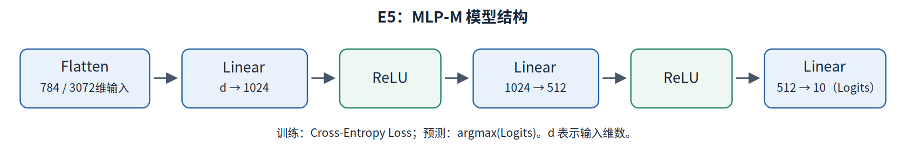

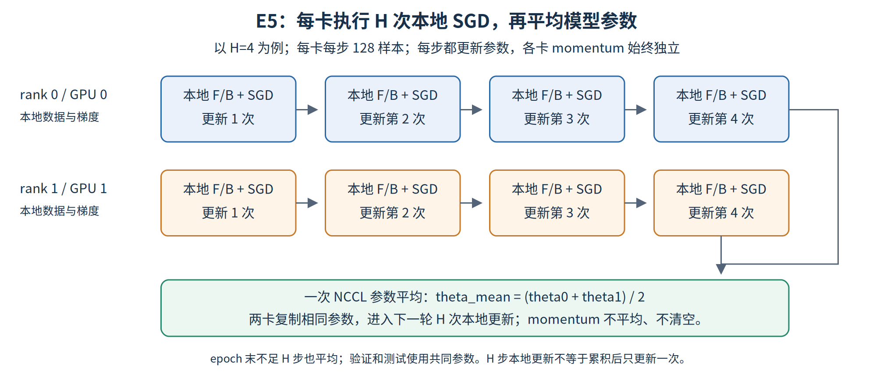

所有H固定采用本地momentum：平均模型参数，不平均或清空momentum。保留各worker本地动量的处理也见于[Local SGD实证研究](https://opt-ml.org/oldopt/papers/2020/paper_91.pdf)，该文其余模型和优化设置与本实验不同。这里固定动量策略，不把不同同步间隔与动量同步方式混在一起比较。

H=1时，每一步更新前的参数相同。理想算术中，本地动量均值满足`mean_v(t)=0.9×mean_v(t−1)+mean_g(t)`，平均后的参数为`theta(t+1)=theta(t)−lr×mean_v(t)`，因此构成同步小批SGD的参照；FP32参数平均与梯度平均不保证逐位相同。H>1时，各卡后续梯度在不同本地参数处计算，优化轨迹也随之改变。

H=1在本组重新实测，不用E0或E4的梯度AllReduce性能替代。参数打包、写回和归约位置不同，通信耗时的直接比较以本组各H之间为准。

## 2. 实验设置与边界

固定两张RTX 4090，GPU计算与NCCL通信；E0的MLP-M隐藏层1024→512、ReLU、10类Logits。MNIST/FashionMNIST为784维输入、参数1,333,770个，模型FP32参数载荷5.335 MB；CIFAR-10为3072维、参数3,676,682个、载荷14.707 MB。

每个Local SGD逻辑副本固定每步128样本，双GPU各执行一份副本，单GPU串行执行两份副本。统一FP32、禁用TF32/AMP和编译，SGD momentum=0.9，学习率MNIST/FashionMNIST为0.1、CIFAR-10为0.05，不随H改变。分层10%验证、划分种子1234，训练种子1234/1235/1236。三数据集×五档H×三种子，双GPU与串行单GPU各45次；普通单模型SGD按每数据集/种子运行一次，共9次，总计99次训练，每次20轮。

MNIST/FashionMNIST每轮54000训练、6000验证、10000测试；CIFAR-10为45000/5000/10000。使用顶层Data的FP32/255展平输入，CIFAR-10按HWC顺序，不增强。每进程4个主机线程、DataLoader worker=0、评估batch1024。每轮完整训练包括尾批，每轮验证一次，不早停或恢复最优模型，20轮后仅用末轮共同参数测试一次并保存。

每epoch末即使不足H步也进行参数平均，验证和测试使用平均后的共同模型。这样不会在各个H之外增加一套不明的评估模型；也意味着完整训练的同步次数需按实际短轮次计算。

| H | MNIST/FashionMNIST每轮本地更新数 | 每轮参数归约数 | CIFAR-10每轮本地更新数 | 每轮参数归约数 |
|---:|---:|---:|---:|---:|
| 1 | 211 | 211 | 176 | 176 |
| 2 | 211 | 106 | 176 | 88 |
| 4 | 211 | 53 | 176 | 44 |
| 8 | 211 | 27 | 176 | 22 |
| 16 | 211 | 14 | 176 | 11 |

每次参数平均打包完整FP32模型，NCCL求和后除以2，再写回各rank参数。本地更新不使用DDP，不在反向时同步梯度。初始化参数广播、每轮损失统计的小张量归约和验证屏障不计入“训练参数归约次数”。逻辑载荷是参数buffer实际字节数累计，不是测得的网络/PCIe硬件流量。

## 3. 性能、漂移与等待如何测量

### 完整同步轮次

一个计时轮次包含H次本地更新和一次参数平均，尾轮可能不足H步。一次更新含取数/传输、前向反向、SGD；同步含参数打包、NCCL平均、设备等待和解包。边界显式等待CUDA完成，阻塞同步，无计算通信重叠：

`T轮次 = T数据 + T计算 + T同步 + T优化器 + T其他`。

两个rank分别记录，选择完整轮次更慢的rank与其整行分段。H步之间没有同步，不能把每个step的rank最大耗时分别拼接当作实际关键路径。图中的“每次本地更新摊销时间”为所选轮次总时间除以轮内本地更新数，不是假设每步都做了全局参数更新。

最初16步为预热，参与训练但排除性能；只有H步都为完整batch、且不含预热的完整轮次进入稳态统计。短轮次和含尾批的轮次仍然训练和平均，只排除固定工作量性能。验证、测试、保存、CSV写入和样本顺序哈希在轮次性能区间外。

与E4一样，完整轮次筛选会改变计时覆盖率：H=1与H=16在MNIST/FashionMNIST分别覆盖训练样本的99.18%与98.23%，CIFAR-10为99.10%与90.57%。因此图中吞吐是完整H步轮次的性能，不代表包括尾轮、验证与日志的端到端速度。训练与Time-to-Target均保留这些被排除计时的样本和轮次。

预热只用于计时筛选，算法从第一步就采用对应H；没有先以H=1训练一段再切换的Post-Local SGD阶段，也没有学习率热身。

### 本地训练步记录

每个rank另存`steps_rank0/1.csv`，每次实际`optimizer.step()`对应一行，保存实际样本数、数据/计算/SGD/同步/其他耗时、完整步毫秒及本地样本/秒。时间戳逐步采集，轮次内不增加逐步跨卡屏障，也不把H步总时间均摊成H个伪观测。

只有同步边界步记一次`parameter_allreduce`及完整参数载荷，其他步的跨卡归约次数为0；epoch末不足H也同步。E5没有在backward时归约梯度，因此不将这些事件标成`gradient_allreduce`。参数平均耗时计入边界步，漂移诊断从逐步与轮次计时中同时扣除，完整训练阶段墙钟仍包含诊断。

完整轮次的逐步耗时、样本及同步计数之和必须还原原始轮次。跨卡全局吞吐按完整H步轮次选取较慢rank，不能分别取每个本地步的最大rank再拼接。

### 同步前模型漂移

每epoch仅在最后一个由完整batch组成的完整H步轮次，平均前测一次漂移。不同H都固定20次诊断，避免H=1因诊断更多而额外变慢。诊断借助参数平均已有的mean buffer，在GPU计算`2×||theta_rank−theta_mean||₂ / ||theta_mean||₂`；双rank时对应两模型的相对L2距离，两个rank的观测取平均，再对20个epoch统计均值与最大值。

诊断点为`floor(每轮完整本地batch数/H)×H`，因此不同H在epoch内的位置最多相差15次本地更新。MNIST/FashionMNIST的H=1和16分别在第210与208步诊断，CIFAR-10分别为175与160步。它比较各自最后完整轮次的同步前状态，并非同一样本边界、同一个参数点的局部梯度误差实验。

H=1在平均前也可能有漂移，因为两卡刚用不同数据独立完成一次SGD；参数平均后重新一致。漂移诊断使用GPU高精度范数归约，持续时间单独记录，并从轮次性能时间中扣除；Time-to-Target墙钟仍包含这项固定频率诊断。未为诊断额外发送一个完整模型。

### 等待与GPU活动

在参数打包和设备等待完成后、发起NCCL前记录同一主机的monotonic时间戳。两rank到达时间的差值为“同步点到达差”，反映早到rank可能等待另一rank的尺度，不是纯网络传输或精确GPU空闲时间。

正式训练全部结束后，另用[PyTorch Profiler](https://docs.pytorch.org/tutorials/recipes/recipes/profiler_recipe.html)采集16步预热后的64步时间线，覆盖三个数据集、五档H、三个种子和两个rank。统计训练区域中CUDA kernel/memcpy/memset活动区间的并集，区域减去该并集得到“无已捕获CUDA活动时间”。先对同一种子的两个GPU求平均，再汇总三个种子。

Profiler初始化完成后、进入测量区域前，执行两rank屏障并等待CUDA完成，避免将采集器启动时间差混入第一次参数平均。该屏障位于测量区间外，不计入64步通信kernel次数。

每个诊断配置按对应种子重新初始化模型，先执行16步，再采集接下来64步；它观察相同初始阶段的运行机制，没有加载第20轮检查点，也不用于比较最终模型精度。

Profiler中的主机事件用于界定采集区域边界；模型forward、backward和参数更新仍全部在CUDA上执行。

Profiler有额外开销，时间线诊断不混入正式吞吐。NCCL的等待/轮询kernel也计作活动，所以空白比例既不是SM利用率，也不是所有低效等待的总和。压缩Chrome trace保留，允许复查空白和NCCL kernel区间，不能把整段NCCL墙钟简单称为GPU空闲。

## 4. 指标及Time-to-Target

记稳态完整轮次数R、轮内本地更新总数U、全局样本N，累计轮次/同步/计算毫秒T/S/C。

| 指标 | 定义与单位 | 研究目的 |
|---|---|---|
| 参数归约次数 | 完整20轮实际计数 | 验证H减少多少模型通信操作 |
| 累计逻辑载荷 | 参数buffer字节×归约次数，每rank字节数 | 带宽需求代理，不是实际链路流量 |
| 训练吞吐 | 1000N/T，样本/秒 | 固定每步batch与工作量的系统效率 |
| 每次本地更新摊销时间 | T/U，ms | 计算、同步及轮次控制总成本 |
| 每次参数平均耗时 | S/R，ms | 一次同步的暴露路径成本 |
| 每更新同步摊销 | S/U，ms/本地更新 | H对通信成本的摊薄 |
| 同步占比 | S/T×100% | 同步在完整轮次中的暴露比例 |
| 每样本同步成本 | 1000S/N，微秒/全局样本 | 通信需求在样本上的摊销 |
| 同步点到达差 | 两rank发起NCCL前时间戳之差，ms | 到达不齐与潜在等待的尺度 |
| 模型漂移 | 平均前参数相对L2距离 | 本地多步更新的偏离程度 |
| 训练/验证/测试 | 逐轮训练loss、验证loss/accuracy；末轮测试 | 收敛与最终模型质量 |
| Time-to-Target | 验证准确率首次达到预设阈值的训练阶段墙钟秒数 | 判断处理更快是否转为达标更快 |
| GPU活动空白比例 | 独立Profiler区域的无设备活动时间/区域时间 | 观察主机发起、调度等造成的时间线空白 |

目标在正式运行前固定为MNIST97%、FashionMNIST85%、CIFAR-1045%，仅使用验证集判断，不从测试结果选择阈值。墙钟从训练循环开始，到首次达标的验证结束为止，包含此前的训练、验证、漂移诊断、原始CSV写入及已经发生的日志和屏障；不含数据预处理、模型初始化与进程组建立，也不含该观察点之后的日志写入和等待。每轮才观察一次，分辨率为一个epoch，不插值推断更早达标时间。

20轮未达到时保留`target_reached=false`和空时间，图中在20轮实际观测时长处用叉表示；不设0、不伪造达标时间，也不静默删除。三种子均达到才给该H的TTT均值/标准差，否则报告达标数与未达状态。

每次运行指标先独立计算，再跨三个种子等权汇总均值、样本标准差和范围。图1—4、图6的灰色为单GPU串行双副本，蓝色为双GPU Local SGD；圆/方/三角为三个种子，同色粗线/菱形为均值，单卡均值用虚线，不画置信区间。两组算法、样本与本地动量策略一致；普通单模型SGD参考在图8—11中单独标识。环境见environment.json，未锁频或控制宿主调度，精确排序需结合波动。

## 5. 运行与核验

项目根目录执行：

```bash
uv run python -m E5.run --list
CUDA_VISIBLE_DEVICES=0,1 NCCL_DEBUG=WARN uv run python -m E5.run
uv run python -m E5.run --resume
uv run python -m E5.run --output-dir E5/results/new_run
uv run python -m E5.evaluate --checkpoint E5/results/mnist/h8/seed1234/checkpoint.pt --split validation --device cuda:0
uv run python -m E5.evaluate --checkpoint E5/results/mnist/h8/seed1234/checkpoint.pt --split test --device cuda:1
uv run pytest E5/tests -q
uv run python -m E5.check_results
uv run python -m E5.profile_activity
uv run python -m E5.plot_results
```

主实现与单GPU实现的19项联合检查通过，覆盖逐本地SGD计时、边界同步、逐步时间还原轮次、独立动量、尾轮与20轮评估隔离，并包含双GPU/NCCL数值对照。模型计算均在CUDA上执行，文件协议检查在主机完成，见[preflight_step_logging.json](preflight_step_logging.json)。双卡结果按`{数据集}/h{H}/seed{种子}/`保存，两个rank同时记录steps和rounds CSV。

45次双卡训练及54次单卡参考均完成。训练日志分别为`paired_training_数据集.log`与`single_gpu/paired_training_数据集.log`，配对执行顺序见`paired_driver_数据集.log`。Profiler在性能采集和模型复测后单独运行。

## 6. 实测结果

45次双卡运行均完成20轮，并保存实际逐本地更新日志。下表为三个种子的均值±样本标准差。吞吐单位为千样本/秒，更新时间为ms/本地更新；漂移列将原始相对L2距离乘以1000显示，例如2.714对应0.002714。完整结果见[final.csv](final.csv)，分组统计见[seed_summary.csv](seed_summary.csv)，同种子相对H=1的比值见[paired_comparison.csv](paired_comparison.csv)。

图1—6直接对照同算法的45次单GPU串行双副本与45次双GPU运行，数据见[main_comparison.csv](main_comparison.csv)。图5按单、双GPU分行，逐轮来源见[convergence_plot.csv](convergence_plot.csv)；配对配置与原始文件哈希见[来源核验](main_comparison_sources.json)。本节随后在图8—11中区分严格同算法基线与普通单模型SGD任务参考。

| 数据集 | H | 训练吞吐 | 更新摊销时间 | 同步占比（%） | 同步前漂移（×10⁻³） | 末轮测试准确率（%） |
|---|---:|---:|---:|---:|---:|---:|
| MNIST | 1 | 71.85±28.93 | 4.15±2.17 | 25.59±4.44 | 2.714±0.049 | 98.31±0.03 |
| MNIST | 2 | 67.37±33.03 | 4.34±1.66 | 14.51±1.49 | 5.215±0.008 | 98.31±0.03 |
| MNIST | 4 | 72.68±36.90 | 4.07±1.62 | 8.12±1.13 | 8.729±0.137 | 98.36±0.06 |
| MNIST | 8 | 78.14±35.81 | 3.68±1.34 | 4.97±1.11 | 15.626±0.187 | 98.37±0.05 |
| MNIST | 16 | 102.03±37.88 | 2.84±1.34 | 3.04±0.62 | 26.980±0.577 | 98.35±0.05 |
| FashionMNIST | 1 | 55.70±27.69 | 5.28±2.06 | 24.55±3.50 | 6.894±0.069 | 88.82±0.40 |
| FashionMNIST | 2 | 65.64±35.23 | 4.57±1.88 | 14.33±1.64 | 10.995±0.131 | 88.58±0.30 |
| FashionMNIST | 4 | 53.58±3.06 | 4.79±0.28 | 7.78±0.11 | 18.050±0.227 | 88.82±0.32 |
| FashionMNIST | 8 | 55.81±1.81 | 4.59±0.15 | 4.26±0.29 | 31.119±0.407 | 88.93±0.13 |
| FashionMNIST | 16 | 59.65±2.79 | 4.30±0.20 | 2.49±0.28 | 50.149±0.456 | 88.92±0.13 |
| CIFAR-10 | 1 | 30.32±0.68 | 8.45±0.19 | 28.14±2.54 | 8.186±0.086 | 51.22±1.09 |
| CIFAR-10 | 2 | 37.08±1.68 | 6.91±0.31 | 17.55±1.04 | 12.706±0.178 | 51.61±0.94 |
| CIFAR-10 | 4 | 39.94±1.58 | 6.42±0.25 | 11.11±1.58 | 21.782±0.454 | 51.68±0.16 |
| CIFAR-10 | 8 | 47.01±6.76 | 5.52±0.73 | 5.48±0.24 | 36.878±0.079 | 51.05±0.37 |
| CIFAR-10 | 16 | 48.82±5.14 | 5.28±0.55 | 3.24±0.09 | 59.892±0.334 | 50.87±0.44 |

H从1增到16，三个数据集的同步次数减少约93%，每次本地更新的配对同步成本比例分别降至0.082±0.006、0.090±0.019、0.072±0.003。与此同时，平均同步前漂移约增至9.9、7.3、7.3倍。通信摊销与模型偏离需要同时观察。

H=16相对H=1的配对吞吐比分别为1.438±0.071、1.224±0.464、1.611±0.179。MNIST与CIFAR-10的三个种子均更快；FashionMNIST仍有变慢的配对种子，不能用比值均值掩盖分布。不同H不保证单调提高吞吐，当前范围也不足以确定通用最优H。

### 图1：参数归约次数与逻辑通信需求

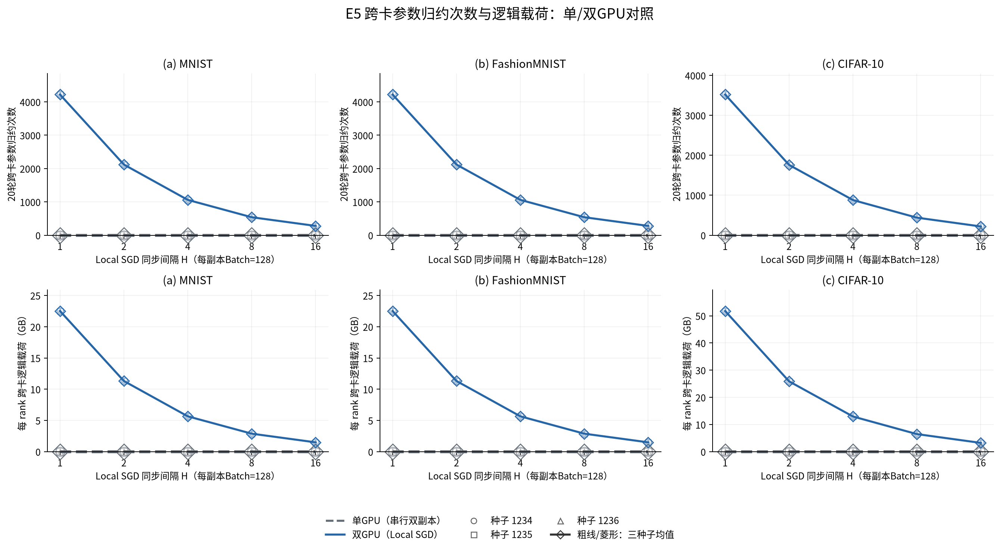

三列(a)、(b)、(c)对应MNIST、FashionMNIST、CIFAR-10。横轴为H，按2的幂显示；上排为20轮跨卡参数归约次数，下排为每rank跨卡累计逻辑载荷（GB），包含预热与尾轮。单GPU串行双副本的设备内平均不使用NCCL，灰线两项均为0；蓝线为双GPU实测值。相同协议的三个种子计数重合，不表示缺少重复运行。

MNIST/FashionMNIST五档H分别为4220、2120、1060、540、280次，CIFAR-10为3520、1760、880、440、220次。H=16相对H=1减少约93.4%和93.8%的调用及逻辑载荷。本地SGD更新总数却始终保持4220次和3520次；归约次数虽然可以与E4窗口末同步一致，参数更新预算与算法含义并不相同。

### 图2：吞吐与本地更新摊销成本

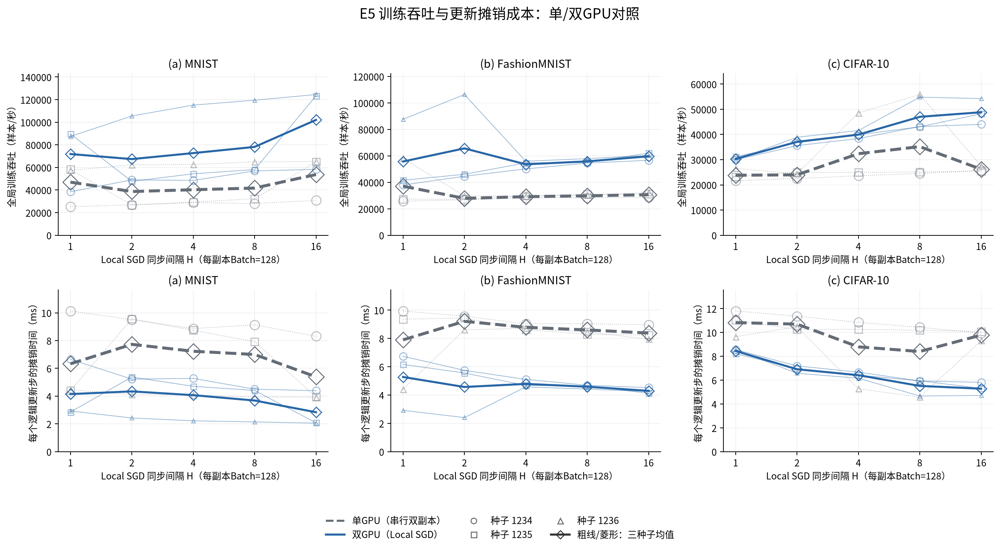

三列为三个数据集，横轴及图例同图1。上排为全局训练样本/秒；下排为完整同步轮次时间除以其中的逻辑更新步数，每步全局处理256样本。单GPU每个逻辑步在同一设备依次执行两个副本的SGD，双GPU则各执行一个副本，二者都包含H步后的参数平均成本。只统计预热后完整H步轮次；尾批和不足H的轮次参与训练，不计稳态性能。

H=1→16时，MNIST平均更新摊销由4.15降至2.84 ms，FashionMNIST由5.28降至4.30 ms，CIFAR-10由8.45降至5.28 ms。更新次数和每步样本数没有减少，主要变化是同步频率；实测幅度还受到数据准备、主机控制与到达差影响。当前没有控制宿主调度或锁定频率，较大的跨种子波动完整保留。

### 图3：一次同步的成本和到达差

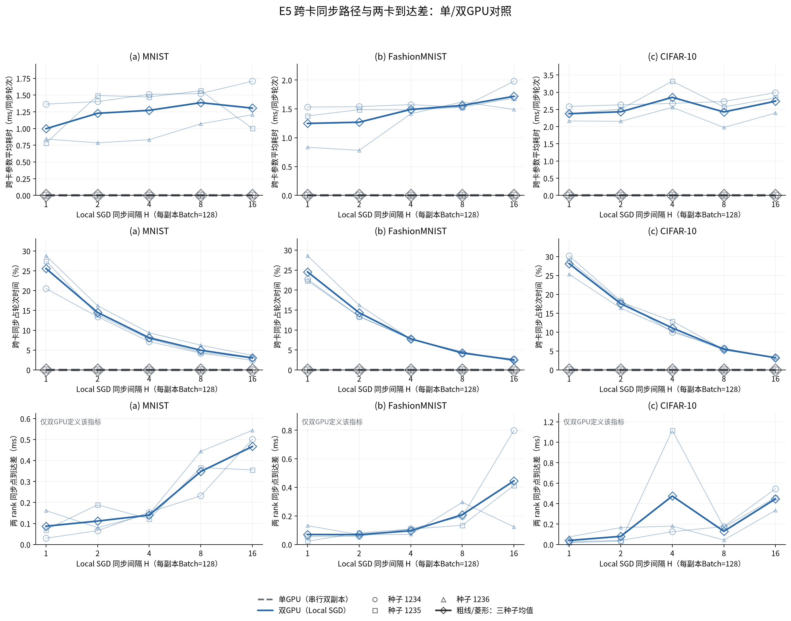

三列为三个数据集，横轴及图例同图1。上排为每次跨卡参数平均路径耗时（ms），中排为跨卡同步占完整H步轮次时间的比例（%）；单GPU这两项为0，其设备内平均已计入图2的完整耗时，不能视为免费。下排为两个独立rank在发起NCCL前的到达时间差（ms），仅双GPU定义，单GPU不绘制零值替代，并在图中注明。到达差是主机时间戳度量，不等于纯GPU空闲。

H=16的平均同步占比分别为3.04%、2.49%、3.24%，低于H=1的25.59%、24.55%、28.14%。单次参数平均却由约1.00→1.31、1.25→1.72、2.38→2.74 ms略有增加。收益主要来自将一次同步成本分担到更多本地更新，不能解释成单次传输速度提高。

同步点到达差反映两卡计算、数据准备与调度不齐，可能贡献等待成本，但不等于纯GPU空闲或纯链路传输。图中保留每个种子的实际差异，不由1/H公式替代实测同步时间。

### 图4：平均前模型漂移、末轮质量与显存

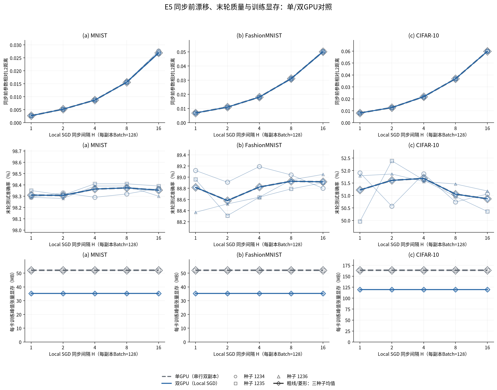

三列为三个数据集，横轴及图例同图1，共三排：上排为20个epoch固定诊断点的平均同步前相对L2距离，中排为第20轮平均模型的完整测试集准确率（%），下排为每卡训练峰值张量显存（十进制MB）。单GPU漂移在两个逻辑副本之间测量，双GPU在两个rank之间测量，诊断点均位于独立SGD之后、参数平均之前。曲线重合时，较大的灰色空心菱形保留在蓝色标记外侧，表示两组观测相同。单GPU同一设备保存两份模型和动量，双GPU显存取两rank较大值，不能按副本数相同推断每卡显存相同。

H=16的平均同步前相对L2距离约为0.0270、0.0501、0.0599，均高于H=1。对应末轮测试准确率为98.35±0.05%、88.92±0.13%、50.87±0.44%；H=1为98.31±0.03%、88.82±0.40%、51.22±1.09%。这些三种子观测没有显示漂移增加必然造成大幅精度下降，但也不构成不同H精度等价的证明；CIFAR-10的H=16均值比H=1低0.35个百分点。

### 图5：训练损失与验证集收敛

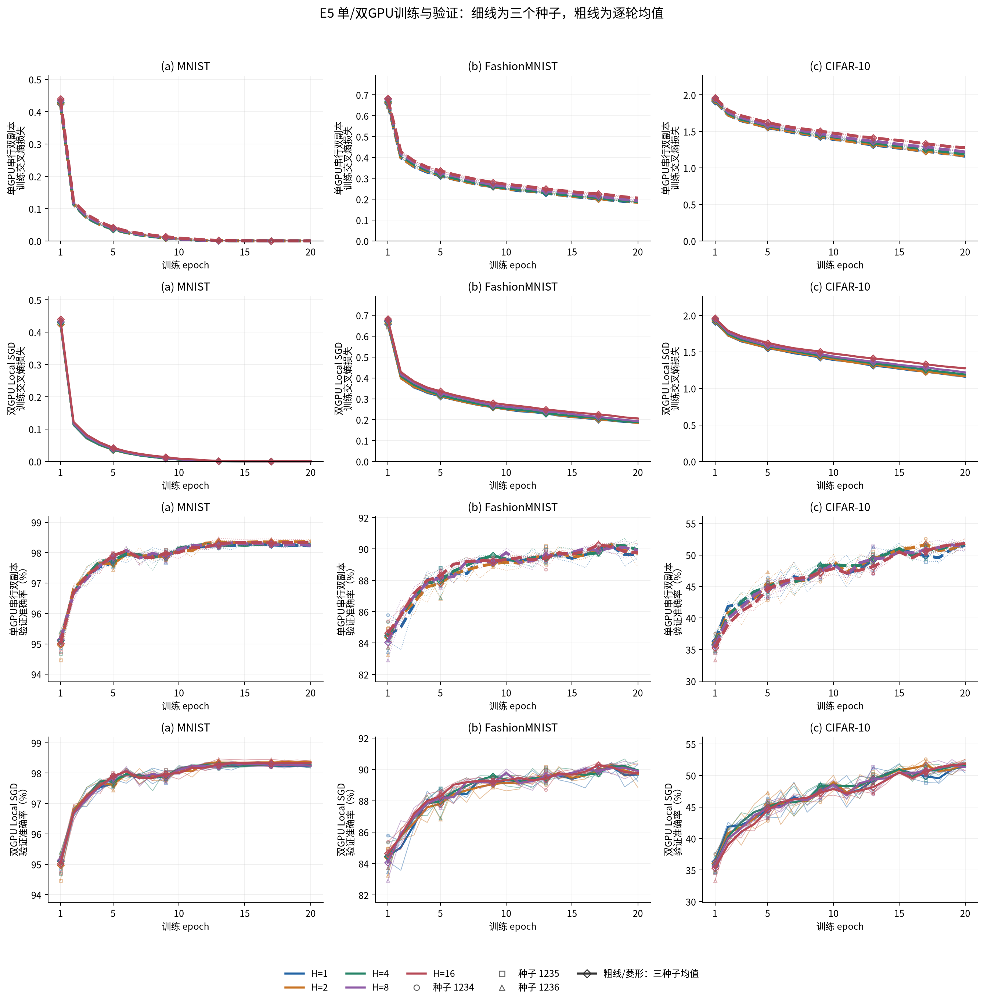

三列为三个数据集，横轴为epoch，共四排：单GPU训练损失、双GPU训练损失、单GPU验证准确率、双GPU验证准确率。前两排为两个副本在各自本地参数处计算、按样本数加权的在线交叉熵，不是事后用共同模型重评训练集；后两排为完整验证集准确率（%）。五种颜色对应H=1、2、4、8、16，细线和圆/方/三角保留三个种子，粗线为逐epoch均值。单、双卡分行便于观察同算法收敛是否一致；不对不同运行的墙钟坐标求逐点均值，也不逐轮使用测试集。

各H均完成20轮，无提前停止。首次达到目标的轮次仍有差别，例如CIFAR-10的H=1三个种子分别在第5、6、7轮达到45%，H=16为第6、5、5轮；训练吞吐较高的实现未必对每个种子都更早跨过验证阈值。图6进一步把这种优化过程差异与实际运行时间结合。


### 图6：达到验证目标的实际耗时

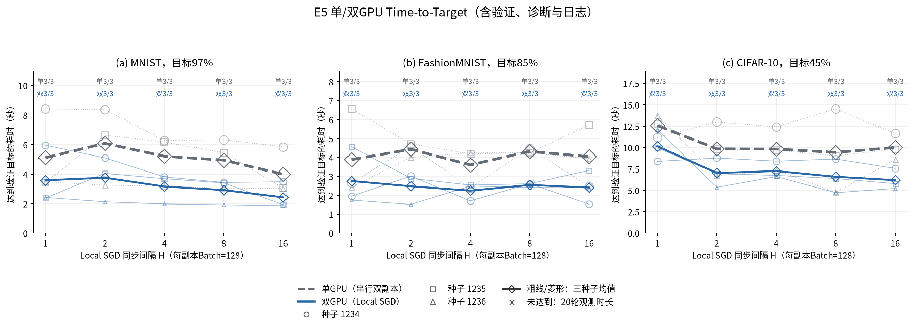

三列为三个数据集，标题注明各自目标。横轴为H，纵轴为首次达到验证目标的墙钟秒数。灰色为单GPU串行双副本、蓝色为双GPU，圆/方/三角为三个种子；每组均值仅在该H的3/3均达到时显示。未达用叉标在20轮实际观测时长，表示删失观测，不代替达标时间。每个H上方分别标“单”和“双”的达标数/3。

图中45次双GPU与45次同算法单GPU均达到预设验证目标，没有未达叉号。下表列双GPU结果，轮次按seed1234、1235、1236排列，时间为三个种子的均值±样本标准差，单位秒；分辨率为每epoch结束后的观测时刻。单、双卡的达标时间及普通SGD参考见本节图11。

| 数据集 | H | 达标种子数 | 首次达标epoch（三种子） | Time-to-Target（秒） |
|---|---:|---:|---|---:|
| MNIST | 1 | 3/3 | 4、3、3 | 3.59±2.06 |
| MNIST | 2 | 3/3 | 4、3、3 | 3.76±1.51 |
| MNIST | 4 | 3/3 | 3、3、3 | 3.16±1.02 |
| MNIST | 8 | 3/3 | 3、3、3 | 2.92±0.87 |
| MNIST | 16 | 3/3 | 3、3、3 | 2.42±0.92 |
| FashionMNIST | 1 | 3/3 | 1、3、2 | 2.76±1.58 |
| FashionMNIST | 2 | 3/3 | 2、2、2 | 2.48±0.83 |
| FashionMNIST | 4 | 3/3 | 1、2、2 | 2.25±0.47 |
| FashionMNIST | 8 | 3/3 | 2、2、2 | 2.55±0.11 |
| FashionMNIST | 16 | 3/3 | 1、3、2 | 2.41±0.90 |
| CIFAR-10 | 1 | 3/3 | 5、6、7 | 10.15±1.87 |
| CIFAR-10 | 2 | 3/3 | 6、5、4 | 7.03±1.71 |
| CIFAR-10 | 4 | 3/3 | 6、5、5 | 7.26±1.00 |
| CIFAR-10 | 8 | 3/3 | 7、5、5 | 6.59±1.98 |
| CIFAR-10 | 16 | 3/3 | 6、5、5 | 6.19±1.22 |

以同种子`H=1达标时间/H=16达标时间`计算，三数据集的配对达标加速比分别为1.415±0.259、1.129±0.349、1.715±0.604。均值比较、配对比较与种子分布提供不同信息，应与图中的三个原始点一起读取。目标阈值固定且较早达到，这些结果不等同于达到更高精度所需的时间，也不能代替整个20轮训练阶段的耗时。

### 图7：独立GPU活动时间线诊断

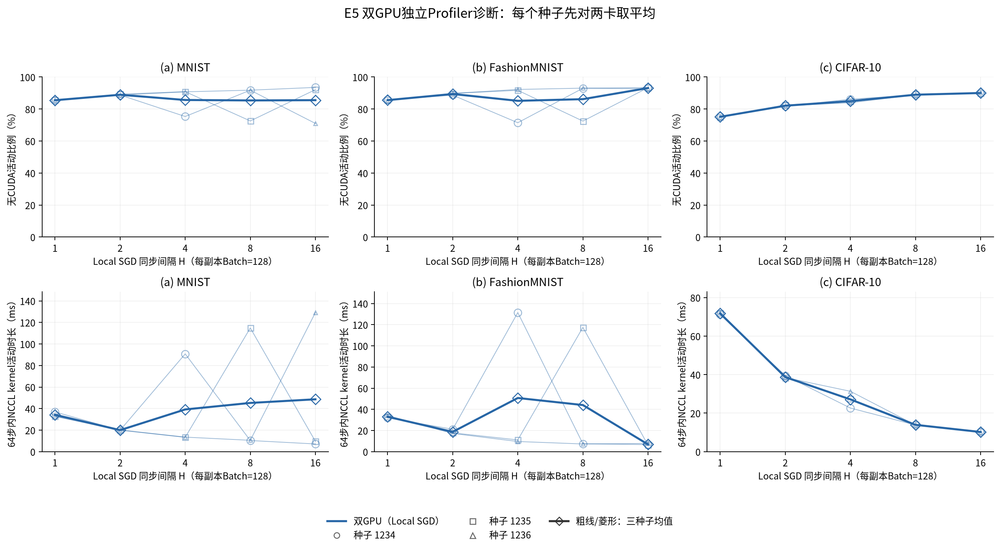

三列为三个数据集，横轴为H；蓝色细线及圆/方/三角表示三个种子，蓝色粗线/菱形表示均值。本图只使用双GPU独立Profiler记录，未采集单GPU时间线，因此不添加推算的单卡曲线。上排为64步区域内无已捕获CUDA kernel/memcpy/memset的时间比例（%），下排为NCCL kernel活动区间并集总毫秒；每个种子先对两卡取平均。Profiler有额外开销，不能代替图2吞吐；NCCL等待kernel计作活动，低空白比例不表示计算更有效率。

45个配置共保存90份双rank时间线，均捕获CUDA与NCCL活动。64步内的NCCL kernel次数严格对应64、32、16、8、4次。以下为H=1与16的三种子均值±样本标准差；它们属于有插桩开销的短段诊断，不能替代正式20轮的同步均值。

| 数据集 | H | 无CUDA活动比例（%） | 64步NCCL kernel活动总时长（ms） |
|---|---:|---:|---:|
| MNIST | 1 | 85.50±0.10 | 34.23±2.31 |
| MNIST | 16 | 85.53±12.62 | 48.63±69.75 |
| FashionMNIST | 1 | 85.55±0.25 | 33.00±1.06 |
| FashionMNIST | 16 | 93.12±0.40 | 6.87±0.84 |
| CIFAR-10 | 1 | 75.13±0.22 | 71.76±0.56 |
| CIFAR-10 | 16 | 90.01±0.09 | 10.21±0.24 |

MNIST的H=16虽然只有4次训练参数归约，NCCL kernel总时长仍出现48.63±69.75 ms的大幅离散，高于H=1的均值。记录没有被删除或截短。等待/轮询也计为CUDA活动，短段的插桩开销、到达不齐与执行环境波动不能据此分离；该现象不能解释成纯传输带宽变差。

因此图7不支持GPU空白比例或NCCL kernel总时间随H稳定单调下降的结论。判断通信优化仍以图1的实际调用和载荷、图2至图3的正式20轮计时为主，图7用于区分“无CUDA活动”与“GPU正在等待通信”的不同情形。逐rank指标见[profile_activity.csv](profile_activity.csv)，双GPU先平均的种子记录见[profile_seed_summary.csv](profile_seed_summary.csv)，原始压缩时间线位于profiles/。

### 单、双GPU性能与并行收益

#### 两种单卡参考

严格同算法参考在一张GPU、一个训练进程中串行运行两个完整逻辑模型，各自每步128样本和一份独立momentum，每H步在设备内平均参数。两副本与双卡使用相同分片、样本顺序、本地SGD次数和epoch末平均规则；没有跨卡NCCL，设备内平均单独计时。三数据集、五档H、三种子，共45次真实单卡训练，每次20轮。

另运行普通单模型SGD，单卡batch256，每数据集/种子只运行一次，共9次。它提供常规单卡任务参考：H=1时理想算术等价于同步SGD，FP32批形状和求和路径仍可不同；H>1时Local SGD已改变优化算法，不能把相对普通SGD的吞吐比叫作严格同算法并行加速比。

普通SGD没有H超参数。比较时把同一条真实SGD时间线按各H的相同样本边界重新组织，使用相同预热和完整轮次筛选，并计入窗口内部相邻更新之间实测的`post_unit_ms`。因此其统计吞吐可能随选中窗口略变，参数、末轮准确率、完整训练墙钟与达标时间仍来自同样9次训练；不虚构45次SGD运行。

双卡45次与单卡54次共99次训练，按数据集、种子和H交错安排，计时任务逐次串行执行。单卡4个主机线程，双卡两个进程各4个线程；硬件频率和宿主调度未锁定，配对减少时间间隔，不能消除全部执行环境波动。

#### 严格配对指标

相同种子、相同H的计时样本集合一致。记双卡与串行单卡吞吐为Q2、Q1，测量时间为T2、T1，则`S=Q2/Q1=T1/T2`。计算段加速比为`C1/C2`，C1累计两个逻辑模型的串行前向反向时间，C2使用整轮次较慢rank的计算段；其中包含主机发起与CUDA等待，不是纯kernel或FLOPs比值。并行效率为`S/2×100%`，时间节省为`1−1/S`，GPU分配时间成本比为`2/S`。

普通SGD的任务吞吐比另记为`Q2/Q普通SGD`，H>1时不据此计算严格并行效率。所有比值均先按种子配对，再对三个种子等权取均值和样本标准差。Time-to-Target只使用原先固定的验证阈值，未达标保留删失；严格配对只有两侧三个种子全部达标时才给出三种子平均达标加速比。

45次串行双副本与9次普通SGD均已完成并通过末轮模型CUDA独立复测，见[单卡核验](single_gpu/validation.json)。下表为严格同算法配对的三种子均值±样本标准差，吞吐单位为千样本/秒。

| 数据集 | H | 单GPU吞吐 | 双GPU吞吐 | 吞吐加速比 | 计算段加速比 | 并行效率（%） |
|---|---:|---:|---:|---:|---:|---:|
| MNIST | 1 | 46.98±18.80 | 71.85±28.93 | 1.528±0.011 | 1.934±0.002 | 76.4±0.6 |
| MNIST | 2 | 38.66±20.48 | 67.37±33.03 | 1.764±0.065 | 2.001±0.080 | 88.2±3.2 |
| MNIST | 4 | 40.26±19.36 | 72.68±36.90 | 1.792±0.097 | 1.953±0.073 | 89.6±4.8 |
| MNIST | 8 | 41.75±20.16 | 78.14±35.81 | 1.889±0.123 | 2.017±0.124 | 94.5±6.2 |
| MNIST | 16 | 53.69±19.83 | 102.03±37.88 | 1.899±0.006 | 1.946±0.008 | 94.9±0.3 |
| FashionMNIST | 1 | 37.07±18.22 | 55.70±27.69 | 1.500±0.022 | 1.894±0.037 | 75.0±1.1 |
| FashionMNIST | 2 | 27.86±1.62 | 65.64±35.23 | 2.314±1.094 | 2.797±1.436 | 115.7±54.7 |
| FashionMNIST | 4 | 29.14±0.72 | 53.58±3.06 | 1.838±0.067 | 2.031±0.072 | 91.9±3.4 |
| FashionMNIST | 8 | 29.81±1.32 | 55.81±1.81 | 1.874±0.079 | 2.009±0.138 | 93.7±4.0 |
| FashionMNIST | 16 | 30.62±1.87 | 59.65±2.79 | 1.950±0.068 | 1.986±0.084 | 97.5±3.4 |
| CIFAR-10 | 1 | 23.81±2.48 | 30.32±0.68 | 1.283±0.136 | 1.924±0.164 | 64.1±6.8 |
| CIFAR-10 | 2 | 23.98±1.29 | 37.08±1.68 | 1.548±0.067 | 1.977±0.045 | 77.4±3.3 |
| CIFAR-10 | 4 | 32.37±14.03 | 39.94±1.58 | 1.360±0.437 | 1.626±0.512 | 68.0±21.9 |
| CIFAR-10 | 8 | 35.17±17.91 | 47.01±6.76 | 1.485±0.436 | 1.681±0.525 | 74.2±21.8 |
| CIFAR-10 | 16 | 26.21±1.13 | 48.82±5.14 | 1.860±0.135 | 2.029±0.165 | 93.0±6.7 |

H=16时三数据集的严格吞吐比约为1.90、1.95、1.86，计算段加速比接近2，同步摊销降低后并行效率高于H=1。中间档位并不保证单调：FashionMNIST的H=2、seed1236吞吐比为3.577，拉高均值及标准差；原因没有被独立定位，不能用115.7%的效率均值证明稳定超线性扩展。图9完整保留该点。CIFAR-10的H=4、8也存在较大离散，不按均值挑选最佳结果。

普通单模型SGD的任务参考另列如下，仍先同种子配对。H>1的比值同时包含算法变化，只能回答该任务在当前预算下的处理速度，不能替代上表的严格加速比。

| 数据集 | H | 普通SGD吞吐（千样本/秒） | 双卡/普通SGD任务吞吐比 |
|---|---:|---:|---:|
| MNIST | 1 | 56.31±27.58 | 1.392±0.733 |
| MNIST | 16 | 55.38±27.37 | 2.011±0.978 |
| FashionMNIST | 1 | 43.56±1.93 | 1.299±0.706 |
| FashionMNIST | 16 | 42.68±1.89 | 1.400±0.111 |
| CIFAR-10 | 1 | 34.90±3.01 | 0.873±0.070 |
| CIFAR-10 | 16 | 34.27±2.95 | 1.425±0.089 |

CIFAR-10的H=1相对普通单卡SGD平均更慢，而相对串行双副本仍更快；两种参考回答的问题不同。H=16时任务吞吐比提高，但MNIST仍有很大运行离散。模型质量和达标时间须一起读取，不能仅据这些吞吐比断言训练任务全面加速。

### 图8：两种单卡参考与双卡吞吐

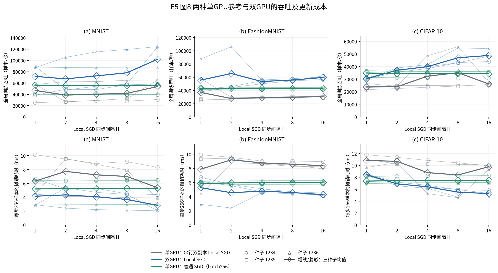

三列为MNIST、FashionMNIST、CIFAR-10，横轴为Local SGD的同步间隔H。灰色为单GPU串行双副本，蓝色为双GPU Local SGD，绿色为普通单模型SGD参考。上排为全局样本/秒；下排为完整测量窗口耗时除以本地步数，即每步256个全局样本的摊销毫秒，串行单卡包含两次本地SGD。圆、方、三角分别为1234、1235、1236，粗线/菱形为三种子均值，无置信区间。

### 图9：严格加速比与任务吞吐比

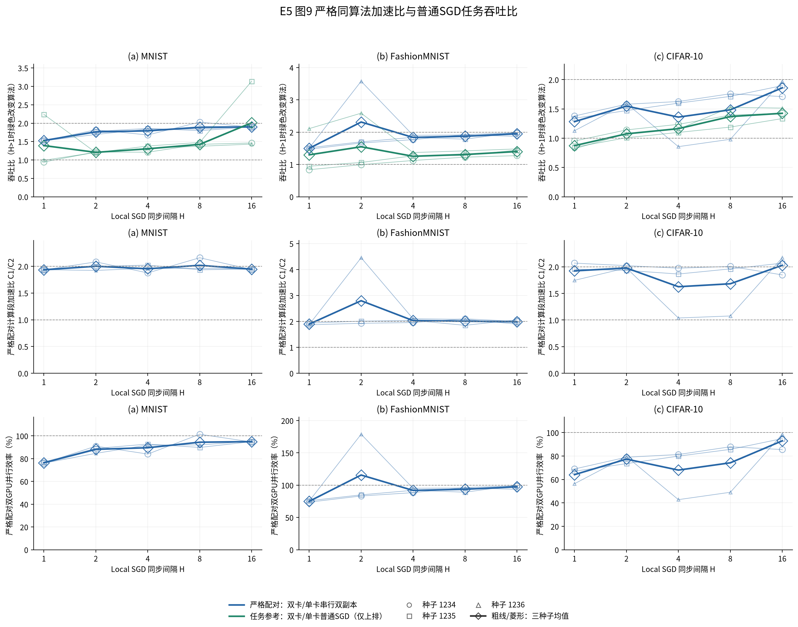

横轴、三列和种子标记沿用图8。上排蓝线是双卡/串行双副本吞吐比，绿线是双卡/普通SGD任务吞吐比，H>1时后者包含算法变化；中排只显示严格配对的计算段加速比，下排只显示严格配对的双GPU并行效率（%）。加速比1、2和效率100%的虚线分别为无收益与线性参照，不是硬件利用率。

### 图10：模型质量和每卡显存

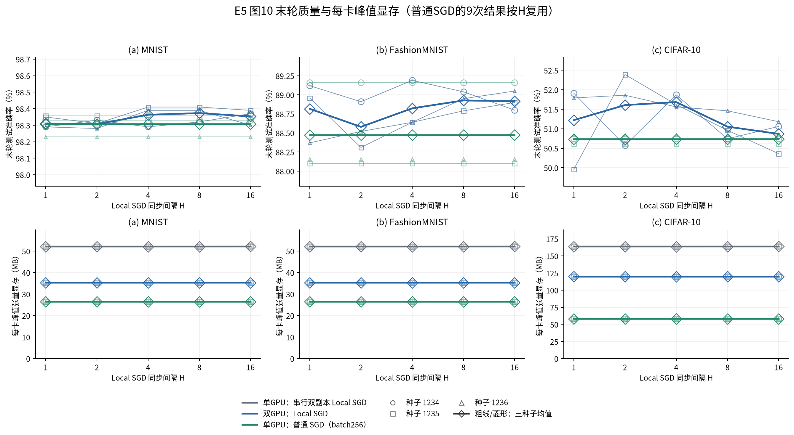

横轴、颜色和种子标记同图8。上排为第20轮模型完整测试集准确率（%），下排为每卡峰值张量显存（十进制MB），双卡取较大rank。串行双副本在同一设备保存两份模型及动量；Local SGD峰值包含固定漂移诊断缓冲，普通SGD不进行该诊断。验证和测试显存不计入训练峰值。普通SGD沿H显示相同9次结果，平坦线不是置信区间。

### 图11：完整训练时间与达标时间

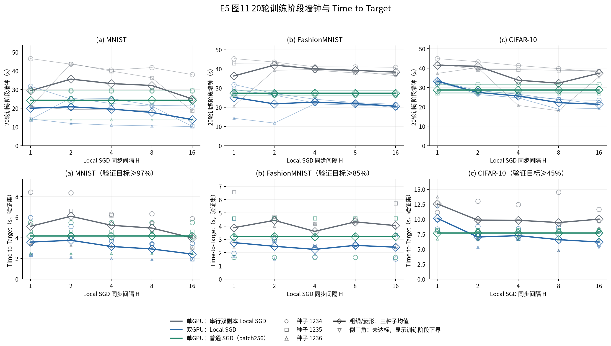

横轴、颜色和种子标记同图8。上排墙钟从训练循环开始，截止第20轮验证结束，包含此前的训练、验证、日志与诊断，不含初始化、最后观察点之后的写入等待和最终测试；下排为首次验证达到MNIST97%、FashionMNIST85%、CIFAR-1045%的实际秒数，分辨率为一个epoch。倒三角用于未达标运行，画在其训练阶段结束时间，表示达标时间下界；只有该H三个种子均达标时才画达标时间均值。普通SGD的总墙钟和达标时间按H重复展示同一份参考。

## 7. 结果核验与适用范围

99次单、双GPU训练的配置、数据划分、20轮样本预算与末轮模型均已核验。双卡同步轮次、本地SGD次数、尾轮、参数归约、逻辑载荷、分段时间、漂移诊断与首次验证达标时间均可从原始记录复算。全部检查点在CUDA上独立测试，完整10000样本测试集准确率与训练记录一致，损失在核验容差内一致，见[双卡核验](validation.json)与[单卡核验](single_gpu/validation.json)。

45组串行双副本与双卡末轮模型在CUDA上逐位一致，见[GPU控制比较](gpu_control_comparisons.json)。它支持所测同算法配置的终态一致性，不外推为不同精度或设备上的逐位保证。图1—7的曲线与图片哈希见[图表核验](figure_validation.json)，图8—11见[配对图核验](scaling_figure_validation.json)，报告数值见[表格核验](scaling_report_validation.json)。

H增大能摊薄同步成本，也增大同步前模型漂移，两者均不能单独决定Time-to-Target。相对串行双副本的严格并行收益与相对普通SGD的任务收益分别解释。结果受小型MLP、每副本128、20轮、固定学习率、本地动量、双4090互联及运行波动约束，不将某个H的均值最优推广为通用最优间隔。

## 8. 逐步记录与复现

严格配对明细、汇总、工作量复算与普通SGD参考分别保存为`scaling.csv`、`scaling_summary.csv`、`scaling_validation.json`和`ordinary_sgd_reference.csv`。串行单卡`local_steps.csv`记录两副本每次真实SGD，`rounds.csv`记录整轮次；普通SGD保存`steps.csv`。实际单卡配置和来源位于`single_gpu/`，运行方式见[单GPU说明](../single_gpu/README.md)。

全部99次运行的显式逐步导出包含753,480条rank/逻辑副本观测与175,440个全局计时单元，后者包括同步轮次和普通SGD更新，不能混称为同一种参数更新数。每行保存实际样本、毫秒、样本/秒、同步类型/次数/载荷及原始来源。见[逐步索引与复算](step_metrics/audit.json)、[压缩CSV往返核验](step_metrics/roundtrip_validation.json)。单卡585个原始文件的哈希见[单卡文件校验表](single_gpu/original_gpu_files_sha256.json)，90份独立时间线的复算见[Profiler核验](profile_validation.json)。

在项目根目录执行；重跑独立目录时，可为配对启动器分别指定`--dual-output-dir`与`--single-output-dir`，核验和比较同时指定相应`--dual-results-dir`。

```bash
uv run python -m E5.single_gpu.paired_run --list
uv run python -m E5.single_gpu.paired_run --dataset mnist --resume
uv run python -m E5.single_gpu.paired_run --dataset fashionmnist --resume
uv run python -m E5.single_gpu.paired_run --dataset cifar10 --resume
uv run pytest E5/tests E5/single_gpu/tests -q
uv run python -m E5.single_gpu.check_results
uv run python -m E5.single_gpu.compare
uv run python -m E5.single_gpu.plot_results
uv run python -m E5.evaluate --checkpoint E5/results/single_gpu/mnist/serial_h4/seed1234/checkpoint.pt --split validation --device cuda:0
uv run python -m E5.evaluate --checkpoint E5/results/single_gpu/mnist/serial_h4/seed1234/checkpoint.pt --split test --device cuda:0
```
